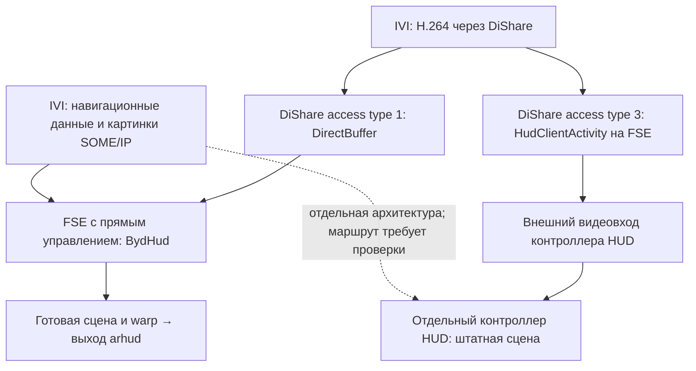
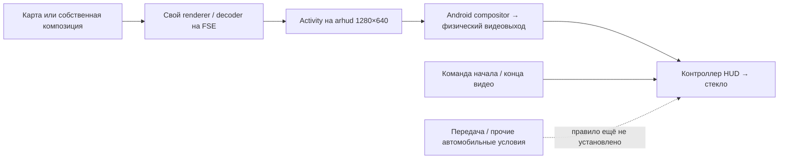
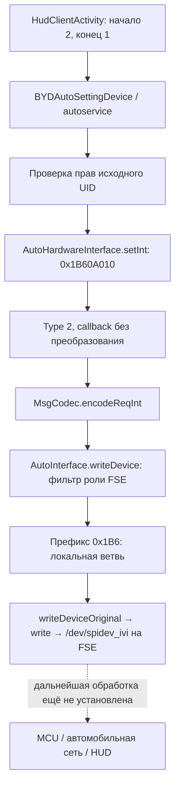
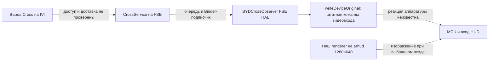

# HUD и BydHud: инженерный разбор

Проекционный HUD машины владельца как дисплей: какие картинки и видео на него
можно вывести обычным приложением, кто рисует штатную сцену и что выключает
показ. Разбор офлайн по IVI и FSE OTA (Java, ресурсы, AArch64-дизассемблер,
эмуляция отдельных функций); на машине — чтения, пробники и парковочные
прогоны, автомобильные свойства нашими пробниками не записывались.

## Текущее состояние

Полосы штатной навигации исследуются отдельно от карты и ADAS:
[Проверка штатных полос](#hud-native-lanes),
[исходная графика и способ сборки штатным навигатором](#hud-stock-artwork).

Обновлено 2026-10-16. Прежние натурные результаты относятся к Z9GT; отдельная проверка N9 ниже явно помечена. Документ отвечает, как вывести текст, картинку или видео на HUD, какие дополнительные области стоит проверить и почему полноэкранный показ пропадает вне P.

| Утверждение | Статус | С | Раздел |
|---|---|---|---|
| На Z9GT 24.09 `sys.hud.direct.config = 0`; `PackageManager` отвечает `NameNotFoundException` для `com.byd.hud` (BydHud not registered), хотя `/system/app/BydHud/BydHud.apk` лежит в образе и по SHA-256 совпадает с OTA; причина — `BydPackageUtil.nonDirectDrive` в `PackageManagerService.scanDirLI` (firmware): при `direct.config == 0` пакет пропускается, это аппаратная конфигурация, не P/D | live | 2026-09-24 | [14.8 FSE не запускает BydHud](#fse-inspector-live), [14.2](#hud-bydhud-not-direct) |
| Устройство BydHud (сцены, профили, crop, P-gate, warp) описывает direct-drive вариант OTA, не HUD исследованной Z9GT; на N9 совпавший APK зарегистрирован, см. опыт 16.10. RTSP `DiSRPlayer` — заглушки, virtual HUD не реализован, `0x8004` не обрабатывается; других готовых независимых окон в проверенных путях не найдено | firmware | 2026-10-15 | [2–13](#bydhud-direct-drive), [14.1](#hud-options-table), [Дополнительное содержимое](#hud-extra-content) |
| «Штатную картинку HUD рисует BydHud на FSE `arhud`» (журнал, 2026-09-24) — неверно для Z9GT: BydHud не зарегистрирован; где синтезируется её штатная сцена (согласованная модель — отдельный HUD-контроллер), не разобрано | refuted | 2026-09-24 | [FSE: первое чтение](#hist-fse-first-read) |
| FSE: `arhud` 1280×640, ~60 Гц, flags 139 (trusted, не PRIVATE), в снимке id 2 — искать по имени. IVI: access type `0x34C00010 = 3`, `0x38B0003A = 1`, `0x38B00036 = 2` в P; по совпавшему по хешу DiShare это тракт `HudClientActivity` → `arhud` → отдельный HUD. Размер видеовыхода не равен размеру окна карты | live | 2026-09-24 | [14.8 FSE не запускает BydHud](#fse-inspector-live) |
| `0x8003` (`HudNavigationmap`, Base64 PNG) показывает карту справа от скорости; скорость и поле 8 остаются. Нужен road-пакет `0x8001` с полем 16 = 2 (`road=1`); без него окно пустое. Яндекс 300×180 с app-owned display проверен в P 2026-09-23; показ на ходу — сообщение владельца 2026-10-09, без журнала прогона | live | 2026-10-09 | [Moving-frames test](#hud-moving-frames), [Яндекс в окне карты](#hud-yandex-map-window) |
| 300×180 помещается целиком, 600×360 обрезается; уменьшать на IVI. Приняты до 15 fps (300×180) и 10 fps (600×360); 15 на стекле на глаз плавнее 5, цель продукта ≥10. Точная область/fps не измерены. Объём карты задаёт вырезка в dp: 576×346 dp при 160 dpi уменьшалась ×0,52; при 320 dpi это 1152×692 px ×0,26 | live | 2026-10-09 | [Second run](#hud-map-rate-size), [third run](#hud-map-grid), [Окно карты как функция продукта](#hud-map-product) |
| Захват главного экрана без диалога. `MediaProjection`: `MediaProjectionPermissionActivity` SystemUI сразу, без UI, возвращает `RESULT_OK`, если `hasProjectionPermission` — op 46 `PROJECT_MEDIA` = allow (`MediaProjectionManagerService.java:229-237`); берёт `getCallingPackage()`, значит запускается `startActivityForResult` из нашей Activity; `allowEmbedded` нет — на нашем VD не живёт; `MANAGE_MEDIA_PROJECTION` signature-only, у shell его нет — другого пути к токену нет. `MediaProjection.start` требует работающий foreground service типа `mediaProjection` (32) нашего uid (`:411`), `handleForegroundServicesChanged` останавливает проекцию, как только тип 32 у uid пропал. Проекция одна на систему: `startProjectionLocked` останавливает прежнюю — чужая останавливает нашу и наоборот, выбор live-video маршрута MediaRouter тоже. `AccessibilityService.takeScreenshot`: capability 128, запрос через ≤333 мс после прошлого — ошибка 3, не больше ~3 fps | firmware | 2026-10-09 | [Окно карты как функция продукта](#hud-map-product) |
| «HUD не заявляет функцию карты (`0x38B00030 = 65535`), значит окно карты не появится» — окно появилось 2026-09-23 17:39; `65535` значит лишь, что в штатных настройках нет переключателя карты | refuted | 2026-09-23 | [Moving-frames test](#hud-moving-frames) |
| «Большой кадр карты режется от левого верхнего угла» — сетка этого не установила; в BydHud (здесь неактивен) crop центрирующий, снизу при превышении обеих осей; алгоритм отдельного контроллера не установлен | refuted | 2026-09-24 | [Third run](#hud-map-grid) |
| Дополнительные области: PNG field 8 обновляется на глаз до 10 fps и работает на ходу; PNG field 7 (123×60, lanes 3, RoadClass 7) показал три полосы в P 2026-10-11 без field 29, движение не проверено. Строки 10/26/27 показаны в прогоне 2026-07-19; title/artist как музыкальный режим ещё не испытывались | live | 2026-10-11 | [Moving-frames test](#hud-moving-frames), [Полосы](#hud-native-lanes), [Текстовые области](#hud-extra-content) |
| Сборка называется YandexHUD; номер 1 записан в `versionName=29.8.1-YandexHUD.1`, `versionCode=739494301`, имени APK, отчёте и стартовом логе. Установлена обновлением на машине, версия/хеш проверены. Единый номер — `tools/yandex_hud_build/identity.py`; поведение AR/карты прежнее, различия только в manifest и диагностическом логе | code | 2026-10-15 | [Идентификация YandexHUD](#hud-yandex-build-identity) |
| Яндекс HUD ARM64 debug передаёт штатному AR настоящую геометрию MapKit: `HudArSource` / `HudAr`, поля 19–22 и 30–33 в существующем road-пакете, без ADB и второго GPS. Эмулятор подтвердил передний план, фон, совпадение с маршрутом, очистку и переподключение. APK установлен обновлением на машине 15.10, хеш проверен; показ AR на стекле ещё не проверен | code | 2026-10-15 | [AR из маршрута Яндекса](#hud-yandex-native-ar) |
| ARM64-вариант Яндекс HUD уменьшен с 369 062 907 до 219 758 519 байт (−40,45%): удалены только 64 библиотеки ARM32/x86/x86_64, все остальные несигнатурные ZIP-файлы совпадают с универсальным кандидатом; debug-режим, подпись и аккаунт Denza сохранены. ARM64-эмулятор подтвердил обновление с сохранением данных и ведение/HUD в фоне | code | 2026-10-15 | [ARM64-сборка](#hud-arm64-build) |
| Debug-модуль переведён на оригинальные голубые PNG BydLaunchermap: полосы в 5/7 отдельного штатного слота, манёвры в 8; синяя плашка с карты удалена. Строка 41×N на 60, манёвр 80×80; worker кеширует строку до изменения. Хостовые и Android pixel/cache проверки прошли; на машине новая сборка не проверялась | code | 2026-10-15 | [Реализация штатных стрелок](#hud-native-arrows-build) |
| В P штатный HUD Z9GT показывает отдельные три стрелки полос из PNG 123×60 в поле 7 при числе полос 5 = 3 и RoadClass 6 = 7; поле 29 не требуется. Одни поля 5/29 без картинки дают только контрольный манёвр. Владелец подтвердил все три режима на стекле. Перенос реальных полос из встроенного модуля, движение и N9 ещё не проверены; исходная графика штатного отправителя разобрана отдельно 15.10 | live | 2026-10-11 | [Проверка штатных полос](#hud-native-lanes), [Перенос из встроенного рендера](#hud-embedded-native-lanes), [Графика отправителя](#hud-stock-artwork) |
| В установленном Яндексе 29.8.1 есть структурированные полосы и картинка в Car App, защищённом allowlist сертификатов хоста. Обычный `LaneBalloonViewImpl` строит offscreen-текстуру карты: его resource ID `lanes_container` не доказывает доступность через accessibility. Выделение полос из кадра — кандидат, не проверенный источник | code / open | 2026-10-11 | [Источник Яндекса](#hud-yandex-lane-source) |
| Яндекс 29.8.1: независимый рендер 300×180 встроен в debug APK с отдельной тестовой подписью; автоматический старт по маршруту, штатное фоновое ведение, Binder/SOME-IP по контракту Denza Apps. Эмулятор: 9,76 fps на переднем плане / 9,90 в фоне, восстановление после смерти приёмника, очистка ×3 и остановка; без Frida в рабочем тракте. Конфликт общего signature-разрешения воспроизведён и исправлен; установка на машине подтверждена отдельно ниже, работа рендера на стекле ожидает проверки владельца | code | 2026-10-14 | [Независимый рендер](#hud-yandex-independent-renderer), [Встроенный модуль и транспорт](#hud-yandex-embedded) |
| Debug Яндекс HUD установлен на Android 13 машины со штатного USB-раздела файлового менеджера. Причина «package appears to be invalid» — повреждённая копия APK на флешке: неверная подпись и сжатый `classes11.dex`. Проверенная копия и установленный `base.apk` совпадают с исходной сборкой по SHA-256 | live | 2026-10-14 | [Встроенный модуль и транспорт](#hud-yandex-embedded) |
| Конфликт AccountManager исправлен отдельным типом `com.yandex.passport.denza`: эмулятор подтвердил добавление/удаление аккаунта под UID Навигатора, машина после обновления с USB зарегистрировала его authenticator и sync adapter. Владельцы типов Клавиатуры/Кинопоиска сохранены; полный серверный вход ожидает проверки владельца | live | 2026-10-14 | [Встроенный модуль и транспорт](#hud-yandex-embedded) |
| Оформление HUD-карты Яндекса v3 для стекла: насыщенные цвета пробок (сильный затор — пурпурный вместо бордового), векторный красно-оранжевый курсор, свои стрелки полос в свободном верхнем углу (заменены штатным отдельным слотом 15.10), белые стрелки манёвров MapKit, значки событий на маршруте (камера с ограничением, ДПС, ДТП, опасность, ремонт, перекрытие, лежачий, переезд), чёрная земля вместо скрытой. Эмулятор: камеры, лежачие, ДТП и ремонт из `DrivingRoute` реального маршрута; приёмка 9,65/9,93 fps. Стекло (владелец): маршрут и курсор читаются сразу; дороги v3 были бледными, после подъёма до 80 %/54 % и ×1,35 всё выглядит отлично | live | 2026-10-14 | [Оформление для стекла](#hud-yandex-glass-design) |
| После недели на стекле (владелец, 18.10): дороги чуть ярче нужного; автобусная полоса — пустая клетка; без спутников окно гаснет и мерцает с мелкой жёлтой надписью; значки событий на дороге некрасивы и дрожат при повороте карты; цифры ограничения не прочитать; цвета значков не совпадают с семьями знаков ПДД. Причины найдены в коде: позиция без новой отметки 3 с → режим «нет позиции» убирает карту, подсказку и полосы и пишет «Нет позиции»/«Маршрут…» (наш текст); значки кладутся поверх кадра по `worldToScreen` с округлением до пикселя при сыром курсе; особые полосы пропускаются, а сдвиг, «неизвестно», слившиеся направления и сочетания вне набора BYD прячут весь ряд. v4 по ответам владельца (18.10): раскладка v3, значки Навигатора крупнее и сбоку от маршрута (placemark MapKit), камера рядом со знаком ограничения, удержание позиции 30 с без текста, клетка из пикселей BYD для каждой полосы, сильная пробка тёмно-красная, дороги на 10 % тише. Реализовано в модуле, проверено на эмуляторе. После поездки (18.10 вечер) — v4.1: одно место — один знак (события ближе 50 м, место ≤ 120 м), не больше двух, камера с ограничением — один знак 3.24 (пара «камера + знак» и грозди раздражали), все значки ~34 px, цифры шрифтом Навигатора (YandexSansText-Bold) по центру их контура; на эмуляторе центровка всех ограничений 5–130 в пределах 0,5 px; у носа курсора значок уходит, а не ложится на маршрут; на стекле v4.1 не проверено. Колонка знаков сбоку отклонена владельцем | code | 2026-10-19 | [Замечания после поездок](#hud-yandex-drive-notes) |
| Модуль сам заполняет блок манёвра HUD: метры, улица, остаток пути и времени, код манёвра (поле 28 по штатному навигатору) и ограничение в поле 11 из `getSpeedLimit()` (м/с). Без этих полей HUD показывал в блоке манёвра свои китайские подписи (владелец на машине). Белая стрелка 192×192 из первой версии заменена штатным PNG 80×80 15.10. Знак самой машины (ADAS) из модуля недоступен: нужны права `BYDAUTO_*`. Эмулятор: приёмка 9,78/9,94 fps, 26 пакетов подсказки за 8 с, ошибок 0; на стекле не проверено | code | 2026-10-14 | [Подсказки из модуля](#hud-yandex-module-hints) |
| N9: владелец уточнил, что названия улиц отсутствуют и с Denza Apps. Предпосылка эксперимента сокращения строк не подтверждена; код `9c7a4a5d` откачен (`b21e293f`) и остаётся в истории main, доказательства эмулятора сохранены. Разбор штатного поля продолжен 16.10 независимо от сокращений | parked | 2026-10-16 | [Отложенное сокращение улиц N9](#hud-yandex-n9-parked), [Натурная проверка](#hud-n9-native-street) |
| N9: независимый пробник показал метры и картинки, но штатное поле 10 пусто для `TEST`, `МОСКВА`, `北京路`. Снимок FSE подтвердил `sys.hud.direct.config=1` и зарегистрированный BydHud 2.0.21 с точным хешем корпуса; его `CreateUISurfaces` не создаёт название улицы, все четыре layout задают ему нулевые размеры и шрифт. Команда включения штатного поля не найдена; изменения renderer не испытывались | live + firmware | 2026-10-16 | [Штатное поле улицы N9](#hud-n9-native-street) |
| Продукт шлёт road-пакет `0x8001` и, при «Карте на проекции», `0x8003` на той же сессии `HudSomeIpClient`: пока подсказки держат маршрут и Яндекс виден на главном экране, кадры — зеркало display 0 через `MediaProjection` в половину размера (1280×800, `VIRTUAL_DISPLAY_FLAG_AUTO_MIRROR`, «Denza HUD Map», `HudMapProjectionSource`), не чаще 12 в секунду; вырезка 490×294 dp вокруг стрелки (с 2026-10-11) рисуется GPU в 300×180, фон в чёрный; ночная карта перекрашивается для проектора попиксельно (`HudMapPalette`, мягкий вариант с 2026-10-14, сборка 78; объекты не распознаются и не вырезаются), дневная остаётся как после ключа; PNG (`HudMapPipeline`); последний кадр повторяется раз в секунду, пока новых нет; при остановке, потере маршрута, уходе или перекрытии Яндекса — чёрный кадр ×3 через 120 мс (`HudMapRunner`); без живой проекции окно пустое, состояние `NO_GRANT` | code | 2026-10-14 | [Окно карты как функция продукта](#hud-map-product) |
| Источник кадров выбирается сам (`HudMapAutoSource`): пока Яндекс спроецирован на приборку, кадр читается `PixelCopy` с поверхности дисплея `Denza Navigation` (`HudMapClusterSource`, `HudMapSurfaceReader`) — вырезка в тех же 490 dp, окно во весь дисплей, без токена `MediaProjection`; иначе — зеркало главного экрана; кадры, не получающиеся секунду подряд, гасят окно (`FAILING`); на машине не проверено, сборка 77 | code | 2026-10-13 | [Приборка: оценка](#hud-map-cluster-plan) |
| Токен захвата (`HudMapGrant`) берётся из `MainActivity` при включении карты/подсказок и в `onResume`, а с 466d03d1 — автоматически через отдельную прозрачную `HudMapCaptureRequestActivity`, когда держится маршрут, Яндекс на главном экране и токена нет (`HudMapProjectionSource` → `requestInBackground`); фоновая попытка не чаще раза в минуту. Только при op 46 = allow, иначе сначала локальный ADB; токен живёт в `HudMapProjectionService` (FGS типа 32), выключение карты или подсказок останавливает его и службу | code | 2026-10-11 | [Окно карты как функция продукта](#hud-map-product) |
| Сборка 67, SHA-256 `9e322134358c7c4521df2e40d601544e8540e11b98b199f62a6228a1a50fc3ce`: после принудительной смерти процесса (`am crash`, стоянка в P) Android поднял accessibility-службу, прозрачная Activity получила токен из фона; `grant LIVE` через 2,47 с, `state SENDING` через 3,16 с от смерти процесса. `MainActivity` не запускалась, Activity запроса закрылась, зеркало 1280×800 восстановилось; полный сон/пробуждение машины и картинка на стекле в этом прогоне не проверялись | live | 2026-10-11 | [Восстановление захвата без открытия приложения](#hud-map-background-recovery) |
| DiShare `screen_hud`: окно любого приложения (H.264, 30 fps) занимает всю проекцию и заменяет штатную картинку вместе со скоростью; плавно, в P | live | 2026-09-23 | [Moving-frames test](#hud-moving-frames) |
| P→D на месте (0 км/ч): `0x38B00036` 2→1, DiShare удаляет receiver с `605`; примерно через 4 с в P доступность снова 2, но сеанс сам не возобновился | live | 2026-09-24 | [14.9 DiShare закрывается в D](#hud-pd-live) |
| Цепочка 605: FSE `DeviceConfigHelper` считает available из `0x38B0003A`/`0x38B00036` (приоритет у `0x4C50000F`/`0x4C500014`) → `DiShareSession` удаляет receiver → `HudClientActivity.finish` → `0x1B60A010 = 1`; проверки gear/speed в DiShare нет | firmware | 2026-09-24 | [14.3 Доступность трансляции](#hud-availability-chain) |
| «Камера поворотника на HUD через DiShare — это сеанс на всю поездку, правило движения неизвестно» — DiShare не переживает даже D на месте, так что камера или Яндекс на всю проекцию через DiShare на ходу не работают | refuted | 2026-09-24 | [Камера поворотника](#hist-turn-signal-camera) |
| Своя Activity ordinary-UID APK на FSE `arhud` (Inspector 0.2.1): окно 1280×640, 397 draws и frame callbacks за 20 с без IVI и DiShare — на стекле ничего не изменилось | live | 2026-09-24 | [14.11 Пробник прямой Activity](#fse-local-probe) |
| Команда видеовхода `0x1B60A010` (2 — начало, 1 — конец) уходит в локальный `/dev/spidev_ivi` FSE; `arhudshift` только переназначает availability между конфигурациями, без проверки передачи; GET/SET device 1023 требуют signature permissions | firmware | 2026-09-24 | [14.12 Команда включения](#hud-hal-input-route), [14.10.2](#hud-video-switch-permissions) |
| Кандидат без FSE shell: Cross `0x2130001C` → FSE `BYDCrossObserver` → `writeDeviceOriginal` с исходной командой (эмуляция функций); доставка, права UID и реакция HUD не проверены; Inspector 0.2.2 («Доступ FSE → JSON») для этой проверки установлен на FSE (live: installer `result=-7` на `res_id=924151925`), отчёта ещё нет | firmware | 2026-09-24 | [14.13 Вход через Cross](#hud-cross-input-candidate), [14.13.6](#hud-inspector-022-install) |
| Штатная диагностика FSE: 10 нажатий за 4 с по подписи яркости → DevelopmentTools → после авторизации `Wireless adb debug switch` (`service.adb.tcp.port=5555`); на машине не проверялось | firmware | 2026-09-24 | [14.12.3 Штатная диагностика](#hud-fse-diagnostics) |
| Широкие PNG в `byd-hud` commit `ce99ebac`: field 8 = 720×48, field 7 = 960×48; compositor добавляет текст и значки рядом с основной картинкой. На Z9GT ширина, crop и свободные края не проверены | code | 2026-10-15 | [Широкие PNG](#hud-extra-content) |
| Штатная музыка: HUD-ресурс IVI Info Fusion, FID `0x38B00026`/`0x4C10E038` и метаданные `0x43FB1008` существуют. Последний — известный канал приборки; его получатель/показ на HUD владельца не установлен. Наличие строки или setter не доказывает действующую функцию | firmware | 2026-10-15 | [Музыкальное поле](#hud-extra-content) |

**Открытые вопросы**
- Где рождается `0x38B00036 = 1` в D: входящее сообщение FSE HAL, MCU или контроллер HUD? Решит запись входящего пакета до cache FSE HAL из диагностического контекста FSE — [14.12.2](#hud-hal-input-route).
- Покажет ли стекло наш рисунок на `arhud` после штатной команды `0x1B60A010 = 2` в P без DiShare? Решит один ограниченный сеанс с гарантированным `= 1` через FSE autoservice или Cross — [14.12.4](#hud-hal-input-route), [14.13.4](#hud-cross-input-candidate).
- Доставляет ли Cross с IVI команду в FSE HAL от UID нашего APK? Решат первый отчёт Inspector 0.2.2 (одно нажатие «Доступ FSE → JSON») и сверка хешей установленных IVI Cross-библиотек — [14.13.6](#hud-inspector-022-install).
- Геометрия карты и полей 7/8: показывает ли Z9GT широкие PNG 720×48 и 960×48, как `byd-hud`, или режет их? Решит парковочный прогон с контрольным малым кадром и метками краёв; точные размер/fps карты остаются отдельным измерением — [широкие PNG](#hud-extra-content), [second run](#hud-map-rate-size).
- Читается ли кадр Яндекса на приборке через `PixelCopy.request(Surface, srcRect, Bitmap)` с той `Surface`, которую получает `Denza Navigation`, без GL-тройника? И выбирает ли Яндекс масштаб по размеру своего окна, а не только по скорости? Решат одна проба на машине и снимки одного маршрута на главном экране, в панели ⅓ и на приборке — [Окно карты как функция продукта](#hud-map-product).
- Восстанавливается ли карта после полного сна/пробуждения машины без открытия Denza Apps? Смерть процесса на стоянке уже проверена; полный цикл требует выключенного запрета Denza Apps на странице «Disable background Apps» и маршрута в видимом Яндексе после пробуждения — [Восстановление захвата без открытия приложения](#hud-map-background-recovery).
- Появляется ли в строке состояния значок трансляции и как наша проекция взаимодействует со штатной (DiShare, «Трансляция», MediaRouter)? Нужны визуальная проверка и `dumpsys media_projection` до и после штатной трансляции — [Окно карты как функция продукта](#hud-map-product).
- Кто синтезирует штатную сцену и есть ли в ней отдельный музыкальный получатель? Нужны идентичность/образ HUD-контроллера; сначала чтение `0x38B00026` и наблюдение за штатной сменой трека — [музыкальное поле](#hud-extra-content), [14.3](#hud-availability-chain).

Граница доказательства: снимок 14.8 не содержит видеосеанса; опыт 14.9 —
работающий сеанс и переключение передачи на месте, но не движение. Поведение
своего renderer на `arhud` в D не проверялось. Где это существенно, ниже
указано «код OTA» или «наблюдалось на машине».

## Содержание

- [Текущее состояние](#текущее-состояние) — таблица утверждений и открытые вопросы.
- [Рабочий рецепт на машине владельца](#рабочий-рецепт-на-машине-владельца) — окно карты, поле 8 и DiShare: что работает и где граница; окно карты как функция продукта (разбор 2026-10-09); [независимый рендер Яндекса](#hud-yandex-independent-renderer) (эмулятор, 2026-10-14).
- [Название и номера сборок YandexHUD](#hud-yandex-build-identity) — идентификация APK и обновление на машине.
- [Дополнительный текст, музыка и широкие PNG](#hud-extra-content) — подтверждённые поля, след штатной музыки и кандидат из открытого `byd-hud` (2026-10-15).
- [1. Главные ответы](#engineering-answers) — короткие ответы на основные вопросы о HUD.
- [2–13. Устройство BydHud (direct-drive): перенесено](#bydhud-direct-drive) — сводка неактивного здесь рендерера и ссылка на research.
- [14. Яндекс на всём HUD в движении](#engineering-yandex-motion) — офлайн-разбор, Inspector, P→D, путь без Simulcast, HAL, Cross.
- [15. Журнал прежнего исследования](#historical-record) — IVI-чтения и парковочные прогоны 2026-09-23, первое чтение FSE OTA.

## Рабочий рецепт на машине владельца

Что сейчас работает с обычного APK на IVI, без системных прав. Всё проверено
только на стоянке в P; доказательства — по ссылкам, сами опыты остаются в 14–15.

**Своя картинка в окне карты (`0x8003`).**

1. Подключиться к `com.ts.car.someip.service` (`SomeIpServerService`) и
   предложить сервис 266, как это делают `HudSomeIpClient` продукта и
   `hud-frames-probe`. IVI не проверяет ни отправителя, ни topic, ни размер
   ([штатная карта](#hist-stock-map-picture)).
2. Рядом с каждым кадром карты слать road-пакет `0x8001`
   (topic `1127042368241665`) в состоянии «навигация идёт», поле 16 = 2
   (`HudSomeIpSender.roadPayload` пробника, `road=1` в
   `tools/hud_frames_probe.sh yandex`). Без него кадры принимаются, а окно
   пустое ([прогон 18:44](#hud-yandex-map-window)). Во время маршрута Яндекса
   такой пакет уже шлёт продукт.
3. Кадр — `HudNavigationmap{1: Base64 PNG}` в событии `0x8003`
   (topic `1127042368241667`), 300×180: помещается целиком, края мягкие.
   Больший кадр обрезается, а не уменьшается (600×360 — кроп), поэтому
   вырезать и масштабировать нужно на IVI до кодирования
   ([второй](#hud-map-rate-size) и [третий](#hud-map-grid) прогоны).
   Профильные размеры BydHud SZ 300×180, HT/SN 270×180, EZ 200×160 к этой
   машине не относятся; слот её контроллера не измерен.
4. Частота: штатный навигатор шлёт 5 fps; IVI принимал 300×180 до 15 fps,
   600×360 до 10 fps. Частоту на стекле никто не измерял.
5. Источник Яндекса в опыте — app-owned virtual display «Denza Navigation»
   (960×576, 160 dpi), на который скрипт переносит задачу навигатора;
   вырезка вокруг стрелки машины, PNG 5 fps. Владелец видел карту на стекле
   2026-09-23 в 18:50 ([Яндекс в окне карты](#hud-yandex-map-window)).
   Перенос задачи — не форма продукта: продукт копирует Яндекс с того экрана,
   где он открыт ([Окно карты как функция продукта](#hud-map-product)).
6. В конце — пустой кадр карты (чёрный на HUD не виден), пакет «не навигация»
   (поле 16 = 1), если road-пакет слали сами, и снять offer. Штатный навигатор
   пишет в те же события; побеждает последняя запись.

Окно карты стоит справа от скорости, в правой трети проекции; скорость и
поле 8 остаются ([moving-frames](#hud-moving-frames)). В Denza Apps окно карты
кормит переключатель «Карта на проекции» панели «HUD Подсказки»
(`HudMapRunner`, `HudSomeIpClient.publishMap`), пока только с главного экрана.

**Картинка манёвра (поле 8 `0x8001`).** Слот следует за новой картинкой каждый
кадр, на глаз до 10 fps, и уже работает на ходу ([moving-frames](#hud-moving-frames)).

**Видео на всю проекцию (DiShare `screen_hud`).**
`start(screen_ivi, [screen_hud], <app>, com.byd.dishare)` от обычного APK
кодирует окно приложения в H.264 (30 fps) и показывает его на всей проекции
вместо штатной картинки, скорость тоже пропадает. Работает в P: переход в D
даже на месте снимает `0x38B00036` 2→1, DiShare закрывает receiver с `605`,
после P сеанс сам не возвращается; N, R и движение не проверялись
([14.9](#hud-pd-live)). После stop своё
Activity остаётся на главном экране в `byd-freeform`, его надо закрыть самому
([moving-frames](#hud-moving-frames)). P-gate нативной LVDS-сцены BydHud — правило
direct-drive варианта, не этой машины.

**Не работает или не применимо здесь:** правка BydHud и его профилей (пакет не
зарегистрирован, [14.8](#fse-inspector-live)); большой PNG вместо полного
экрана, RTSP, virtual HUD, `0x8004` ([14.1](#hud-options-table)); своя Activity
на `arhud` рисует, но стекло без выбора видеовхода не меняется
([14.11](#fse-local-probe)).

<a id="hud-map-product"></a>

### Окно карты как функция продукта (разбор 2026-10-09)

Разбор без машины: как дать окну карты кадр Яндекса и не уносить Яндекс с того
экрана, где его держит водитель. Форму ниже владелец принял 2026-10-09; для
главного экрана она построена ([Как построено](#hud-map-built)), приборка —
следующий шаг.

**Объём карты задаёт вырезка в dp, а не разрешение источника.** Яндекс рисует
карту в dp: дороги, стрелка, подписи и тайлы масштабируются вместе с плотностью
дисплея. Поэтому вырезка одного участка в dp с любого дисплея после уменьшения
до 300×180 даёт одну и ту же картинку, а плотность меняет только резкость до
уменьшения. Прогон 23.09 вырезал 576×346 dp из окна 960×576 dp (160 dpi) и
уменьшил ×0,52. Главный экран 2560×1600 при 320 dpi — это 1280×800 dp, больше,
чем у пробника. Та же вырезка там — 1152×692 px ×0,26. «Мало карты» выходит
только при вырезке 300×180 px 1:1 с экрана высокой плотности: это 150×90 dp.
Сравнение на кадре 23.09 лежит в git-ignored
`captures/hud-live-20260923/hud-map-crop-compare.png`. Значит, ни отдельный
дисплей низкой плотности, ни смена плотности Яндекса не нужны. На главном
экране плотность к тому же одна на весь дисплей: `wm density` меняет все
приложения сразу.

Вырезка должна помещаться в окно Яндекса, не задевая его кнопок и панелей: на
800×480 dp в кадр уже входят кнопки масштаба. Стрелка и линия маршрута после
уменьшения должны оставаться различимы. Окна Яндекса в dp: весь главный экран —
1280×800, панель ⅓ сплита — около 425 в ширину, приборка — Full 1506×424,
Center 512×360, Left 602×358, Right 602×308 (размещения из
[instrument-display-findings.md](instrument-display-findings.md#navigation-projection)).
Одна вырезка в dp для всех источников даёт одинаковую карту на стекле, а
масштаб, который водитель выставил щипком в Яндексе, стекло повторит само.
Выбирает ли Яндекс масштаб по размеру окна, не проверено.

**Откуда брать кадр.** Задача Яндекса живёт на одном дисплее, но её кадр можно
копировать.

| Где Яндекс | Как взять кадр | Цена |
| --- | --- | --- |
| На приборке (`Denza Navigation`) | Этот VD наш и рисует в `Surface` кластерного `SurfaceView` (`NavigationProxyClient.createVirtualDisplay`). Кандидат — `PixelCopy.request(Surface, srcRect, Bitmap)` (API 26) 5 раз в секунду: вырезка и уменьшение одним вызовом. Если последний буфер так не читается, остаётся GL-тройник из [Using it](#hud-map-copy-design) | Новых прав нет; пока Яндекс на приборке, он рисует всегда |
| На главном экране и виден (весь экран или панель сплита) | Построено: `MediaProjection`, зеркало display 0 в половину размера в `ImageReader`, границы окна Яндекса из специальных возможностей. Диалога нет, если op 46 = allow; его ставит локальный ADB, как и специальные возможности. Нужны foreground service типа `mediaProjection` и `Activity`, которая вызывает `startActivityForResult`, потому что SystemUI берёт `getCallingPackage` | Захватывается только видимое: если окно Яндекса закрыто, кадра нет. Токен живёт до смерти процесса; с 466d03d1 при видимом маршруте автоматически берётся через прозрачную Activity из фона, без открытия `MainActivity`; другая трансляция останавливает нашу |
| Свёрнут или закрыт другим приложением | Кадра нет | Окно карты пустое, подсказки идут как обычно |
| Унесён на свой скрытый VD (опыт 23.09) | Работает | Не форма продукта: окно 300×180 не заменяет карту на экране, а у Яндекса появляется третье место, которого водитель не видит |

**Кадр для стекла.** HUD добавляет свет, поэтому чёрное на нём прозрачно.
Тёмно-синий фон ночной темы Яндекса станет тусклым прямоугольником, светлая
дневная тема — светлым. Фон надо уводить в чёрный (на кадре сравнения — по
расстоянию до цвета фона), дневную тему переводить. Порог подбирается на
записанных кадрах обеих тем с маршрутом. Стрелку искать в кадре: жёлтый курсор
ставится примерно на ¾ высоты вырезки, остальное — дорога впереди. Штатный
навигатор шлёт 5 fps и повторяет последний кадр раз в секунду; продукт целит в
10–12 fps (на стекле 15 заметно плавнее 5) и тоже повторяет последний кадр раз в
секунду; в конце — пустой кадр.

**Форма (принята владельцем 2026-10-09).** Карта — второй переключатель в панели
«HUD Подсказки», под «Подсказками на проекции». Окно карты показывается только
рядом с road-пакетом «навигация идёт», а его шлют подсказки. Источник продукт
выбирает сам по тому, где сейчас Яндекс (таблица выше); выбора источника,
разрешения и режима «только проекция» нет. На «Экран водителя» карта не
переносится: тот решает, что занимает приборку, а окно карты работает при любом
выборе там.

<a id="hud-map-cluster-plan"></a>

**Приборка: оценка (2026-10-13, по коду, без машины).** Сейчас, пока Яндекс на
приборке, окно карты пустое: единственный источник — зеркало display 0, и он
отвечает `NOT_ON_SCREEN`. Подсказки при этом идут: читатель Яндекса берёт окна
всех дисплеев (`getWindowsOnAllDisplays`).

Что есть для захвата:
- `Denza Navigation` создаётся в процессе приложения
  (`NavigationProxyClient.createVirtualDisplay`) и рисует в `Surface`
  кластерного `SurfaceView` (`ClusterPresentation.showMap`).
- Яндекс на этом дисплее один (`OWN_CONTENT_ONLY`) и занимает его целиком.
  Окно Яндекса — весь дисплей, читать окна через специальные возможности не нужно.
- Плотность задаём мы: 85 % от 320 dpi приборки, у `CENTER` 100 %
  (`ClusterMapLayout.densityScalePercent`).
- Затемнения сцены (`mapShade`) — отдельные view поверх `SurfaceView`. В буфер
  дисплея они не попадают: захват их не увидит.
- Токен `MediaProjection` и его служба здесь не нужны.

Размещения в dp Яндекса и вырезка 490×294 dp в них:

| Размещение | Пиксели @ dpi | dp | Доля окна под вырезкой |
| --- | --- | --- | --- |
| FULL | 2560×720 @ 272 | 1506×424 | 33 % × 69 % |
| LEFT | 1023×609 @ 272 | 602×358 | 81 % × 82 % |
| RIGHT | 1023×524 @ 272 | 602×308 | 81 % × 95 % |
| CENTER | 1023×720 @ 320 | 512×360 | 96 % × 82 % |

Вырезка помещается во все четыре. Значит, масштаб на стекле тот же, что с
главного экрана, если Яндекс выбирает тот же зум. Как он выбирает зум в узком
окне, не проверено. В FULL вокруг курсора чистая карта. В LEFT, RIGHT и CENTER
вырезка — почти всё окно, и в неё войдут панели Яндекса (манёвр, скорость,
время прибытия). На `CENTER` ни один навигатор живьём не отрисовался
(Waze, 2026-08-19).

**Построено 2026-10-13 (код, на машине не проверено, сборка 77).**
- `HudMapAutoSource` раз в 500 мс смотрит, где Яндекс. Признак «на приборке»:
  `NavigationCoordinator.snapshot()` в фазе `PROJECTED` с пакетом Яндекса и
  живым дисплеем. Работает один из двух источников, при переключении один
  останавливается, другой запускается. Пишется строка `source …` в лог
  `DenzaHudMap` и в «Сервис».
- `HudMapClusterSource` 12 раз в секунду отдаёт кадр `HudMapImage.Drawn`: это
  поверхность дисплея (`NavigationProxyClient.drawnSurface`), окно во весь
  дисплей, плотность `densityDpi / 160`, над Яндексом ничего. Токен не нужен.
- `HudMapPipeline` читает такой кадр через `HudMapSurfaceReader`. `PixelCopy`
  сразу масштабирует вырезку в 600×360, а на кадрах поиска курсора — ещё и
  окно целиком до 320 в ширину. Весь кадр на CPU не попадает. Дальше всё как
  с главного экрана: курсор, ключ, палитра, PNG.
- Отказ `PixelCopy` бросает исключение с причиной (`ERROR_SOURCE_NO_DATA`,
  `ERROR_SOURCE_INVALID`, …). «Бегунок» считает его ошибкой обработки и пишет
  первую за прогон в лог `DenzaHudMap` («frame failed»). Ожидание ответа —
  не дольше 250 мс; у каждого запроса свой ответ.
- Восстановление.
  - Короткие отказы прикрывает повтор последнего кадра.
  - Если кадр не получается секунду подряд, окно гасится, состояние —
    `FAILING` (`HudMapFailureClock`). Раньше «бегунок» раз в секунду повторял
    последний удачный кадр, и при долгом отказе на стекле застыла бы старая
    карта.
  - При смене источника окно гасится сразу.
  - Если специальные возможности видят Яндекс на главном экране, главный экран
    важнее отстающего состояния проекции.
  - Ошибка в чтении состояния навигации — это главный экран или отсутствие
    кадра, но не падение службы.
  - Токен `MediaProjection`, пока Яндекс на приборке, не отпускается: зеркало
    закрывается, при возврате открывается снова. На Android 13 один токен
    допускает новые виртуальные дисплеи, так уже работают повторные маршруты.
- Тесты: вырезка остаётся 490 dp и помещается во все четыре размещения
  (`HudMapGeometryTest`), выбор источника (`HudMapClusterSourceTest`).

Что проверить на машине. Яндекс с маршрутом на приборке, на стоянке, по
очереди в FULL, LEFT, RIGHT и CENTER:
1. в логе `source приборка, PixelCopy` и состояние `SENDING`, нет «frame failed»;
2. окно карты на стекле показывает карту приборки;
3. снимки маркером `HudMapCapture` из каждого размещения, чтобы сверить зум
   Яндекса и долю его панелей в вырезке;
4. время кадра в «Сервисе».

Если `PixelCopy` откажет, в логе будет его причина. Тогда остаётся тройник
через `ImageReader` (выше).

<a id="hud-map-built"></a>

**Как построено (2026-10-09, только главный экран).** Переключатель «Карта на
проекции» хранит своё значение (`HudGuidanceSettings`, ключ `map`) и серый, пока
подсказки выключены; плитка его не трогает. Монитор подсказок запускает
`HudMapRunner`, пока держится маршрут и переключатель включён, а на потере
маршрута, выключении и отключении сервиса гасит окно чёрным кадром — до
road-clear и до остановки сессии. Кадры идут через `HudMapFrameSource`;
источник главного экрана — `HudMapProjectionSource`: виртуальный дисплей
«Denza HUD Map» с `VIRTUAL_DISPLAY_FLAG_AUTO_MIRROR` в половину display 0
(1280×800) в `ImageReader` с буферами для GPU. Он живёт, пока работает
источник; токен (`HudMapGrant`) переживает его. Кадр берётся не чаще раза в
83 мс: каждое пришедшее изображение берётся как самое свежее и сразу
закрывается, если кадр не нужен, так что очередь не копится. Окно Яндекса и
окна над ним — из списка окон специальных возможностей не чаще раза в 250 мс,
в пикселях зеркала. Без живой проекции — состояние `NO_GRANT`, источник
проверяет токен раз в 500 мс и начинает кадры, как только он появился.

Конвейер за источником от него не зависит: вырезка 490×294 dp (до 2026-10-11 —
576×346 dp, как в прогоне 23.09; после поездки владелец счёл карту мелкой, и она
стала крупнее примерно на 17 %) ставит стрелку по центру на 0,77 высоты, в
панели ⅓ сужается с сохранением 5:3; в зеркале это 490×294 px. Один проход GPU (`Picture` →
аппаратный bitmap, полный экран в память CPU не копируется) рисует вырезку
сразу в 300×180, а раз в 300 мс под ней — окно Яндекса шириной 320 px для
поиска стрелки; найденная стрелка ставит вырезку следующего кадра. Фон — самый
частый цвет грубой гистограммы, пиксель гаснет линейно от расстояния 22 до 90;
затем PNG и Base64 на своём потоке, главный поток только шлёт. Яндекс не на
главном экране или под другим окном, задевающим вырезку глубже 4 dp, — кадров
нет, окно гаснет один раз. Состояние, причина отсутствия захвата, кадры, время
кадра, кадры в секунду и отказы — в «Сервисе» (`HudMapRuntime`); кадры для
подбора порогов пишутся, только если стоит файл
`files/hud-map-capture/ENABLED` (`HudMapCapture`). Главный экран проверен на
машине 2026-10-11; приборный источник пока не построен.

Токен берётся из `MainActivity` при включении карты/подсказок и в `onResume`,
если оба переключателя включены, а проекции нет. **Описание от 2026-10-09
«только из MainActivity; прозрачной Activity из фона нет» устарело:** в
466d03d1 (сборка 67, 2026-10-11) источник при удерживаемом маршруте, видимом
Яндексе на главном экране и отсутствии токена вызывает
`HudMapGrant.requestInBackground`. Отдельная прозрачная
`HudMapCaptureRequestActivity` запускает SystemUI за результатом и сразу
закрывается; собственный task affinity и `excludeFromRecents` оставляют
`MainActivity` в фоне. В прошивке `ActivityStarter` разрешает фоновый запуск
при разрешённом op 24 `SYSTEM_ALERT_WINDOW`; это подтверждено системным логом
[прогона ниже](#hud-map-background-recovery).

Запрос SystemUI идёт только при op 46 = allow, иначе сначала
`appops set dev.denza.apps PROJECT_MEDIA allow` через локальный ADB; без ADB
ничего не просится, «Сервис» говорит почему. Фон и `onResume` повторяют попытку
не раньше чем через минуту, переключатель — через 3 с (`HudMapGrantPolicy`).
Токен берётся в `HudMapProjectionService` после его `startForeground` (FGS
типа 32 по манифесту, уведомление под id `RuntimeRecoveryService` — прошивка
не снимает общее уведомление, пока его держит другая служба); выключение
карты или подсказок останавливает проекцию и службу. Имя зеркала — одно из
«своих» дисплеев для `ClusterDisplayResolver`, приборным экраном оно не
предлагается.

Первый источник, скриншот специальных возможностей (`takeScreenshot`), был
построен и заменён в тот же день: прошивка отдаёт его не чаще раза в 333 мс, и
~3 fps владелец счёл дёрганым для движущейся карты.

На эмуляторе (API 35, 2560×1600, 320 dpi, 2026-10-09; вместо Яндекса —
Google Maps, двигаемый свайпами) путь работает целиком. Op 46 был не разрешён:
продукт разрешил его через локальный ADB, SystemUI ответил без диалога, токен
появился через ~0,6 с после запроса; служба в foreground с `types=0x20`,
`dumpsys media_projection` показывает `TYPE_SCREEN_CAPTURE` нашего uid;
выключение карты в панели снимает и проекцию, и службу; включение — токен через
~0,4 с, источник подхватил его в пределах 500 мс. Кадров до 9 в секунду: кадр
стоит 50–110 мс, в среднем ~85 — проход GPU с чтением назад 28–90 мс (цена
вызова, а не размера: эмулятор делит хостовый GPU с самой картой), ключ 1–9,
PNG дневной карты 35–47 КБ — 20–62 мс. На машине время не измерено. Что с
эмулятора на машину не переносится: на API 34+ второй виртуальный дисплей с
того же токена снова запускает согласие SystemUI («Reusing token: Reshow
dialog») — с op 46 оно отвечает само за ~0,4 с, но отдельной задачей поверх
экрана; в Android 13 машины этого механизма нет, а если прошивка его получит,
зеркало надо держать столько же, сколько токен. Значок трансляции в строке
состояния эмулятор показывает; про машину — открытый вопрос выше. Рендер в
постоянный `ImageReader` через `HardwareRenderer` на эмуляторе не давал ничего,
даже заливку, поэтому каждый проход создаёт и сразу освобождает два маленьких
bitmap; память процесса и GPU-память HWUI за ~600 кадров не росли.

**Первый прогон на машине (2026-10-11, сборки 63–64, стоянка).** Разрешение на
захват взялось без диалога (op 46 выдан через ADB, в `dumpsys media_projection`
наш `TYPE_SCREEN_CAPTURE`). Владелец сдвинул карту Яндекса пальцем, и окно карты
опустело насовсем. Стрелка ушла влево, вырезка поехала за ней к внутреннему краю
панели сплита. Там лежит системное окно-ручка разделителя (x 780–956, 176 px),
которое на 76 px заходит в обе панели, и правило «чужое окно глубже 4 dp —
перекрытие» сочло его перекрытием. Проверка перекрытия стояла раньше поиска
стрелки, поэтому вырезка больше не двигалась. Исправлено в 8735d05a: при
перекрытии поиск стрелки всё равно идёт, а перекрытием считается только окно над
серединой вырезки, без полей по 15 % с каждой стороны.

**Поездка 2026-10-11 (12:48–14:36, сборка 65).** Машина не засыпала, разрешение
на захват жило всю поездку. Окно карты слало кадры почти всё время. 12 раз оно
гасло под системным окном в середине экрана (на зеркале `[419,95][747,563]`, по
8–20 с) и дважды на 4 с под верхней полосой. 9 раз Яндекса не было на экране,
6 раз маршрут кончался. Застреваний и падений не было. На кадрах фон уходит в
чёрный, маршрут и стрелка яркие. Но Яндекс в этой раскладке держит стрелку у
самого низа окна, и в вырезку попадают его плашка с названием улицы и край
полосы прибытия. Границы этих плашек известны из accessibility, и их можно
затирать. Но владелец 2026-10-11 решил не затирать: на стекле вместо них было бы
просто пустое место, а помехой он их не считает. Кадры лежат в
`captures/hud-drive-20261011/` (git-ignored).

**Палитра для проектора (прототип на кадрах поездки, 2026-10-12, не в коде).**
Владелец счёл серые линии на стекле плохими. Ключ `HudMapKey` гасит только фон и
оставляет цвета Яндекса. Дороги ночной темы, (65, 78, 120), стоят к фону близко и
после ключа выходят серо-голубыми, яркостью около 25 %, с мягкими краями. На
аддитивном проекторе это тусклые размытые линии, а днём их почти не видно.

Попиксельная раскладка по классам грызла форму: стрелки разметки внутри трасс и
кольца вокруг подписей резали дороги. Владелец отверг это. Рабочий вариант (v8)
не трогает форму Яндекса и меняет только цвет и контраст, всё в двойном размере
с усреднением до 300×180:
- «чернила» — крутая, но гладкая кривая по яркости;
- подписи и номера домов убираются целиком как мелкие острова, слова на плашках —
  как нейтральные компоненты до 50 px;
- ярко-синие пины выбрасываются;
- дырки в заливке заделывает закрытие;
- цветной маршрут — своим цветом на полной яркости; текст поверх маршрута
  заделывает закрытие шире буквы;
- серый маршрут (без пробок) находится открытием как толстый нейтральный штрих
  и доращивается по связности до точной формы — тогда белые стрелки манёвра
  сохраняют острые кончики. Серый маршрут рисуется белым на 72 %, стрелки на 100 %,
  дороги одним холодным белым на 62 %.

Мелкие огрехи прототипа (обрывки значков рядом с дорогой, края плашек) идут от
того, что он работает по уже обработанным кадрам 300×180. В приложении
обработка шла бы по исходной вырезке до уменьшения. Скрипт и листы сравнения
лежат в `captures/hud-drive-20261011/` (`palette-v8.png`).

**Перекраска целиком (v9–v10, 2026-10-12; v10 в коде — `HudMapPalette`, сборка 74).** Владелец спросил, можно ли
перекрасить всё в контрастные цвета, и попросил проверить разные сочетания пробок.
Что здесь наше, а что нет:
- окно карты (`0x8003`) — наш PNG, каждый пиксель;
- картинка манёвра в поле 8 — тоже наша (уведомление Яндекса или своя стрелка);
- расстояния, время и знак ограничения рисует сам HUD.

Рычага цвета для них не найдено. Единственный сигнал про цвет — `0x34C00032`
(`INSTRUMENT_MAP_ICON_COLOR_FLAG_SET`, на машине `0`).
**Уточнено 2026-10-15:** это читаемый штатным навигатором выбор между двумя
наборами картинок полос и манёвров, а не настройка цвета текста всего HUD.
При `0` используются голубые PNG, при `1` — альтернативные синие ресурсы;
цепочка и пиксельные цвета проверены в [разборе графики](#hud-stock-artwork).

Цвета маршрута ночной темы Яндекса, измерены на кадрах поездки:
- свободно — (130, 233, 13);
- медленно — (255, 255, 65);
- курсор — (233, 177, 53);
- без данных — нейтральный серый (160, 160, 160) с белыми стрелками манёвра.

Лайм и жёлтый расходятся по тону всего на 28°, и на стекле днём они сливаются.
Синий даёт около 7 % яркости белого, это худший цвет для проектора. Поэтому
каждой роли назначен свой цвет, разнесённый по кругу тонов, и все они яркие:

| Роль | Цвет |
| --- | --- |
| Без данных (серый или синий маршрут) | голубой (0, 225, 255) |
| Свободно | зелёный (40, 255, 60) |
| Медленно | жёлтый (255, 235, 0) |
| Пробка и плотная пробка | красный (255, 30, 40); тёмный цвет на стекле — отсутствие света |
| Курсор | оранжевый (255, 130, 0) |
| Стрелки манёвра на любом маршруте | белый 100 % |
| Дороги | нейтральный белый 42 %, все плоские. ~~Широкая проезжая часть — контуром по слабой заливке (30 %)~~ — **отменено владельцем 2026-10-12 (v11, сборка 75):** контуры перегружали картинку, широкие дороги залиты тем же цветом, что края |

Как прототип выделяет элементы:
- курсор — по правилу цвета приложения (`HudMapArrow.isCursorColour`), самое
  крупное пятно внизу посередине;
- синий маршрут — линейные толстые синие компоненты с насыщенностью выше 0,62.
  Дороги ночной темы, (70, 88, 128), имеют насыщенность до 0,47;
- серый маршрут — строго нейтральный. Разделительная полоса трассы, (136, 142,
  155), им не считается;
- ~~значки, пины, плашка полос и знаки на маршруте убираются целиком~~ —
  **отменено владельцем 2026-10-12 (v10): синие указатели остаются.** Плашка
  полос и знаки на маршруте (квадрат в белой рамке) показываются так, как их
  рисует Яндекс; синяя плашка приглушена до 55 %, чтобы белый глиф читался и
  плашка не перебивала маршрут. Различие в двойном размере кадра:
  - плашка полос — крупная, больше 60 px, около 109×76;
  - знак — квадрат 26×27 с белой рамкой; у края окна — по размеру;
  - пин магазина — вытянутая капля 20×24 без рамки, он по-прежнему убирается.

  Неактивные стрелки полос Яндекс рисует голубыми, (115, 163, 254). До v11
  они не считались частью плашки, уходили в дороги и обводились контуром.
  С v11 всё голубое ярче 0,8 в рамке плашки — тоже указатель. Дорога вокруг
  плашки не ярче 0,6 и сюда не попадает.

  Пока своих полос на HUD нет, плашка Яндекса в окне карты — единственная
  подсказка полос.
- убранный пин уходит вместе с белым глифом. Через место убранного
  значка маршрут (а там, где идёт маршрут, и дороги) проводится так: каждый
  вход линии в рамку соединяется с её центром на ширине линии. Поворот выходит
  поворотом, сходящиеся дороги — перекрёстком.

Модель стекла откалибрована по фото владельца 2026-10-12, днём над асфальтом:
асфальт около 125, белый текст HUD около 240, то есть проектор добавляет примерно
половину своего значения. На этой модели нынешний вывод выглядит так, как на фото:
бледные линии, лайм и жёлтый не различить. В перекраске все роли различимы.

Пробка, плотная пробка и синий маршрут в записи не встретились. Их сочетания
собраны подменой цвета на настоящих кадрах, а цвета Яндекса для них — оценки
(240, 60, 60), (165, 25, 35), (70, 140, 255) до первого кадра, где они есть.
Дневная тема Яндекса не проверялась. Лист сравнения — 11 сочетаний, «сейчас» и
перекраска, на чёрном и на стекле: `captures/hud-drive-20261011/palette-v10.png`,
скрипт `hud_palette_v10.py` там же (v9 без указателей — `palette-v9.png`).

**В приложении (2026-10-12, сборка 74).** ~~v10 перенесён в `HudMapPalette`~~ — **заменён 2026-10-14 мягким вариантом v12 (сборка 78), см. ниже.** v10 перенесён в `HudMapPalette`.
`HudMapPipeline` рисует вырезку на GPU в 600×360, это двойной размер окна.
Дальше идут ключ фона, перекраска и уменьшение 2×2 до 300×180.

Если ярчайший канал земли от 0x60 и выше, это дневная тема. Её кадр только
уменьшается: палитра настроена по ночной. Ночная земля на кадрах поездки —
(35, 44, 63) на всех 102 кадрах.

Сверка с прототипом на восьми кадрах поездки: на вход подан тот же кадр в
двойном размере. Средняя разница — до 1,25 уровня из 255, визуально картинки
совпадают. Расходятся тонкие полосы по краям окна (прототип заворачивал края) и
одна диагональ трассы: контур широкой дороги в приложении считался двоично.
С v11 контура нет, лист — `palette-v11.png`, скрипт `hud_palette_v11.py`.

Время перекраски на Mac (JVM) — 8,5–11 мс на кадр. Первый наивный порт тратил
62–114 мс. Ускорение дали три вещи:
- двоичные шаги на упакованных битах;
- закрытие дырок двоично, с заполнением только добавленных пикселей;
- пропуск чёрной земли.

На машине время не мерилось; среднее время кадра видно в строке карты в «Сервисе»
(`HudMapRuntime`).

**Отзыв владельца на стекле и мягкий вариант (2026-10-14; в коде с этого дня, сборка 78).**
Владелец оценил палитру v10–v11 на стекле как слишком жёсткую: удаление шума
задевало и нужные элементы карты, а сама обработка давала артефакты:
- прямоугольные вырезы на подписях улиц поверх маршрута и на месте значков;
- нестабильность от кадра к кадру — объекты появлялись и пропадали;
- смена цвета плашки полос по мере её появления в окне;
- искажённый контур курсора.

Общая причина — решения о целых объектах:
подписи и пины вырезаются островами, знак отличается от пина по форме, синий
маршрут — по вытянутости, курсор — по месту, знак у края окна — по краю. Такое
решение переворачивается от сдвига на пиксель. Острова и рамки режут
прямоугольниками, закрытие 9×9 даёт квадраты.

Мягкий вариант v12 (`captures/hud-drive-20261011/hud_palette_v12.py`) объекты не
распознаёт и ничего не вырезает:
- цвет каждого пикселя переводится плавно, по тону, в цвета проектора, а его
  яркость остаётся как тень;
- сине-серые дороги и подписи ночной темы становятся холодным белым через кривую
  тона;
- голубеет только серый маршрут, и только там, где в окрестности 3×3 нет белого:
  так у белых подписей нет голубой каймы.

Подписи, номера домов и пины возвращаются: по цвету их не отделить от дорог.

Замер мигания на 26 кадрах поездки, каждый сдвинут на пиксель и на 1,5 % по
масштабу. Считаются куски вывода, которые меняются скачком больше 80 уровней
сверх самого сдвига:

| Вариант | Сплошные пятна | Мерцание тонких краёв |
| --- | --- | --- |
| Без обработки | 0 | 0 |
| v11 | 59 | 39 |
| v12 | 9 | 40 |

Мерцание краёв — цена поднятого контраста тонких линий в обоих вариантах.
Листы: `palette-v12.png`, `flicker-v11-v12.png`.

Владелец принял направление.

Уточнения перед переносом в приложение:
- Синим считается насыщенность от 0,48 до 0,60. У дорог на 99 % кадров она не
  выше 0,47, неактивные стрелки полос (115, 163, 254) имеют 0,55. Так эти
  стрелки не сливаются с белыми активными.
- Плашки полос, знаки и пины — тёмно-синие (15, 60, 150), чтобы белые глифы на
  них были контрастны. Это решение владельца; маршрут, который Яндекс рисует
  синим, тоже выйдет тёмным.

`HudMapPalette` теперь попиксельный:
- вырезка снова рисуется сразу в 300×180;
- тон, тень и пороги по яркости — таблицы на 256 уровней, цвет по тону — таблица
  на 361 градус;
- на кадр остаются максимум 3×3 и арифметика.

Сверка с прототипом на восьми кадрах: средняя разница до 0,47 уровня, ни один
пиксель не расходится больше чем на 10. Перекраска — около 1 мс на кадр на Mac
(JVM), против 8,5–11 мс у v10. Тест `aColourShadingIntoAnotherNeverJumps`
держит главное свойство: при плавном смешении двух цветов вывод не прыгает
больше чем на 20 уровней за шаг.

**Порядок проверки.**

1. На ходу: держится ли окно карты. Это решало судьбу функции целиком.
   **Ответ 2026-10-09: держится** (сообщение владельца; журнал прогона не
   записан). Владелец принял форму выше и попросил сначала главный экран,
   приборку — позже.
2. На стоянке: рамка и метки краёв окна (открытый вопрос выше).
3. Главный экран и токен без диалога проверены 2026-10-11, автоматический
   повторный захват без `MainActivity` — [в прогоне ниже](#hud-map-background-recovery).
   Следующий полный сон/пробуждение владелец оставил на следующую стоянку.
   Ещё нужны значок трансляции, частота/время кадра и штатная трансляция при
   живой карте.
4. Без машины: кадры маршрута днём и ночью с главного экрана и с приборки, на
   них подобрать вырезку, фон и поиск стрелки.
5. Пробник: `PixelCopy` кластерной `Surface` — источник приборки.

<a id="hud-map-background-recovery"></a>

**Восстановление захвата без открытия приложения (2026-10-11, 15:17 МСК,
сборка 67).** Проверен установленный `base.apk` по SHA-256
`9e322134358c7c4521df2e40d601544e8540e11b98b199f62a6228a1a50fc3ce`; локальный
APK совпадает, исходный HEAD `f470f099`. Владелец подтвердил P. Перед прогоном
подсказки и карта включены, Яндекс видим, зеркало активно, `MainActivity`
отсутствует среди задач. APK не переустанавливался, права, ключи и настройки
не менялись. Прямой `kill` из `run-as` прошивка запретила, PID остался прежним;
затем один `am crash --user 0 27388` намеренно завершил только основной
процесс Denza Apps. В crash-буфере только его `shell-induced crash`, падения
`com.byd.avc` нет.

| Время МСК | Наблюдение |
| --- | --- |
| 15:17:02.829 | Процесс 27388 умер, старая проекция исчезла |
| 15:17:03.861 | Android запустил процесс 21002 через `SimulcastAccessibilityService` |
| 15:17:04.857 | Источник карты сообщил `NO_GRANT` |
| 15:17:04.887 | Фоновый запуск `HudMapCaptureRequestActivity`; firmware разрешает его по `SYSTEM_ALERT_WINDOW` |
| 15:17:05.028 | Activity запускает `MediaProjectionPermissionActivity` за результатом |
| 15:17:05.299 | `grant LIVE`, спустя 2,47 с от смерти процесса |
| 15:17:05.984 | `state SENDING`, спустя 3,16 с от смерти процесса |

После прогона `dumpsys media_projection` показывает наш `TYPE_SCREEN_CAPTURE`,
служба захвата в foreground, зеркало «Denza HUD Map» 1280×800 снова существует.
В задачах нет ни `MainActivity`, ни Activity запроса; фокус остался на Яндексе.
На первом кадре прозрачная Activity на 212 мс попала в список окон как
`COVERED under Denza Apps`, затем источник сам перешёл в `SENDING`.
Доказательства: `captures/hud-capture-20261011/` (git-ignored),
`EXPECTATIONS.md`, `process-recovery.log`, `summary.json`, dumps до/после и
повторный SHA-256. Gradle `:denza-apps:testDebugUnitTest` и
`:denza-apps:assembleDebug` прошли для этого исходного дерева.

Граница: проверены потеря токена со смертью процесса и автоматическое
восстановление захвата/конвейера. Это не проверка полного ACC-сна и следующего
`BOOT_COMPLETED`, доставки нового кадра на стекло или визуальной незаметности
Activity. Последний шаг после стоянки: запрет Denza Apps на странице
«Disable background Apps» выключен (каждая установка включает его снова),
машина полностью уснула и проснулась, владелец открыл маршрут в Яндексе,
Denza Apps не открывал; ожидаются `grant LIVE` и `SENDING` и карта на стекле.
Владелец оставил этот шаг на следующую стоянку.

<a id="hud-native-lanes"></a>

### Проверка штатных полос (2026-10-11)

Владелец хочет сначала установить, умеет ли штатный HUD показывать рекомендации
полос перед манёвром, затем найти источник Яндекса. Это навигационные полосы,
не текущая полоса/разметка ADAS. Поле 8 — обычная картинка манёвра; для полос у
штатного отправителя отдельны поля 5/7/29 события `0x8001` сервиса 266.

Доказательство из IVI OTA `34.1.33.2605218.1`: `BydLaunchermap`,
`sources/k/e/j/d.java.n` берёт `LaneInfo.backLane`/`frontLane`, строит строку
`back,front|`, число полос и отдельную картинку стрелок из lane drawables;
`d.a` помещает их в road-пакет. `LaneAction.java` задаёт коды (0 прямо,
1 налево, 3 направо, 255 — нет рекомендуемой стрелки). Ресурс APK
`res/layout/layout_hud_laneinfo_arrow.xml`, прочитанный `aapt2 dump xmltree`,
задаёт 37×60 px и по 2 px боковых отступов. Подробная таблица полей находится в
[доке приборки](instrument-display-findings.md#the-stock-road-packet-field-by-field-and-what-other-senders-learned-2026-10-09).
Это доказательство штатного отправителя, не дисплейной прошивки отдельного
контроллера. FSE `BydHud` умеет рисовать эти данные, но не работает в конфигурации
машины владельца и не подтверждает её способность.

Для проверки подготовлен отдельный `HudLanesActivity` в `:hud-frames-probe`.
Он не меняет Denza Apps, ADAS, vehicle settings, DiShare или карту. Пять ручных
режимов: `control` (только квадрат-крест в проверенном field 8), `ids` (5/29),
`image` (5/7), `both` (5/7/29), `both-city` (то же с RoadClass 6 вместо 7).
Тестовые три полосы: налево / прямо / направо, рекомендована только средняя;
картинка 123×60. Подробные команды, ожидания и reset — в
[README пробника](../experiments/hud-frames-probe/README.md#native-lane-slot-2026-10-11).

Каждый прогон 1–30 с при 2 Hz. Завершение, Stop и уничтожение Activity очищают
road-пакет трижды через 120 мс, затем снимают offer. Перед прогоном: P,
нулевая скорость, HUD включён, оба навигационных маршрута остановлены, обычная
сцена проверена владельцем; другие отправители не должны конкурировать.
Транспортный `ret=0` означает только приём IVI-сервисом. Полосы рядом с
контрольным маркером подтверждают выбранный режим на стекле в P; один маркер
опровергает его в этих условиях, отсутствие обоих оставляет прогон
неопределённым. Движение этим опытом не проверяется.

Первый контроль 15:31 МСК завершился **до отправки**: start вернул 13, а старый
`HudSomeIpSender` принимал только 0. Владелец увидел лишь предпросмотр IVI.
`SomeIpService/ts/car/someip/sdk/common/ResultValue.java` задаёт 13 как
`ALREADY_STARTED`; `SomeIpServerService.java:463–487` при нём регистрирует нового
клиента в уже существующем наборе владельцев. Denza Apps после `clear()` может
сохранять idle offer, что видно в dump до опыта. Пробник теперь принимает оба
результата, а stop/unbind снимает только его регистрацию. Первый опыт не был
проверкой рендера. Dump и лог сохранены до исправления в
`captures/hud-lanes-20261011/`; регрессия покрыта тестом по этому ответу прошивки.

**Результат на машине владельца, 15:33–15:35 МСК.** Исправленный пробник
из `fd090903`, SHA-256
`35f376263a243bfb290096955488e90a6d96a26991b303522411ba92031a7820`, совпал
с установленным `base.apk`. Denza Apps остался сборкой 67, SHA-256
`9e322134358c7c4521df2e40d601544e8540e11b98b199f62a6228a1a50fc3ce`.
Владелец остановил оба маршрута и подтвердил готовность смотреть на стекло.
Read-only FIDs до и после: P = 1, скорость 0, HUD switch = 1, HUD type = 2.

| Начало МСК | Пакет | Наблюдение владельца на стекле |
| --- | --- | --- |
| 15:33:02.755 | `control`: квадрат-крест в поле 8 | «Да, на стекле виден» |
| 15:33:34.486 | `both`: число 5 = 3, PNG 7, коды 29 | «Вижу три стрелки полос» |
| 15:34:16.867 | `ids`: число 5 = 3, коды 29, без PNG 7 | «Нет, остался только квадрат с крестом» |
| 15:34:59.415 | `image`: число 5 = 3, PNG 7, без кодов 29 | «Да, три стрелки появились» |

Каждый из четырёх прогонов отправил 40 road-пакетов за 20 с при 2 Hz, после
него три clear с `ret=0`, `stop ret=0`, `offer withdrawn`. Start был 13:
у сервиса есть ещё idle-владелец, и пробник снимает только свою регистрацию.
Новых crash-записей нет: последней остаётся намеренный Denza Apps
`shell-induced crash` из предыдущего опыта 15:17. До опыта пробник не был
установлен; после последнего clear он удалён, `adb uninstall` = `Success`.
Владелец сообщил, что проекция теста остановилась; read-only HUD switch
остался 1. Доказательства: `captures/hud-lanes-20261011/` (git-ignored),
пять логов, `observations.json`, identities по hash, service/crash dumps.

Итог для этой машины: есть отдельный штатный слот **картинки полос**. В
проверенном пакете 5/7 достаточны, а 5/29 без картинки недостаточны. Это не
доказательство аппаратной генерации стрелок из кодов. Пробовать RoadClass 6
не понадобилось: работает штатный main road = 7. Для полос из Яндекса ещё
нужно установить источник картинки/данных и правила её появления; при этом
опыте полосы на экране Яндекса не показывались. Показ на ходу остаётся
отдельной приёмкой.

<a id="hud-yandex-lane-source"></a>

**Источник Яндекса, статический разбор установленного APK (2026-10-11).**
> **Уточнено 2026-10-15:** ограничения внешнего приложения ниже остаются в силе,
> но встроенный HUD-модуль уже читает структурированные полосы внутри Навигатора.
> Для него захват/распознавание плашки не нужны — [новый разбор](#hud-embedded-native-lanes).

Версия 29.8.1, versionCode 739494300, SHA-256
`3b0dec3277f261fd2a2e8b6c0ccb287b1c2bf629b5333bff213fb2f6425024b3`:
локальная копия совпала с установленным `base.apk`. Lookup корпуса не нашёл
старой копии этого пакета, поэтому APK снят через ADB; декомпилированы только
нужные классы из dex 2/5, без полной повторной декомпиляции. APK, hashes,
manifest/resource dumps и исходные результаты `jadx` находятся в
`captures/hud-lanes-20261011/`, вне Git.

- `NavigationCarAppService.c()` создаёт host validator с
  `hosts_allowlist_sample`. В этом APK массив содержит шесть пар certificate
  digest/package для Google Android Auto и Automotive templates host.
  `...projected.platformkit.presentation.guidance.maneuver.lane.mapping.h.b`
  берёт `LaneSign.getLanes()`, направления каждой полосы и
  `getHighlightedDirection()`, собирает AndroidX `Lane`/`LaneDirection` и
  отдельный `CarIcon` из bitmap. Внутренние точные данные существуют, но это
  не обычный открытый API для Denza Apps. Обход host validator не выполнялся.
- Обычный экран: `LaneBalloonViewImpl.setItems()` заполняет
  `lanes_container`; `LaneSignContainerBuilder` делает изображения полос,
  `SingleLaneItemView.renderLaneItem()` рисует bitmap с выделенным направлением.
  APK ресурс `layout_lane_balloon` — `res/3ZQ.xml`, контейнер — `res/_wO.xml`,
  ID `lanes_container` — `0x7f0b0fc2`.
- Этот ID **не является готовыми границами на экране**. Родитель
  `BalloonView` — обычный объект, а не Android View: он делает
  `LayoutInflater.inflate(layout, null)`, `ViewExtensionsKt.relayoutWithoutParent`
  и `BalloonTextureImpl`; `createTexture()` возвращает `ImageProvider`. То есть
  разобранная ветка рисует offscreen-элемент в текстуру карты. Наличие его
  `ImageView`/ID в APK не доказывает наличие node в дереве accessibility.

Кандидат для продукта: из уже работающего захвата Яндекса выделять область
реальных стрелок, отделять фон, сохранять различие рекомендуемых/остальных
направлений и отправлять PNG в поле 7 **того же** road-пакета, которым владеет
`HudSomeIpClient`. Отдельный отправитель перетирал бы подсказки. В рассмотренной
ветке нельзя основывать поиск области только на ID: нужны кадры и проверка
визуального выделения. Полосы не должны выводиться по догадке о манёвре или
оставаться после исчезновения источника. Обычный захват зависит от видимого
Яндекса; фон/приборка для полос этим исследованием не подтверждены.

Для следующего опыта нужен короткий кадр/ролик с реальными полосами перед
развязкой, дерево accessibility в тот же момент и исчезновение полос после
манёвра, сначала полный экран, затем split, днём и ночью. Владелец сейчас не
видит полос в Яндексе и не знает способа вызвать их; искусственное включение
или изменение навигационного APK не выполнялись. Автоматический перенос
полос Яндекса в продукт **не реализован и не подтверждён**.

**Историческое решение владельца 2026-10-11 (исследование возобновлено 2026-10-15):** дальнейшее исследование источника Яндекса
отложено. Сейчас не добавлять обходы/распознавание или продуктовый вывод полос.
Возобновить с записи настоящего появления полос на экране Яндекса и их
исчезновения, а не с нового перебора HUD-пакетов: его слот картинки уже
подтверждён. Тестовый APK удалён, Denza Apps не переустанавливался. Полный
итог и ограничения сохранены в `captures/hud-lanes-20261011/summary.json`.

<a id="hud-embedded-native-lanes"></a>

### Полосы встроенного рендера в штатной области HUD (2026-10-15)

**Обновление:** план ниже реализован в [debug-сборке штатных стрелок](#hud-native-arrows-build). Ниже сохранён исходный разбор до реализации.

Владелец предложил перенести синюю плашку с нашей карты в штатную область полос.
Разбор выполнен в `experiment/yandex-hud-renderer` по текущему коду, отправителю
из OTA и сохранённым наблюдениям 11 октября; новый APK не собирался, автомобиль
не менялся. Вывод: путь существует, остаётся соединить уже доступный источник
Яндекса с проверенным слотом PNG. Это ещё не реализованная функция.

**Что доступно сейчас.** `NavigatorSource.read()` получает
`getNextLaneSignDistance()` и `getWindshield().getLaneSigns()`, затем число,
вид, направления и выделенное направление каждой полосы. Текущий фильтр —
0–800 м, от одной до шести полос, действующее ведение и свежая позиция.
Порядок специальных полос сохраняется; неизвестные направления не угадываются.
Источник работает внутри процесса и не зависит от видимой плашки: в фоне
действует тот же gate штатного фонового ведения, что для карты.
`HudPainter.laneBadge()` пока рисует эти данные поверх 300×180, а `HudWire.road()`
вообще не отправляет поля 5/7/29. Поэтому штатная область сейчас их не получает.

**Что принимает HUD.** Перепроверены `observations.json` и `summary.json` в
`captures/hud-lanes-20261011/`: режим `image` действительно показал на стекле
картинку 123×60 без кодов 29. Штатный `BydLaunchermap` также сам собирает
стрелки в bitmap (`k/e/j/d.java:n,z,y`) и кладёт байты в поле 7 общего
road-пакета (`d.a`). Это отдельный слот картинки, а не доказанный генератор
стрелок из кодов. PNG в поле 7 — обычные байты; Base64 нужен окну карты,
но не этому полю. Позицию слота выбирает HUD, графику внутри PNG — отправитель.

**Предлагаемое подключение:**

1. Из существующего списка `Lane` рисовать самостоятельный PNG без синей
   подложки: яркое рекомендованное направление, приглушённые остальные
   (последующее пожелание владельца — максимально штатный вид; исходный набор
   `#15C6FF` / `#91959C` разобран [ниже](#hud-stock-artwork)),
   сохранённые позиции автобусных/такси/трамвайных полос. Начальная геометрия
   штатного отправителя — ячейка 37×60 с боковыми отступами по 2 px,
   то есть 123×60 для трёх полос. Увеличение числа полос ещё требует замера
   на стекле; это не доказанный максимальный размер окна.
2. Убрать `laneBadge` из композиции карты и её прямоугольник из исключений
   размещения событий. В `HudWire.road()` добавить число полос и PNG в тот же
   пакет, где уже есть манёвр, улица, расстояние и ограничение. Полосы не должны
   зависеть от наличия `Hint`: это самостоятельные данные. Второй отправитель
   `0x8001` не нужен и мог бы перетирать остальные поля.
3. Кешировать только текущий набор полос и его PNG; обновлять при смене
   направлений/выделения/темы, а не кодировать заново с каждым кадром карты.
   Передавать кеш через существующий worker и heartbeat road-пакета
   (изменения до 4 Hz, повтор через 500 мс). Это не требует нового видеопотока
   или второго сеанса Binder.
4. При исчезновении данных, перестроении, устаревшей позиции и завершении
   маршрута явно очищать число/картинку полос в очередном полном road-пакете.
   Переход «полосы → нет полос», включая фон, должен проверяться отдельно от
   полного выключения HUD: старые стрелки оставаться не должны.

Чёрный фон в проверенном PNG оптически не светится; поддержку настоящей
alpha-прозрачности отдельный HUD-контроллер этим опытом не подтвердил.
Визуальный вариант без синего прямоугольника поэтому начинать с чёрного.

**Границы доказательства и следующий опыт.** На Z9GT проверены три полосы в P,
RoadClass 6 = 7 и полный reset навигационного пакета. Не отделена необходимость
поля 5 от PNG, не проверено отсутствие/другое значение поля 6; подменять тип
всех дорог на main road в рабочем ведении по этому опыту нельзя. Размеры для
4–6 полос, сочетание с активной картой, локальное исчезновение полос при
продолжающемся маршруте, движение и N9 требуют своей приёмки. BydHud на FSE
здесь неактивен, его layout не устанавливает геометрию этого контроллера.
Следующий опыт — один отправитель с картой и реальными полосами Яндекса,
появление/смена/исчезновение, 3 и 6 полос, переход в фон; сначала пакет/PNG
в эмуляторном приёмнике, затем визуальная проверка на нужной машине.

<a id="hud-stock-artwork"></a>

### Как штатный навигатор собирает графику HUD (2026-10-15)

По просьбе владельца ориентир для следующего оформления — максимально штатная
проекция. Исследован `BydLaunchermap.apk` из IVI OTA `34.1.33.2605218.1`, SHA-256
`3a7773d4b41bbbdcb2df7f6f249b91feaf197ff791d67e32e31859bd2425c793`.
Это статический разбор исходных ресурсов/Java и сверка с ранее сохранённым
чтением машины; новый штатный маршрут на автомобиле не запускался.

**Полосы — готовые маленькие картинки.** В `res/drawable-hdpi-v4/` найдено
154 ресурса полос: 77 основных PNG и 77 альтернативных JPEG.
`global_image_landback_hud_*` содержит невыделенные направления,
`global_image_landfront_hud_*` — выделенные и составные варианты.
В основных PNG непрозрачная заливка рекомендованного направления ровно
`#15C6FF`, остальных — `#91959C`; края имеют сглаживание по alpha.
У полосы с несколькими направлениями выделяется нужная ветвь:

| Данные `backLane,frontLane` | Выбранный ресурс | Вид |
| --- | --- | --- |
| `0,0` | `landfront_hud_0` | голубое прямо |
| `0,255` | `landback_hud_0` | серое прямо |
| `2,0` | `landfront_hud_20` | прямо голубым, налево серым |
| `2,1` | `landfront_hud_21` | налево голубым, прямо серым |
| `4,3` | `landfront_hud_43` | направо голубым, прямо серым |
| `9,5` | `landfront_hud_95` | разворот голубым, прямо серым |

Выбор делает `k/e/j/e/a.java:e,c,a`; у варианта `_new_` параллельные методы
`f,d,b`. Первая декомпиляция пропустила составной селектор, поэтому только
этот класс перечитан из `classes24.dex` с `--show-bad-code`; результат
`LaneResourceSelector.java` оставлен в captures. Это не перевод номеров Яндекса:
у него нужно сопоставлять смысл направлений и выделения, а не ordinal enum.

`k/e/j/d.java:n,z,A,y` собирает горизонтальный `LinearLayout`, делает drawing
cache и кодирует bitmap для поля 7. `layout_hud_laneinfo_arrow.xml` содержит
`SkinImageView` **37×60 px**, `FIT_CENTER`, отступы **2 px** с обеих сторон.
Фон корня — `transparent_color = #00000000`; синего прямоугольника нет.
Основные PNG уже 37×60, поэтому вся геометрия и внутренние поля есть в ресурсе.
Отсюда шаг 41 px и исходная строка 123×60 для трёх полос.
Рядом есть layout `_r` с 62×100, но рассматриваемый SOME/IP-отправитель
использует именно обычный layout; выбирать `_r` по имени машины нельзя.
При числе полос больше восьми штатный код берёт первые четыре и последние
четыре; это поведение отправителя, а не доказанный предел HUD, и копировать
потерю средних полос в нашем модуле без отдельного решения не следует.

**Выбор палитры — параметр машины.** `SomeIPDataHudManager` (`k/e/j/g/e.java:m`)
читает `PlatformUtils.getArHudBitmapColor()` →
`BydAutoInstrumentProxy.getArHudImgColorType()` → FID **`0x34C00032`**.
Только значение `1` выбирает набор `_new_` с синими стрелками; остальные —
основной голубой. Формат транспорта выбирается независимо: FID
**`0x34C00026 == 2`** означает JPEG, иначе PNG. Расширение исходного drawable
и формат отправляемого bitmap — разные вещи. В сохранённом чтении Z9GT
`captures/hud-live-20260923/fids-1.json` оба значения `0`: это основание
ориентироваться на **основной голубой набор и PNG** для той конфигурации.
Сегодня параметры повторно не читались, на N9 не измерялись.

**Манёвры имеют тот же язык графики.** Найдено ещё 100 ресурсов:
`global_image_ar_hud_sou*` (50 PNG, исходник 80×80) и `_new_sou*`
(50 JPEG, исходник 34×34). Голубой основной цвет тот же `#15C6FF`.
`NaviUiUtil` (`k/e/f/f2/r/c.java:t,v`) выбирает специальные картинки для
слияний и колец с номером выезда; при наличии байтов изображения от движка
ветка `v` может использовать их. Ветви загрузки учитывают Android density,
а `t/d` дополнительно масштабирует через platform-dependent размер:
80×80 — размер PNG в APK, не доказанный универсальный размер пакета на стекле.
Манёвр кодируется отдельно в поле 8 (`k/e/j/d.java:B,l`), картинка полос — в 7.

**Карта и остальная сцена.** `MapController.setScreenModelEagle()` включает
EGL screenshot навигационного движка, а `NaviEGLScreenshotObserver` получает
RGB_565, уменьшает его, переворачивает Y и отдаёт `SomeIPDataHudManager.I` →
`d.f/F/H` → событие `0x8003` с Base64. В fallback DiLink 5.1 выбран исходный
прямоугольник 600×360 и масштаб 0,5 → 300×180; сохранённый FID размера 65535
попадает в этот fallback, если нет сохранённого override 1–4. Это разбор
ветки кода, а не свежий замер изображения штатного маршрута.
Карту рисует AutoNavi/GBL, её полная палитра здесь не восстановлена.
Улицы, метры, остаток времени, ограничение, скорость, ADAS и расположение
элементов не запечены в эту карту: навигатор передаёт данные/отдельные картинки,
приёмник собирает сцену. Из одного APK навигатора нельзя восстановить шрифты
и всю раскладку отдельного HUD-контроллера; неактивный здесь FSE BydHud не
подменяет этот пробел.

**Воспроизводимый эталон.** Хостовый
[`stock_reference.py`](../research/yandex-hud-renderer/stock_reference.py)
проверяет SHA-256 APK, извлекает только 254 ресурса (~390 KB) в ignored captures,
записывает размеры/хеши/цвета и собирает листы из оригинальных пикселей.
`captures/yandex-hud-stock-style-20261015/` содержит `artwork-report.json`,
`stock-hud-overview.png` (примеры строк обоих наборов и манёвров, увеличение ×2),
`stock-lanes-catalogue.png` (все 77 основных ресурсов), строки в исходном
размере и dumps ресурсов. Эти листы — иллюстрации компоновки ресурсов,
не снимки Android View или проекции. Свои HUD-глифы на них не использовались.

Следующее изменение модуля должно сохранять штатные форму/цвет/пропорции
стрелок и отправлять их в штатные слоты, а текст/раскладку оставить приёмнику.
Исходные ресурсы доступны для локальной сборки из закреплённого APK;
бинарные ресурсы и декомпилированный код в Git не добавлены.
В этом исследовании тема модуля, APK и автомобиль не изменялись.
Следующая реализация описана ниже; на автомобиль она пока не ставилась.

<a id="hud-native-arrows-build"></a>

### Debug-сборка со штатными голубыми стрелками (2026-10-15)

Реализовано в той же `experiment/yandex-hud-renderer`, без новой ветки.
`StockHudSymbols` сопоставляет смысл направлений Яндекса с проверенными
ресурсами основного набора. `StockHudArt` на существующем output worker
собирает строку из ячеек 37×60 с полями по 2 px, без масштабирования density.
Рекомендованная ветвь `#15C6FF`, остальные `#91959C`, фон строки чёрный.
Составные стрелки используют штатные составные PNG, а не наложенные друг
на друга самостоятельные стрелки. Специальные полосы сохраняют пустые места.
Повороты 45°/135° представлены штатным левым/правым знаком; если две разные
ветви одной полосы схлопнулись бы в одну, знак скрывается целиком. То же для
сдвигов полос и неизвестных комбинаций. Больше шести полос не обрезаются.

Из карты удалены `laneBadge`, выбор угла, его прямоугольник исключения событий
и пересборка overlay при смене полос. Тема карты больше не содержит старых
глифов полос и белого блока манёвра. Манёвры — исходные PNG 80×80 из того же
голубого набора, без перекодирования; кольца со съездами 1–10, неизвестный
номер даёт общий знак без выдуманного номера. Промежуточная точка и финиш
имеют разные ресурсы. Улицы/метры/итоги продолжает рисовать сам HUD.

Один road-пакет несёт число полос 5 и сырые байты PNG 7 вместе с подсказкой
манёвра 8–11/28 и итогами 3/4/26/27. Полосы не зависят от наличия `Hint`.
Пропавший знак, перестроение/потеря позиции и выключение HUD явно отправляют
5 = 0 без поля 7. Второго отправителя и нового потока нет. Кешируется только
текущая строка; декодирование и PNG-кодирование происходят при её смене,
исходные маленькие PNG кешируются в пределах фиксированной таблицы ресурсов.

Build-tool проверяет оба исходных APK по SHA-256, копирует 127 первичных PNG
(176 502 байта), проверяет их размер и наличие каждого достижимого mapping,
сохраняет хеш каждого ресурса в `build-report.json`. Debug-подпись и
`com.yandex.passport.denza` сохранены. APK:
`captures/yandex-hud-native-arrows-20261015/build-02/yandex-navigator-29.8.1-denza-hud-exp.1.apk`,
SHA-256 `13047a8ef191ddca0647bd4870553d3ae08da9ec62536f5e751636de39801ab3`.

Проверены 67 хостовых assertions (пакет, смысл глифов, отсутствие/очистка,
фоновые gates), 10 Node-тестов сцены. Android fixture из отдельного
`app_process` использует ресурсы установленного APK: 1/3/6 полос, цвета,
пустая специальная ячейка, 1000 кадров без перекодирования неизменной строки,
исчезновение/возврат и манёвры. PNG и отчёт — `artwork-check-02/` рядом со сборкой.
Это проверка Android-графики, а не замена реального источника в приложении.

Приёмка реального маршрута в эмуляторе (`acceptance-02`, `--require-lanes`):
9,87 fps на экране / 9,91 в фоне; 58/60 разных PNG; за 12 секунд скрытого
Яндекса пришло 40 пакетов полос. Одновременно присутствуют поля 5/7/8/9/10/28.
Ошибок протокола 0; переподключение после смерти приёмника, три очистки,
остановка кадров при запрете фона и повторная отмена без рестарта прошли.
Исходная сборка `build-01` на появлении реальных полос выявила оставшийся
расчёт свободного угла в `HudMap` после удаления темы плашки. В `build-02`
удалены и этот расчёт, и его буфер/проецирование маршрута; повторная приёмка
успешна. `acceptance-01` сохранён как отрицательное доказательство.
Дополнительный прогон `lane-lifecycle/` на том же APK подтвердил переход 0 → 3 → 0 полос в фоне при активном маршруте и продолжающихся кадрах; после отмены также 0 полос и неактивный пакет.

**На машине не проверено:** одновременная карта и штатные полосы, очистка
полос при продолжающемся маршруте, размер 4–6 полос и масштаб манёвра 80×80,
движение и N9. Поле 6 (RoadClass) оставлено как прежде: опыт с тремя полосами
использовал 7, но его необходимость не изолирована, поэтому классификация
всех дорог не подменяется. Следующий опыт на стекле должен проверить эти
границы, включая появление/смену/исчезновение реальных полос и фоновое ведение.

<a id="hud-arm64-build"></a>

### Уменьшенная ARM64-сборка (2026-10-15)

По запросу владельца builder в той же `experiment/yandex-hud-renderer`
получил `--abi arm64-v8a`; по умолчанию `universal` сохраняет прежнюю сборку.
Фильтр касается только файлов `lib/<другая архитектура>/`: удалены 22 ARM32,
20 x86 и 22 x86_64 библиотеки. Все 22 ARM64 ELF-библиотеки сохранены.
Итоговый пакет — 219 758 519 байт вместо 369 062 907, экономия
149 304 388 байт (40,45%). Это размер файла APK; установленный кеш/загруженные
карты сюда не входят.

`captures/yandex-hud-arm64-20261015/` содержит `build-01/build-report.json`,
независимое сравнение с предыдущим универсальным кандидатом `comparison.json`
и итоговый `DenzaHUD-arm64-debug.apk` с `.sha256`. SHA-256:
`c70d3300f0f1132d71e61d162d43d9a14bb084d464b5f29026a594ff15d1f30f`.
Побайтовое сравнение всех несигнатурных ZIP-файлов подтверждает: кроме удаления
64 библиотек изменений нет. Код и ресурсы карты, Алисы, авторизации, модуля
HUD и вся графика совпадают с `13047a8e…1ab3`. Сертификат один и тот же,
debug и `com.yandex.passport.denza` сохранены. SDK проверил подпись,
16-KiB alignment, manifest и resource semantics; 67 хостовых assertions прошли.

В ARM64-эмуляторе проверено обновление поверх универсального кандидата через
`adb install -r`: UID и контрольный файл в private data сохранились,
`primaryCpuAbi=arm64-v8a`, хеш установленного `base.apk` совпадает с новым
артефактом (`upgrade-check.json`).

Тот же ARM64 APK прошёл `acceptance-02 --require-lanes`: 9.92/9.91 fps
на экране/в фоне, 10 фоновых пакетов полос, очистка полос при продолжающемся
маршруте, переподключение после смерти приёмника, очистка ×3 при запрете фона,
остановка кадров и сохранение процесса после отмены. Ошибок протокола 0.
Первый прогон попал в неполный JSON при перезаписи отчёта; исправлено только
чтение host-скрипта (до трёх попыток с паузой 50 мс), APK между прогонами
не менялся. `acceptance-01` сохранён отдельно как незавершённый прогон.

Пакет предназначен только для ARM64. На автомобиле в этой сессии не
устанавливался; новые полномочия, свойства машины и транспорт не добавлялись.

<a id="hud-yandex-native-ar"></a>

### Штатный AR из настоящего маршрута Яндекса (2026-10-15)

**Источник контракта.** В корпусе IVI BydLaunchermap
`k/e/f/a2.java:a` строит `guideLine` из остатка текущего сегмента и следующего
сегмента, а `k/e/j/d.java:r` ставит `guidePoint` на конец текущего сегмента.
`d.java:p/a` передаёт координаты, курс, скорость в м/с и высоту; вся сцена идёт
одним road-пакетом `0x8001`. `BaseNaviPresenter.onUpdateNaviInfo` передаёт
отношение пройденного пути к полному. Это обычный Binder/SOME-IP, без ADB;
саму анимацию рисует штатный HUD. Прежняя аппроксимация Denza Apps нужна
из-за отсутствия доступа к маршруту другого процесса; встроенному модулю
она не нужна. Никакие переключатели HUD или автомобильные FID не записываются.

**Реализация.** `NavigatorSource` сохраняет позиции ближайшего и следующего
манёвра из `Windshield`. `HudArSource` проверяет `onRoute(routeId)` и переводит
их через `positionOnRoute(routeId)` в положения на настоящей `getGeometry()`.
`HudAr` сохраняет каждую вершину от текущего положения до манёвра и далее
до следующего манёвра, но не более 120 м после первого. Точки границ внутри
сегмента интерполируются по этому сегменту, углы поворота не придумываются.
Чтобы пакет оставался ограниченным, больше 256 вершин означает отсутствие AR,
а не упрощение изгибов. Копия геометрии и накопленные длины кешируются по id
маршрута; неизменяемый локальный фрагмент сериализуется на существующем worker.
Поле 33 — доля пройденной длины всей геометрии, не близость к манёвру.

Положение берётся из штатного classified location Яндекса. Для AR нужны
курс, скорость, точность до 20 м, timestamp не старше 2,5 с и не более 1 с
в будущем, положение не дальше 30 м от текущей точки маршрута. Worker
повторно проверяет срок свежести после кодирования. Нет ADB, собственного
запроса GPS, новых permissions или чтения экрана. Скрытый Яндекс продолжает
вывод только при его включённом фоновом ведении. Смена id маршрута, потеря
позиции, перестроение и остановка инвалидируют уже поставленный в очередь
кадр. Невалидный AR убирает все его поля, обычные подсказки остаются; остановка
посылает прежнюю тройную очистку. Финиш, промежуточная точка и паром AR не
включают. Для колец используются настоящая линия и ранее разобранные штатные
коды 13/24; их физическое отображение ещё требует проверки.

**Сборка и доказательства.** Артефакт
`captures/yandex-hud-ar-20261015/DenzaHUD-AR-arm64-debug.apk`, 219 762 615 байт,
SHA-256 `11a882f29cebfe3b917a7b55860c4e167c7904f5846261ede551a97c445252c7`.
В сравнении с ARM64 `c70d3300…f30f` изменился только `classes17.dex` вне
подписных данных; manifest, ресурс аккаунта `com.yandex.passport.denza`,
сертификат, все ARM64-библиотеки и PNG остались прежними (`comparison.json`).
SDK проверил подпись, выравнивание, manifest/resource semantics; 67 прежних
и 148 AR assertions прошли. В `acceptance-01 --require-lanes --require-ar`:

- 80 кадров / 9,91 fps на экране, 120 / 9,90 fps в фоне; 59/60 разных PNG;
- 25 AR-пакетов в интервале на экране, 40 в фоне и 40 фоновых пакетов полос;
- одна загрузка геометрии на маршрут, восстановление после смерти приёмника,
  очистка AR при запрете фона, три чёрных кадра и остановка счётчиков;
- ошибок протокола 0; повторная отмена не перезапускает процесс Навигатора.

Приёмник сохранял декодированную AR-линию, а отдельный путь тестового harness
выгрузил исходную native MapKit-геометрию. Хост независимо проверил 43 образца
на экране и 60 в фоне: каждая точка лежит на исходной линии в порядке движения,
максимальное отклонение 0,0051 м — округление до семи знаков. Это проверка
формата/геометрии, не измерение точности физической проекции. Оба сборщика
доказательств включены только на `ranchu`/`goldfish`.

**Проверка на машине впереди.** Установить этот APK как обновление, включить
штатный Navigation Fusion и фоновое ведение Яндекса; отключить отправку HUD
в Denza Apps, чтобы был один автор road-пакетов. Проверить левый/правый поворот,
плавный съезд и кольцо, затем скрыть Яндекс, отменить/перестроить маршрут.
Ожидается штатная анимация на фактической дороге и её исчезновение при отмене;
неверная сторона, зависшая линия или изменение после скрытия опровергнут
перенос.

**Установка на машину 15.10, 12:13 МСК.** По запросу владельца APK установлен
через существующее авторизованное соединение `127.0.0.1:5555`, без изменений
туннеля или ключей, командой `adb install --no-streaming -r`. До обновления
стояла сборка `d23c4054…b57e` (`yandex-hud-roads-20261014/build-01`, локальный
APK сохранён). Установленный `base.apk` имеет SHA-256 `11a882f2…252c7`, как
кандидат; `primaryCpuAbi=arm64-v8a`, `DEBUGGABLE`, UID и `firstInstallTime`
сохранились. Журнал падений до/после не изменился. Доказательства:
`captures/yandex-hud-ar-20261015/car-install-01/`. Это подтверждение установки,
не визуальная приёмка AR или фонового ведения на машине; маршрут не запускался.

<a id="hud-yandex-build-identity"></a>

### Название YandexHUD и номера сборок (2026-10-15)

По запросу владельца имя приложения и launcher-target теперь **YandexHUD**.
Нумерация начинается со **сборки 1**, без перенумерации старых экспериментов.
`tools/yandex_hud_build/identity.py` — единый источник: номер повышается перед
распространением изменённой сборки, повтор той же ревизии номер не меняет.
Версия Android — `29.8.1-YandexHUD.1`, код — исходный `739494300` + 1.
Имя APK — `YandexHUD-1-arm64-debug.apk`; версия видна в системной информации
о приложении и берётся из PackageManager в стартовый лог модуля.
`build-report.json` содержит номер, обе версии, имя и SHA-256; рядом с APK
сборщик записывает `.apk.sha256`. Проверять точную сборку на машине по-прежнему
надо по хешу, а не только по номеру.

Артефакт `captures/yandexhud-1-20261015/YandexHUD-1-arm64-debug.apk`,
219 762 615 байт, SHA-256
`c93b90f8f8553cba1415c500db7bcf81d20fe452875da39968e157a6e23feea7`.
Вне подписных данных против AR-кандидата `11a882f2…252c7` отличаются только
manifest и `classes17.dex` (чтение версии для стартового лога). Поведение
карты/AR не менялось; все прочие файлы совпадают побайтно. Сохранены пакет
`ru.yandex.yandexnavi`, ключ подписи, тип аккаунта `com.yandex.passport.denza`.
Прошли 67 module + 148 AR assertions, независимые SDK-проверки manifest,
ресурсов, подписи и выравнивания. Доказательства: `build-01/build-report.json`,
`comparison.json` в каталоге сборки.

В 13:04 МСК установлена обновлением на машине: совпали версия, код и SHA-256
установленного `base.apk`, сохранены UID и время первой установки; журнал
падений не изменился (`car-install-01/report.json`). Маршрут не запускался,
визуальная проверка AR/фонового ведения на стекле по-прежнему впереди.

<a id="hud-yandex-independent-renderer"></a>

### Независимый рендер Яндекса для HUD (2026-10-14)

**Дополнение 2026-10-14:** ниже сохранён исходный Frida-опыт. Встроенный
debug-модуль с собственным транспортом и проверкой фонового ведения описан
[далее](#hud-yandex-embedded); для него Frida уже не требуется.

**Задача владельца:** полноценный штатный Навигатор остаётся на главном экране;
на HUD одновременно рисуется его текущий маршрут, с отдельными масштабом,
камерой и минимальным оформлением, визуально без фона. Вторая карта с независимо
построенным маршрутом эту задачу не решает.

**Результат — в эмуляторе, не на автомобиле.**
Ветка `experiment/yandex-hud-renderer`, исходная точка `d6253bae`.
Хостовый [пробник](../tools/yandex_hud_renderer_probe.py) загружает наш небольшой
[renderer](../research/yandex-hud-renderer/renderer.js) через Frida 16.7.19 в
запущенный Навигатор на временном ARM64 Android 15 (`denza_hu`, `-read-only`,
`-no-snapshot-save`, `emulator-5580`). APK установлен без перепаковки и смены
подписи. Пробник проверяет эмулятор, SHA-256 установленного APK и ADB-forward;
не допускает запуска на машине. Ключи, аккаунты, validator и код Навигатора не
извлекает и не меняет. В симуляции меняется только состояние тестового маршрута.

Использован уже снятый с машины APK 29.8.1 / 739494300,
`captures/hud-lanes-20261011/yandex-installed.apk`, SHA-256
`3b0dec3277f261fd2a2e8b6c0ccb287b1c2bf629b5333bff213fb2f6425024b3`.
Декомпиляция дополнена в существующем корпусе
`captures/firmware/yandexnavi-29.8.1-3b0dec32/jadx/Navigator/`:
пакет содержит 193 649 классов; основной движок — `libmaps-mobile.so`, Java
интерфейсы ведут в JNI. `MapKitFactory.getInstance().getVersion()` в процессе:
`2026062515.9-aed2f3febc6e406-29.8-navi`.

**Что есть в APK и что получилось использовать.**

- `MapKit.createOffscreenMapWindow(300, 180, 1.0)` создаёт отдельные `MapWindow`
  и `Map`. У них свои `setMapStyle`, `set2DMode`, `setModelsEnabled`,
  `setFocusPoint`, `setMaxFps` и `CameraPosition`. Главная карта остаётся
  дневной и трёхмерной, вторую рисуем сверху: чёрный фон, серые дороги,
  голубая линия выбранного маршрута, белая стрелка, без подписей, POI и панелей.
- `com.yandex.navikit.guidance.Guidance` даёт `route()`, `getLocation()` и
  `getRoutePosition()`. Пробник находит единственный живой `GuidanceBinding`;
  геометрия берётся из `DrivingRoute.getGeometry()`, положение и направление —
  из `ClassifiedLocation.getLocation()`. Он не строит альтернативный маршрут.
  При отсутствии маршрута/позиции кадр явно помечается `base-map-only`, без
  нашей линии и стрелки; это диагностический режим, не навигационное обещание.
- `OffscreenMapWindow.captureScreenshot()` читает **своё новое окно**, не
  display 0 или исходный `MapView`. Ни `MediaProjection`, ни `PixelCopy`, ни
  виртуальный дисплей, ни вырезка/перекрашивание основного видеопотока не нужны.
  PNG остаётся нужным форматом для известного HUD-слота `0x8003`; передача на
  SOME/IP в этом опыте отсутствует. Стрелка дорисовывается собственным Canvas.
- Native alpha исследован отдельно: `setTransparentBackgroundEnabled(true)`
  с прозрачной геометрией дал прозрачную **всю карту, включая маршрут**;
  осталась только наша Canvas-стрелка (`run-07`). Этот режим непригоден.
  Рабочий вариант — чёрный фон; его невидимость на стекле уже установлена
  прежними автомобильными опытами. Alpha этого offscreen-буфера и передача
  PNG с alpha на HUD этим опытом не подтверждены.

**Почему это пока не обычный второй APK.**
Нативные объекты `MapKit`/`Guidance` принадлежат процессу Навигатора. Подключение
его `.dex` или `.so` в другой процесс само по себе не даёт текущий маршрут,
состояние навигации и живые native handles. Самостоятельный MapKit SDK имеет
аналогичный механизм окна и стили, но будет отдельной картой со своим API-ключом,
а не представлением выбранного в Навигаторе маршрута.

В manifest есть экспортированный `NavigationCarAppService` с
`FEATURE_CLUSTER`. Однако `CarAppBinder.onHandshakeCompleted` берёт настоящий
`Binder.getCallingUid()`. `k0.c.b()` проверяет соответствие UID пакету, затем
принимает собственный UID, UID 1000, пакет с разрешением
`android.car.permission.TEMPLATE_RENDERER` либо совпадение пакета и сертификата
из allowlist. В массиве — шесть сертификатов двух Google-хостов. Одного имени
Google-пакета или успешного `bindService` недостаточно. Обход не выполнялся.
В разобранном manifest и публичных intents экспорт живой геометрии маршрута
для обычного соседнего APK не найден; URI строят/открывают маршрут на вход.

Кроме того, в projected-ветке есть контроллер блокировки главного интерфейса:
`data.repo.protect.i.g(true)` вызывает `block()`, а
`presentation.protect.a.b()` открывает `ScreenBlockActivity` и закрывает
исходную Activity. Поэтому факт существования cluster-сеанса не доказывает
одновременный свободный главный экран. Наш опыт эту ветку не запускает.

**Измерение и воспроизведение.**
Все отчёты, PNG, снимки главного экрана и хеши лежат в
`captures/yandex-hud-renderer-20261014/`; APK и чужой код не входят в Git.
`reports/apk-review.json` содержит API-точки и экспортированные сервисы,
`reports/dex-index.json` — индекс классов. Полная обработка dex 5 завершилась
с 1487 ошибками jadx; выводы выше основаны на прочитанных интерфейсах,
восстановленном dump validator и выполненных native-вызовах, не на заявлении
об успешной декомпиляции всего приложения.

`run-09/report.json`: 300 PNG за 30,00018 с, 9,99994 fps; медиана подготовки
кадра 8 мс. Маршрут двигался в штатной симуляции Навигатора, основная
`MapActivity` оставалась открыта. Это частота получения PNG на Mac, не
измерение HUD или расхода CPU/GPU на IVI. Ранний транспорт с побайтовым JNI
давал лишь 7,91 fps; заменён Java Base64. Полный протокол и ограничения —
[research/yandex-hud-renderer/README.md](../research/yandex-hud-renderer/README.md).

`run-10/report.json`: отмена тестового маршрута через 5,05 с дала 50 кадров
`navigator-route`, затем 70 `base-map-only`; последняя картинка не содержит
голубой линии и стрелки. После завершения `MapActivity` всё ещё основная;
ошибок выполнения и очистки нет. Это проверка исчезновения источника, не
приёмка перестроения или потери GPS. В `run-09` из 300 кадров 299 содержат
живой маршрут; первый ждёт позиции симуляции. Уникальных PNG — 291,
позиция прошла сегменты 0–19.

**Развитие рендера и стенд (2026-10-14).** **Оформление ниже (золотистый
курсор, штатные цвета с поднятой яркостью, штатные глифы полос справа вверху)
заменено в тот же день версией v3 — [Оформление для стекла](#hud-yandex-glass-design).**
Геометрический опыт выше — история. Владелец отклонил первый вариант с
бирюзовым маршрутом, белой стрелкой и строкой манёвра: требуется оформление
Яндекса повышенной яркости, пробки на маршруте и штатные полосы поверх карты.
Текущий общий рендер `hud-scene.js` не рисует манёвр/расстояние и не резервирует
верхнюю полосу. Всё поле 300×180 занимает карта; только синий блок полос
(до 126×36, отступ 6 px) перекрывает правый верхний угол.

Классы пробок читаются из `DrivingRoute.getJamSegments()`, сопоставляются с
сегментами геометрии, окрашиваются по палитре APK с повышением HSL lightness.
Оттенки FREE/LIGHT/HARD/VERY_HARD сохраняются; устаревшие данные или несовпадение
числа сегментов дают нейтральный UNKNOWN. В текущей оптимизированной версии
геометрия постоянная; `hide(Subpolyline)` скрывает пройденную часть по
`PolylinePosition`, не сбрасывая индексы цветов. Палитра передаётся заново
только при изменении данных, а не каждый кадр.
Ресурсы `notification_arrow` и `context_lane_*_large` загружаются из самого
Навигатора. Стрелка — его плоский золотистый ресурс, не 3D-модель; синий блок
собран из его графических компонентов, а не захвачен с экрана. Поддерживаются
до шести обычных полос, неподдерживаемые виды/направления скрываются.

Состояние ведения контролируют `isGuidanceResumed()`, наличие маршрута и
`RouteStatus`. Выбор маршрута без запуска не включает карту; отмена/финиш
очищает весь кадр. Перестроение и неактуальная позиция не сохраняют старую
карту и полосы. Масштаб использует расстояние до следующего манёвра только
внутренне; значок и расстояние на HUD не выводятся.

[Исходник стенда](../research/yandex-hud-renderer/stand/index.html) — шаблон,
который [экспортёр](../tools/yandex_hud_stand_capture.cjs) дополняет ресурсами
из уже разобранного APK. Готовый переносимый `stand.html`, 15 учебных сцен,
сравнение «Штатная палитра / Яндекс ярче» и картинки находятся в
`captures/yandex-hud-design-20261014/v2/`. Учебная геометрия и загруженность
не выдаются за данные реальной поездки. Извлечённые ресурсы в Git не входят.

В `native-stock-01` реальные данные Яндекса: 186 сегментов геометрии и столько
же классов пробок (114 LIGHT, 6 HARD, 63 FREE, 3 UNKNOWN); 146 кадров ведения,
после отмены — 50 чёрных; 9,86 fps, медиана подготовки 27 мс, p95 98 мс.
В окончательном `native-stock-final`, после скрытия недорожной геометрии:
214 кадров / 30,06 с, **7,12 fps**, медиана 68 мс, p95 224 мс; 165 кадров
ведения и 48 полностью чёрных после отмены (попиксельно проверены). 186/186
сегментов: 125 LIGHT, 6 HARD, 52 FREE, 3 UNKNOWN. Ошибок выполнения/очистки
нет. Стабильные 10 fps для этого варианта **не подтверждены**; параллельный
экспорт браузерного стенда мог добавить нагрузку хосту, но это не доказанная
причина. Это результат до оптимизации, заменённый для текущего кода
профилем ниже; старое измерение сохранено. `native-preview` показал выключенный рендер в UI выбора
маршрута. Чёрные кадры, повторный запуск, отсутствие верхней панели и цвета
пробок дополнительно проверены на стенде. Яркость и читаемость на стекле,
автомобильная частота кадров и длительная работа не проверены.

**Профилирование и устройство рендера (2026-10-14).**
Снимки источника, отчёты и кадры: `captures/yandex-hud-performance-20261014/`.
Изолированный `baseline` дал 9,79 fps, медиану/p95 28/98 мс. В `optimized-03`
текущий код дал 298 кадров за 30,01 с — **9,93 fps**, подготовка активного кадра
16/32 мс, работа main — **8/12 мс**. PNG/Base64 выполняется на `Thread-29`,
MapKit — на `main`. Геометрия/цвета загружены по одному разу, оверлей нарисован
три раза, ресурсы загружены четыре раза за весь прогон. У первого кадра
остаётся пик (211 мс всего, 94 мс main), гарантии ровных 10 fps ещё нет.

Маршрут живёт отдельным слоем, продвижение не копирует все точки и не
перепривязывает пробки. `ConditionsListener` инвалидирует цвета при обновлении,
30-секундный опрос страхует потерянное событие, флаг устаревания проверяется
каждый кадр. Старый listener снимается при замене/очистке маршрута.
Два переиспользуемых ARGB-буфера занимают суммарно 432 000 байт без учёта
native-карты/ресурсов; оверлей меняется только с командами рисования, PNG
статического состояния кешируется. Одновременно разрешён один кадр; очередь
просроченных кадров не накапливается. Частичный start откатывает ресурсы,
ошибка одного release не пропускает остальные, stop идемпотентен.

Три последовательных start/stop в одном процессе (`lifecycle`) дали
118/120/119 кадров за 12 с каждый. После отмены — 40 попиксельно чёрных кадров,
39 переиспользуют готовый PNG; ошибок выполнения/очистки нет, основной
`MapActivity` остался resumed. 14 тестов проверяют смену маршрута, события
пробок, устаревание, некорректную позицию, гонку кадров и ошибки start/stop.
Реального обновления пробок во время коротких прогонов не было: доставка
события и смена маршрута покрыты unit-тестами, не приёмкой в движении.
Все 15 PNG стенда побайтно равны v2, оформление не менялось.

`optimized-02` — сохранённый отказ старта без кадров: между опытами Android
эмулятора перезапустил системный процесс (`zygote64` abort), Навигатор не был
на переднем плане. После обычного открытия его Activity повторный прогон
прошёл; причина системного сбоя рендереру не приписывается. Долговременная
память native/GPU, реальное перестроение и производительность IVI ещё не
измерены. Детали и hash протестированного кода — в
[README эксперимента](../research/yandex-hud-renderer/README.md#runtime-structure-and-performance-2026-10-14).

**Обновлено 2026-10-14:** следующий шаг первого опыта — встроенный модуль
и транспорт — выполнен по запросу владельца в debug-сборке ниже. Обычный
standalone APK без доступа к процессу по-прежнему задачу не выполняет.
Оригинальный Навигатор и Denza Apps на автомобиле не менялись. Перестроение,
длительная работа, сон/пробуждение, производительность IVI и стекло остаются
проверками на машине.

<a id="hud-yandex-embedded"></a>

### Встроенный debug-модуль и транспорт HUD (2026-10-14)

Код: [experiments/yandex-hud-module](../experiments/yandex-hud-module/README.md),
сборка: [tools/yandex_hud_build/build.py](../tools/yandex_hud_build/build.py).
Изменения изолированы от продуктовых APK. Это сборка исходного Навигатора
29.8.1 / 739494300 с `debuggable=true`, именем `29.8.1-denza-hud-exp.1` и
отдельным локальным ключом. Подпись Яндекса не используется и не подменяется.
Входящий APK ограничен SHA-256 исходного опыта. Собранный кандидат:

- `captures/yandex-hud-embedded-20261014/build-06/yandex-navigator-29.8.1-denza-hud-exp.1.apk`;
- SHA-256 `16a51953b9c263353d39dff4581ca416169546729553ce12b94515b8ff0926e6`;
- сертификат SHA-256 `df4100bda2c4f581c6bb5251746f1b2bdee2f7662ead31a46ef01ae25f9d39c6`.

Наш Java-модуль добавлен в `classes17.dex`. Два небольших hook: вход в
`MapKitFactory.initialize(Context)` и завершение конструктора
`GuidanceBinding(NativeObject)`. В `classes12.dex` уже 65 536 ссылок на методы,
поэтому только этот изменённый класс перенесён в `classes18.dex`.
В первоначальном build-06 manifest меняет только версию, debug-флаг и добавляет query пакета SOME/IP;
это проверено отдельным декодером Android SDK. Ресурсы и native-библиотеки
побайтно сохранены; проверены подпись APK и выравнивание 16 KiB. Декомпилированный
код, APK и ключ остаются в игнорируемом корпусе, не в Git.

У рендера собственное окно MapKit; основной экран и фоновые службы Яндекса
не заменяются. Источник — его реальное ведение, позиция, пробки и полосы.
Просмотр вариантов маршрута ничего не включает. Скрытие Activity не выключает
карту, если штатная настройка фонового ведения включена и ведение продолжено.
Глобальные `MapKit.onStart/onStop` не вызываются. При выключенном фоновом
ведении скрытый Навигатор гасит HUD; отмена и финиш также гасят.

В main выполняются только MapKit и композиция; PNG и Binder — в одном
выходном потоке, максимум один кадр в работе. Геометрия/палитра/оверлей кешируются,
старый кадр после отмены отбрасывается по поколению. `HudTransport` повторяет
дескриптор, компонент, service ID, темы и protobuf `HudSomeIpClient` из Denza
Apps. Road `0x8001` включает слот (поля 2=2, 16=2), map `0x8003` несёт PNG
300×180; манёвры и свойства машины не записываются. Выключение — чёрный PNG
и неактивный road ×3 через 120 мс, затем stop/unbind. Потеря кадров на 1,5 с
гасит слот; переподключение берёт новый кадр, очереди старых карт нет. Этот
watchdog работает только при живом процессе и неблокированном выходном потоке.

> **Изменено 2026-10-18:** `HudTransport` и `HudSomeIpClient` удалены. Провод,
> компоновщик и сессия теперь общие, `libraries/hud-link`; модуль пишет через
> `HudLink` — через хост Denza Apps, пока она его принимает, иначе сам. Байты
> на проводе прежние. См. [hud-output-architecture.md](hud-output-architecture.md),
> разделы 5, 6 и 10.

**Проверка именно build-06, без Frida/server:**
`captures/yandex-hud-embedded-20261014/acceptance-06/`, воспроизведение через
`tools/yandex_hud_build/acceptance.py`. Отдельный эмуляторный APK приёмника
проверяет Binder/протокол и сохраняет PNG; это не автомобильный сервис и его
нельзя устанавливать на машину.

| Проверка | Наблюдение |
|---|---|
| Основной экран, штатная симуляция маршрута | 79 новых PNG за 8,092 с, 9,76 fps; в кольце 59 разных кадров, обычная карта/интерфейс Яндекса работают одновременно |
| Яндекс скрыт, штатное фоновое ведение включено | 120 PNG за 12,126 с, 9,90 fps; 60 разных кадров, Activity на рабочем столе, `visible=false`, `resumed=true` |
| Процесс тестового приёмника завершён | Новая Binder-сессия, 30 новых PNG после восстановления, Яндекс остался скрыт; ошибок протокола 0 |
| Фоновое ведение выключено | Три полностью чёрных PNG, неактивный road, stop; счётчики остаются неизменными |
| Повторная отмена/cleanup | Тот же PID Навигатора, crash buffer для него пуст; команды симуляции потребляются однократно |
| Отмена во время активного рендера | Отдельный `active-cancel-06`: три чёрных PNG, stop, стабильные счётчики после повторного stop; тот же PID, сохранён `cleared.png` |
| Main рендера | За первые 277 кадров карты среднее 2,502 мс, максимум 39,203 мс; это main, без PNG/Binder, не p95 и не производительность машины |
| Локальные тесты | 16 проверок Java: wire, гейты маршрута/фона, свежесть и точность позиции; 14 тестов прежнего JS-рендера также проходят |

В логе сохранены неудачные промежуточные сборки: переполнение dex (build-01),
неверный регистр hook на выходе R8-метода (build-02; перенесён на вход),
release-проверка подписи Passport (build-03; штатный debug-путь SDK в build-04),
чтение native route status без активного маршрута (build-04; исправлен порядок
гейтов), повторный `stopSimulation()` в эмуляторном harness (build-05;
IDLE-проверка и однократное потребление команд в build-06). Первый прогон
build-05 доказал фоновые кадры, но его последующий cleanup падал; он не является
приёмкой окончательного кандидата. Проверки подписи Passport не патчились;
Frida использовалась только для диагностики выхода build-03 и затем удалена
из проверочного тракта.

**Исправление конфликта установки (2026-10-14).** Владелец удалил исходный
Навигатор, но получил «conflicts with existing package»; на машине остаются
Яндекс Клавиатура и Кинопоиск. Доступа к машине и точного кода установщика нет.
В manifest сборки найдено сохранённое объявление общего signature-разрешения
`com.yandex.permission.READ_CREDENTIALS`. Приложение с нашей подписью не может
повторно объявлять разрешение, принадлежащее другому signer. Android относит
конфликты разрешений и сертификатов к
[STATUS_FAILURE_CONFLICT](https://developer.android.com/reference/android/content/pm/PackageInstaller#STATUS_FAILURE_CONFLICT).

Эмуляторный `tools/yandex_hud_build/install_check.py` устанавливает два пустых
приложения с другим, общим для них ключом и этим разрешением. Старый labelled
v3 build-08 получает **INSTALL_FAILED_DUPLICATE_PERMISSION** с точным именем
разрешения. Исправление удаляет только его объявление `<permission>`; запрос
`uses-permission`, protection уровня signature у настоящего владельца,
защита компонентов и собственное AndroidX-разрешение пакета сохраняются.
APK устанавливается рядом с обоими приложениями; обратный порядок установки
также проходит. Это доказанный дефект упаковки; совпадение с конкретным
отказом автомобиля без его лога пока остаётся гипотезой.

Новый APK:
`captures/yandex-hud-install-conflict-20261014/build-01/yandex-navigator-29.8.1-denza-hud-exp.1.apk`,
SHA-256 `264c6fcb51e49f31dcbf1655e0c30ff194c252a13fe619608410916a3b791dd1`.
От предыдущего labelled v3 APK отличается только manifest (кроме подписи);
код, native-библиотеки и тема побайтно совпадают. Доказательства установки:
`captures/yandex-hud-install-conflict-20261014/check-02/`. Клавиатуру/Кинопоиск
ради опыта удалять не требуется. Если конфликт останется, читать точную ошибку
и установки пакета по пользователям, а не удалять другие приложения наугад.

На этом же APK с двумя установленными соседями прошёл
`captures/yandex-hud-install-conflict-20261014/acceptance-01/report.json`:
80 кадров при открытом Навигаторе, 120 — при скрытом и включённом фоновом
ведении; переподключение получателя, очистка и остановка кадров после
выключения фонового ведения. Ошибок протокола нет, crash-лог пуст. Это проверка
на эмуляторе с тестовым получателем HUD; вывод на стекло машины ещё не проверен.

**Повторный отказ установки (2026-10-14, сообщение владельца).** После выдачи
исправленного APK установщик машины показывает «package appears to be invalid»;
путь — флешка → файловый менеджер. Это не точный код PackageManager. Локальный
файл с указанным выше SHA-256 имеет размер **368855241 байт**; `ZipFile.testzip()`
не находит ошибок, повторяющихся ZIP-имён нет, `aapt2 dump badging` читает manifest,
`zipalign -c -P 16 4` проходит. `apksigner verify --verbose --min-sdk-version 33
--max-sdk-version 33` подтверждает подпись для Android 13. `minSdk=26`, ARM64
присутствует, `testOnly`, `sharedUserId` и обязательных split APK в manifest нет.
Фактическая установка проверялась на Android 15, не на Android 13 и не на машине.
На этом этапе локальная проверка не исключала повреждение USB-копии или
особенности прошивки. Последующая проверка машины ниже установила причину.


**Причина и установка с USB подтверждены (2026-10-14).** Машина доступна через
существующий ADB-туннель, Android 13 / SDK 33. Навигатор отсутствовал, пользователь
Android один; общее разрешение принадлежит `ru.yandex.music`. Другие приложения
Яндекса не удалялись. Владелец подключил флешку и сообщил, что копировал APK
через Finder на Mac.

У файла на USB размер совпал (368855241 байт), SHA-256 — нет:
`9324b3cb8d54b75acfbb92c2bfed16854288ea856562b5a45203a7af3d961e5f`.
Скачанная обратно копия имеет тот же неправильный хеш. В 12 блоках по 4096 байт
есть различия; повреждён сжатый `classes11.dex` (ошибка распаковки deflate).
`apksigner` подтверждает `APK integrity check failed. CHUNKED_SHA256 digest
mismatch`. Штатный файловый менеджер → USB → этот APK → Install воспроизводит
ровно «App not installed as package appears to be invalid», публичный статус 4.
Это дефект копии на носителе. На каком этапе она повредилась — Finder, запись,
извлечение или носитель — не установлено; Finder сам по себе причиной не объявляем.

Проверенный исходный APK передан во временный файл машины и скопирован на **ту же
флешку** под именем `DenzaHUD-verified.apk`; после `sync` чтение с USB даёт исходный
SHA-256 `264c6fcb51e49f31dcbf1655e0c30ff194c252a13fe619608410916a3b791dd1`.
Через тот же штатный файловый менеджер и диалог Install получено **App installed**.
`installerPackageName=com.android.packageinstaller`, `User 0: installed=true`,
DEBUGGABLE; установленный `base.apk` имеет тот же SHA-256. `adb install` и
`pm install` для этой установки не использовались. Код и подпись не менялись.
Временный APK из `/data/local/tmp` удалён, туннель сохранён; Навигатор оставлен
`stopped=true, notLaunched=true` для проверки владельцем. На флешке остаётся
проверенный файл и старая повреждённая копия. Тогда использовался
`DenzaHUD-verified.apk`; актуальное обновление аккаунтов — `DenzaHUD-account-denza.apk` ниже.
Доказательства: `captures/yandex-hud-usb-install-20261014/report.json`, хеши,
результат проверки подписи, XML диалогов и `usb-failure.png` / `usb-success.png`.


**Причина отказа входа прежней сборки установлена (2026-10-14; исправление ниже).** Фото владельца показывает
`Error(authorizeByCookie, uid 10138 cannot explicitly add accounts of type: com…`.
На машине проверен тот же установленный SHA-256 `264c6f…91dd1`, UID Навигатора
10138. Отфильтрованный `dumpsys account` показывает владельца типа
`com.yandex.passport`: `ru.yandex.androidkeyboard`, сервис
`com.yandex.passport.internal.core.auth.AuthenticationService`, UID 10117.
Кинопоиск использует отдельный тип `com.yandex.passport.kinopoisk`.

В firmware `AccountManagerService.java:374-385` операция
`addAccountExplicitlyWithVisibility` выбрасывает ровно такое исключение, если
`isAccountManagedByCaller` не подтверждает права вызывающего UID. Его цепочка
`getTypesManagedByCaller` / `getTypesForCaller` (`:4873-4900`) проверяет
`hasSignatureCapability(serviceInfo.uid, callingUid, 16)`. Наша отдельная подпись
этого условия для Клавиатуры не выполняет. Это локальный отказ при сохранении
аккаунта, отдельный от исправленного конфликта объявления permission при установке.
Требование совпадения подписей также описано в
[AccountManager.addAccountExplicitly](https://developer.android.com/reference/android/accounts/AccountManager#addAccountExplicitly(android.accounts.Account,java.lang.String,android.os.Bundle)).

Исправление должно изолировать тип аккаунта нашего форка. В исходном APK
`passport_account_type` (`0x7f1515b5`) равен `com.yandex.passport`; на него ссылаются
`authenticator.xml` и `passport_sync_adapter.xml`. В SDK
`com.yandex.passport.internal.e0.b(Context)` читает этот ресурс и передаёт его
суффикс в `internal.t.b(String)` — есть штатный механизм отдельного типа.
Первоначально предлагался суффикс `.denza.hud`; по указанию владельца реализован
**`com.yandex.passport.denza`** (сборка и проверка ниже). AccountManager,
сертификаты, аккаунты и настройки соседних приложений не изменяются; удалять
Клавиатуру/Музыку/Кинопоиск не требуется.
Доказательства: `captures/yandex-hud-login-20261014/diagnosis.json`, фото ошибки,
`authenticator-owners.txt`, `navigator-package.txt`, `AccountType.java` и ранее
полученный `captures/yandex-hud-embedded-20261014/PassportChecksDump.java`.

**Сборка с отдельным типом аккаунта (2026-10-14).**
`tools/yandex_hud_build/resources.py` изменяет значение `passport_account_type`
в глобальном пуле `resources.arsc`, сохраняя ID и ссылки на ресурс. Полное
сравнение независимых `aapt2 dump resources` допускает ровно это изменение.
Код Passport и проверки подписей не патчатся. От предыдущей установленной
сборки новый APK отличается только `resources.arsc` (кроме подписи); manifest,
все dex, native-библиотеки и тема рендера побайтно совпадают.

`captures/yandex-hud-account-20261014/build-02/yandex-navigator-29.8.1-denza-hud-exp.1.apk`,
SHA-256 `f53c0f816c7198633db25a73212bce0269850d9d58b7e9bf02eb0bde813d2348`.
18 host-проверок, полное сравнение manifest/resources, подпись для API 33 и
выравнивание прошли. Первый локальный build-01 остановился при чтении чужой
CESU-8 строки в пуле; writer теперь сравнивает только байты ASCII-идентификатора,
не перекодирует остальные строки. Эта неуспешная попытка не устанавливалась.

`account_check.py` на отдельном эмуляторе создаёт inert authenticator общего типа
с чужим ключом и instrumentation с ключом форка. Под настоящим UID Навигатора
прежняя сборка получает `SecurityException` для общего типа; новая разрешает
и ресурс, и SDK в `com.yandex.passport.denza`, добавляет и удаляет синтетический
аккаунт без пароля/токена. Чужой тип всё ещё запрещён, оба владельца сосуществуют.
Результат: `captures/yandex-hud-account-20261014/check-01/report.json`.
Пробники ограничены эмулятором и на машину не устанавливаются. Полный серверный
вход с аккаунтом владельца этим тестом не подменяется.

**Обновление на машине подтверждено (2026-10-14).** Этот APK скопирован на
`/storage/000F-CCC6/DenzaHUD-account-denza.apk`, прочитан обратно и проверен по
SHA-256. Штатный File Manager → USB → Package Installer → Update завершился
`App installed`. Установленный `base.apk` совпадает с SHA-256 `f53c0f…d2348`;
installer — `com.android.packageinstaller`, lastUpdateTime — 13:50:56 по часам
машины. UID 10138, firstInstallTime и ceDataInode сохранены; удаления приложения
и очистки данных не было. `adb install` / `pm install` на машине не использовались.

AccountManager теперь регистрирует `com.yandex.passport.denza` за Навигатором
(UID 10138), его sync adapter использует тот же тип. Общий `com.yandex.passport`
остаётся у Клавиатуры (10117), `.kinopoisk` — у Кинопоиска (10124). Туннель
сохранён. Полный вход оставлен владельцу; регистрация authenticator сама по себе
не доказывает успешный ответ сервера Яндекса. Доказательства:
`captures/yandex-hud-account-20261014/car-report.json`, `car-after-sha256.txt`,
`car-after-owners.txt`, `car-sync-adapter.txt`, `car-package.txt`,
`car-success.xml` и `car-success.png`.

**Граница перед машиной:** debug APK не обновит оригинал из-за другой подписи;
замена/сохранение данных/возврат оригинала планируются перед первой установкой.
Обновление нашей предыдущей debug-сборки с сохранением данных подтверждено выше.
Локальный конфликт типа аккаунта исправлен; полный вход и остальные интеграции,
зависящие от подписи, не проверены. На период опыта
выключить отправитель подсказок/карты HUD в Denza Apps: два писателя одинаковых
road/map-событий не арбитрируются. Права bind на IVI, кадр на стекле, реальное
GPS/перестроение, фоновые ограничения прошивки, внезапная смерть отправителя,
сон/пробуждение, память/GPU и длительная нагрузка требуют отдельной натурной
приёмки. При первоначальной разработке машина не менялась; последующая установка с USB
зафиксирована выше, приёмка рендера на стекле ещё не выполнена.

<a id="hud-yandex-glass-design"></a>

### Оформление для стекла, v3 (2026-10-14)

**Обновление 15.10:** синяя плашка удалена, полосы перенесены в штатный слот; [новая реализация](#hud-native-arrows-build). Ниже — история v3.

Владелец попросил довести визуал встроенного рендера: пропорции полос ему не
нравились; всё должно быть аккуратным, различимым и читаемым; нужны значки
камер, лежачих полицейских и других событий. По ходу он попросил контрастнее
развести цвета маршрута и сдвинуть стрелку-курсор к красно-оранжевому.
Источник дизайна — [`hud-scene.js`](../research/yandex-hud-renderer/hud-scene.js),
модуль получает его как `theme.json` и только расставляет шаблоны. Описание
решений — [README рендера](../research/yandex-hud-renderer/README.md#what-it-renders).

**Что даёт Навигатор для значков** (декомпиляция 29.8.1, классы дописаны в
корпус `jadx/Navigator`):
- `DrivingRoute.getEvents()` → `Event`: `getTags()` (`EventTag`: `SPEED_CONTROL`,
  `LANE_CONTROL`, `MOBILE_CONTROL`, `POLICE`, `ACCIDENT`, `RECONSTRUCTION`,
  `CLOSED`, `DANGER`, `SCHOOL` …), `getSpeedLimit()` (Float, м/с — на кадрах
  вышли 50 и 60 км/ч), `getPolylinePosition()`, `getLocation()`,
  `getCameraData()`.
- `getSpeedBumps()`, `getRailwayCrossings()`, `getPedestrianCrossings()`,
  `getTrafficLights()` — позиции на геометрии маршрута.
- Ветровое стекло автомобильного ведения (`getWindshield()`): `getManoeuvres()`,
  `getRoadEvents()` (с действующим ограничением), `getLaneSigns()`;
  `RoutePosition.positionOnRoute(routeId)` переводит их в позицию на линии.
- `PolylineMapObject.addArrow(position, length, color)` рисует белую стрелку
  манёвра MapKit; `setGradientLength`, `setTurnRadius` сглаживают линию.
  `MapWindow.worldToScreen` переводит точку маршрута в пиксели кадра.
- `LaneKind`: обычная, автобусная, трамвайная, такси, велосипедная; направления
  включают сдвиги `LEFT_SHIFT`/`RIGHT_SHIFT`.

На реальных маршрутах эмулятора: центр Москвы (55.751244, 37.618423 →
55.7705, 37.5958) — 10 камер; пригород (55.9383, 37.5153 → 55.9178, 37.4370) —
13 камер, 4 лежачих, ДТП и ремонт. Переезд,
ДПС и перекрытие живьём не встретились, проверены только на стенде.

**Найденные дефекты прежнего вида и их причины:**
- скрытая «земля» (`visibility: off` для всего, кроме дорог) открывала цвет
  очистки ночной темы MapKit (13,13,13) на 78 % кадра — слабо светящийся
  прямоугольник на стекле. Земля, закрашенная чёрным, даёт ровно (0,0,0);
- пока стиль и тайлы не загружены, MapKit рисует заглушку: светлую сетку
  (первый кадр был почти белым — вспышка на стекле) или серый фон с линиями.
  Такой кадр теперь уходит без карты;
- MapKit принимает стрелки манёвров только по порядку вдоль линии
  («Arrows should be ordered by position along polyline»); манёвр, объявленный
  раньше уже нарисованной стрелки, пересоздаёт линию;
- табличка полос относится иногда к следующему манёвру, а не к ближнему изгибу,
  поэтому угол по одной рекомендованной стрелке закрывал маршрут; угол
  проверяется по первым 260 px маршрута на экране, а в пригороде с густой
  геометрией длина меряется в пикселях, а не числом вершин;
- штатные глифы полос 36×40 растягивались в ячейки 23×28 неравномерно.

**Цвета** проверены на модели стекла от 2026-10-12 (асфальт ~125 плюс
половина значения проектора): насыщенные основные цвета с нулевыми лишними
каналами теряют меньше всего; пурпурный для сильного затора отличим от
красного и на стекле, бордовый Яндекса там — тусклый красный. Листы сравнения
и стенд — `captures/yandex-hud-design-20261014/v3/`, кадры модуля —
`captures/yandex-hud-visual-20261014/` (`hud-visual-native.png`).

**Поправка по стеклу (владелец, 2026-10-14):** маршрут и курсор видно
отлично, а дороги v3 (42 % и 22 % белого) почти не видно. Дороги подняты до
80 % (`#C8CCD4`), дворовые проезды до 54 % (`#8A8E96`), обе толще в 1,35 раза
(styler `scale` стиля MapKit работает). Сравнение пяти ступеней с моделью
стекла — `captures/yandex-hud-roads-20261014/roads-variants.png`; сборка
`build-01` там же отличается от сборки с подсказками только темой. На стекле
новая яркость ещё не проверена.
> **Обновлено 2026-10-14:** владелец поставил эту сборку на машину; на стекле,
> по его словам, всё выглядит отлично — дороги, маршрут и курсор.

**Проверка сборки v3** (`build-06`, SHA-256 `e821f4d7…2d14`):
`acceptance-06` прошла — 9,65 fps на переднем плане, 9,93 в фоне,
переподключение приёмника, очистка ×3, ошибок протокола 0; основной поток
карты в среднем 3,0 мс на кадр (эмулятор). Свежий `-read-only` эмулятор не
выдаёт Навигатору разрешения на геопозицию и уведомления: без `pm grant`
он приостанавливает ведение при скрытии, и фоновая проверка видит 0 кадров
(так прошёл первый повтор; не дефект модуля).

**Открыто:** яркость и читаемость v3 на настоящем стекле днём и ночью; размер
значков и цифр ограничения с места водителя; переезд, ДПС и перекрытие на
живых данных.

<a id="hud-yandex-drive-notes"></a>

### Замечания после поездок и предложение v4 (2026-10-18)

Владелец после недели с v3 на стекле прислал семь замечаний. Ниже — что
нашлось в коде ветки (`e6ec41b8`), что Яндекс может прислать и что предложено.
Макет на настоящих кадрах MapKit: артефакт «YandexHUD: раскладка и цвета»
(кадры записаны модулем на эмуляторе 18.10, маршрут Кремль → Хамовники, все
значки выключены темой; `captures/yandex-hud-layout-20261018/backdrop3`).
Предложение лежит в `research/yandex-hud-renderer/hud-scene.js` рабочего
дерева и в модуль ещё не перенесено.

**Причины.**

- *Окно гаснет и мерцает.* `NavigatorSource.read()` ставит режим
  `waiting-location`, если класс позиции не FINE/EXTRAPOLATED или её отметка
  времени не менялась 3 с; при `NOT_ON_ROUTE`/`ROUTE_LOST` — `rerouting`.
  В обоих режимах `drawMap()` ложно: карта не рисуется, подсказка (`hint`
  только при `drawMap`) и полосы не уходят, `HudPainter.compose()` пишет
  жёлтым 16 px «Нет позиции» или «Маршрут…», эпоха и AR сбрасываются. При
  неустойчивом приёме это повторяется каждые несколько секунд. Мелкая жёлтая
  надпись в окне карты — наша.
- *Значки дрожат.* `HudMap.capture()` двигает камеру по сырому курсу
  `location.getHeading()`, проецирует события `worldToScreen` и снимает кадр
  `captureScreenshot`; `HudPainter` кладёт значки поверх с `Math.round`. При
  повороте карты значок смещается относительно дороги на пиксель и больше.
- *Пустая автобусная полоса и пропадающий ряд.* `NavigatorSource` для
  непростой полосы отбрасывает направления, `StockHudSymbols.lanes()`
  оставляет клетку пустой. Сдвиг полосы (в наборе BYD нет), неизвестное
  направление, два направления, сливающиеся в одну стрелку BYD (например
  LEFT45 + LEFT90), и сочетание вне таблицы `laneAction` дают `NONE` — ряд
  не передаётся целиком. `LEFT_FROM_RIGHT`/`RIGHT_FROM_LEFT` рисуются как
  обычный поворот.

**Что присылает Яндекс 29.8.1** (`com.yandex.mapkit`, декомпиляция в
корпусе): `LaneKind` — UNKNOWN_KIND, PLAIN_LANE, BUS_LANE, TRAM_LANE,
TAXI_LANE; `LaneDirection` — UNKNOWN_DIRECTION, LEFT45/90/135/180,
STRAIGHT_AHEAD, RIGHT45/90/135/180, LEFT_FROM_RIGHT, RIGHT_FROM_LEFT,
LEFT_SHIFT, RIGHT_SHIFT; `EventTag` — OTHER, FEEDBACK, CHAT, LOCAL_CHAT,
DRAWBRIDGE, CLOSED, RECONSTRUCTION, ACCIDENT, DANGER, SCHOOL,
OVERTAKING_DANGER, PEDESTRIAN_DANGER, CROSS_ROAD_DANGER, POLICE,
LANE_CONTROL, ROAD_MARKING_CONTROL, CROSS_ROAD_CONTROL, NO_STOPPING_CONTROL,
MOBILE_CONTROL, SPEED_CONTROL, TRAFFIC_CONTROL, POLICE_PATROL. Маршрут
отдельно отдаёт лежачих, переезды, пешеходные переходы, светофоры, пункты
оплаты, броды, туннели и прочее. Сам Яндекс рисует автобусную и трамвайную
полосу стрелкой с буквой «А»/«Т» или значком, такси — шашечками, поворот из
дальнего ряда — петлёй, неизвестное — вопросом. В наборе BYD есть автобус
(`land*_hud_15`); трамвая, такси, сдвига и петли нет.

**Первый вариант v4 отклонён (владелец, 18.10).** Колонка знаков ПДД сбоку
и метки на маршруте вместо значков: крупные знаки по краю отвлекают, свой
рисунок лежачего не нужен — Навигатор рисует его хорошо. Ожидание владельца:
та же раскладка, значки крупнее. Макет показывал вариант длинными текстами
и сломанной на узком экране вёрсткой; переделан в пары кадров.

**Предложение v4 (после ответа).**

- Дороги на десятую часть тише: 72 % и 49 % (`#B4B8BF`, `#7C8087`).
- Раскладка v3: значок в точке события, до четырёх, не поверх курсора.
  Места сначала получают камеры, перекрытия, ДТП и переезды, затем остальные,
  в каждой группе ближнее раньше. Значок выпадает, только если накрыт ранее
  поставленным больше чем на 45 % своей площади: метки Навигатора тоже
  частично перекрываются.
- Значки примерно вдвое крупнее v3 и стоят сбоку от точки (справа, справа
  выше, слева, слева выше, сверху, снизу — первое место, где на экране нет
  маршрута, курсора и другого значка), с короткой выноской к точке на дороге.
  Навигатор ставит свою метку прямо над точкой; на его наклонной 3D-карте она
  поднимается над дорогой, а на нашей плоской легла бы на маршрут впереди
  (владелец, 18.10: значки не должны накладываться на маршрут). Метки
  Навигатора рисуются без хвостика, по подложке. Лежачий и переезд — ресурсы
  маршрута Навигатора `mapkit_styling_automotive_route_speed_bump` и
  `…_railway_crossing`; ДТП, работы, опасность, обгон, перекрёсток, дети,
  разводной мост, ДПС и камеры на полосе, перекрёстке, против остановки и
  мобильные — его метки `pin_alerts_*`. Модуль рисует их по имени ресурса
  внутри Навигатора (операция `drawable`), ничего не копируя. Камера — белый
  круг в красном кольце с тёмной камерой, как Навигатор рисует её на карте
  ведения; камера с ограничением — та же камера 28 px рядом со знаком 3.24
  36 px (чёрные цифры на белом в красном кольце, около 17 px), пара как в v3.
  Значок камеры на самом знаке владелец не различил даже на мониторе (18.10).
  Перекрытие — 3.1.
- Дрожание: значки отдаются MapKit как placemark, курс сглаживается.
- Без новой отметки позиции до 30 с ничего не меняется (карта, подсказка,
  полосы), дальше карта притухает до 35 %, значки убираются, курсор остаётся;
  при перестроении старая линия притухает до 35 %. Текста в окне нет.
- Полосы: каждая полоса получает клетку, и каждая клетка — пиксели BYD.
  Автобус — штатная `15`; трамвай — тот же автобус с пантографом в сетке 1 px;
  такси — шашки в той же сетке; сдвиг полосы — штатная `d` (серый вариант
  перекрашен из голубого, для правого сдвига зеркально); поворот из дальнего
  ряда — обычный поворот; неизвестное направление — пустая полоса `22`;
  сочетание вне набора теряет развороты, затем крайние ветви, пока у BYD не
  найдётся картинка; слившиеся направления сводятся к одной стрелке. Первая
  версия рисовала эти клетки гладкими векторами — владелец (18.10): не в
  размер, не в стиль, трамвай как вертолёт, редкое сочетание наложением —
  каша; отменено.
- Сильная пробка — тёмно-красная `#B01E00` (у Яндекса `#932100`), а не
  пурпурная v3: так решил владелец 18.10.
- Ресурсы Навигатора брать в дневном варианте (`createConfigurationContext`
  с `UI_MODE_NIGHT_NO`): ночные метки тёмные и на стекле пропадут.

**В модуле (2026-10-18).** v4 перенесён: `HudEvents` (размещение),
значки — placemark MapKit с якорем на точке, `HudPainter` без текста,
`NavigatorSource` держит последнюю позицию (режимы `waiting`, `guidance`,
`lost`, `rerouting`), `StockHudSymbols`/`StockHudArt` — клетка для каждой
полосы. Эмулятор, сборка `captures/yandex-hud-v4-20261018/build-02`
(SHA-256 `4f2b50af…f8e3`), маршрут Кремль → Хамовники: метки Навигатора и
пары «камера + 50» стоят сбоку от маршрута, на перекрёстке с четырьмя
камерами ни одна не легла на линию; полосы с автобусной слева пришли в
приёмник штатными картинками; ошибок кадра 0. Тесты: 82 модуля, 151 AR,
10 дизайна.

**После поездки (владелец, 2026-10-18 вечер), v4.1.** Стало лучше, но
раздражали грозди значков (несколько камер у одного перекрёстка, пара
«камера + ограничение»), часть значков огромная, лежачий мелкий; цифры
в знаке стояли не по центру. Сделано:

- одно место — один знак: события, каждое ближе 50 м к предыдущему (место
  не длиннее 120 м), показываются самым важным (`RANK`: камера с
  ограничением, камера, камеры на полосе/перекрёстке/против остановки,
  мобильная, перекрытие, ДТП, переезд, лежачий, работы, …); на карте не
  больше двух мест, оба в полную силу — бледный второй не нужен (владелец);
- камера с ограничением — один знак 3.24, без второго круга с камерой;
- все значки ~34 px (знак ограничения 38), лежачий заметно крупнее; у меток
  камер Навигатора обрезка включает его значок камеры в углу;
- цифры знака — шрифт самого Навигатора
  `assets/metrokit/fonts/YandexSans/YandexSansText-Bold.ttf`, центр по контуру
  цифр (`getTextPath` → `computeBounds`, рисуется контур), а не по ascent/
  descent: системный шрифт машины другой, чем на эмуляторе, и метрики сдвигали
  цифры. Действие эмулятора `icons` пишет лист всех знаков и ограничений
  5–130 настоящей отрисовкой модуля; замер: смещение центра цифр ≤ 0,5 px
  (предел замера), до перехода на контур трёхзначные стояли на 1 px правее;
- значок не ложится на маршрут: если чистой стороны нет, берётся сторона с
  наименьшим маршрутом под ней, только когда это касание углом (не больше
  `EVENTS.graze` = 3 точки маршрута через 3 px), иначе значок не рисуется.
  Запись эмулятора (18.10) показала, почему: у самого носа курсора все
  боковые места задевают курсор, оставалось «над точкой» — прямо на
  маршруте перед стрелкой, на кадр-два перед проездом. Теперь знак уходит за
  ~15 м до события; тест подъезда к камере — в `hud-scene.test.cjs` и
  `ModuleTest.placement()`.

Эмулятор: сборка `captures/yandex-hud-v41-20261019/build-03`, маршрут Кремль
→ Хамовники — у перекрёстка с четырьмя камерами один знак «50», рядом не
больше двух значков, ошибок кадра нет. Сборка `build-05` (main после `hud-link`
без MAP_ASIDE, с правилом graze): 400 кадров подряд — знак ведёт справа,
перед поворотом перескакивает влево (правое верхнее место занимает стрелка
манёвра) и пропадает у курсора, на маршрут не ложится; тестовый приёмник
получил 401 кадр карты, битых 0, пустые 7 только до первой позиции. На
стекле не проверено. Открыто: перескок стороны за полсекунды до проезда —
нужна ли «липкая» сторона.
Открыто: читаются ли цифры около 17 px на ходу; не слепят ли ночью белые
подложки меток.

<a id="hud-yandex-module-hints"></a>

### Подсказки из модуля (2026-10-14)

**Обновление 15.10:** белая стрелка 192×192 заменена штатным голубым PNG 80×80; добавлены 5/7 полос и явное 5 = 0 при очистке. [Текущая реализация](#hud-native-arrows-build); ниже — первоначальный опыт.

Владелец поставил сборку на машину и при ведении увидел в левом блоке манёвра
HUD только китайские иероглифы. Причина в коде модуля: road-пакет `0x8001`
нёс лишь поля 2 = 2 и 16 = 2 («навигация идёт»), без стрелки, метров и
текстов. HUD открывал блок манёвра и заполнял его своими встроенными
подписями. Что прошивка ставит китайскую подпись сама и что поле 9 около нуля
на других BYD рисует китайское «сейчас», записано в
[instrument-display-findings.md](instrument-display-findings.md#the-stock-road-packet-field-by-field-and-what-other-senders-learned-2026-10-09).
Снимка стекла нет, объяснение по коду.

**Что теперь шлёт модуль** — те же поля и порядок, что `HudSomeIpClient`
Denza Apps, но из самого ведения, без чтения экрана:
- манёвр — первый впереди в `Windshield.getManoeuvres()`: `Annotation.getAction()`,
  улица `getToponym()`, номер съезда кольца из `LeaveRoundaboutMetadata` того
  манёвра, который покидает кольцо;
- метры до манёвра и остаток пути и времени — разность
  `RoutePosition.distanceToFinish()` текущей позиции маршрута
  (`DrivingRoute.getRoutePosition()`) и манёвра, `timeToFinish()`;
- ограничение — `Guidance.getSpeedLimit()` автомобильного ведения:
  `LocalizedValue` в м/с (на эмуляторе 16,67 с текстом «60 kph», 13,89 с
  «50 kph»), на HUD — км/ч с шагом 5 в поле 11;
- картинка манёвра (поле 8) — стрелки полос темы v3 в 6×, 192×192, белым по
  прозрачному; кольцо со съездами; финиш — мишень;
- поле 28 — по штатному навигатору из прошивки: 13 въезд на кольцо, 24 съезд,
  48 финиш, 45 промежуточная точка. Denza Apps шлёт 25 для любого кольца;
  что стекло рисует для 13 и для 25, не видели.

При перестроении и потере позиции уходят только 2/16, без устаревшей
подсказки. Изменившаяся подсказка уходит сразу, не чаще четырёх раз в секунду,
иначе каждые 500 мс. **Знак ограничения самой машины** (приборка и HUD) модуль
не трогает: запись `0x4CA00040`/`0x4CA00050` требует прав `BYDAUTO_*`, Denza
Apps делает её через локальный ADB, а у процесса Навигатора таких прав нет.
По решению владельца пока всё без ADB, поэтому лимит идёт только в поле 11;
что стекло рисует для одного поля 11 на этой машине, не проверено.

**Эмулятор** (`captures/yandex-hud-hints-20261014/`): сборка `build-01`,
SHA-256 `556881b2…3497`, отличается от установленной на машине сборки с
изоляцией аккаунтов только модулем и темой. Приёмка `acceptance-01` прошла:
9,78/9,94 fps, 26 пакетов подсказки с ограничением за 8 с, переподключение,
очистка ×3, ошибок протокола 0. Приёмник эмулятора теперь разбирает поля
пакета и проверяет их. `hint-sequence.txt`: на маршруте по Долгопрудному метры
убывают до каждого манёвра, коды 1/2 сменяются вместе с улицами, ограничение
20 во дворах и 60 на улицах. Названия улиц на эмуляторе латиницей (английская
локаль), на машине — как в Навигаторе.

**Открыто:** остались ли на стекле китайские подписи рядом с итогами (прошивка
ставит их сама), читается ли наша стрелка, что рисуют поле 11 и поле 28 = 13.

<a id="hud-yandex-n9-parked"></a>

**Отложенное сокращение улиц N9 (2026-10-15).** Владелец уточнил, что на N9
улицы не показываются и через Denza Apps. Прежнее сравнение «Denza Apps
показывает, модуль нет» отозвано; оно не доказывает влияние длины строки.
Сокращение `getToponym()` нашим словарём из `9c7a4a5d` убрано из активной
ветки. Код, тесты и полный разбор остаются в истории main в этом коммите
(откат — `b21e293f`); APK, исследования и прогоны остаются в
`captures/yandex-hud-street-20261014/`. Их доказательство ограничено отправкой
сокращённого поля 10 в эмуляторе, а не устранением отказа на N9.
`DenzaHUD-N9-streets.apk` больше не текущий кандидат. В активной ветке снова
полный топоним; версия ярких дорог `d23c4054…b57e` затем получила
[штатные стрелки](#hud-native-arrows-build). Машина не откатывалась.
**Уточнение 16.10:** [пробник и снимок именно N9](#hud-n9-native-street)
подтвердили пустое поле даже для коротких строк и идентифицировали BydHud
с не создаваемым элементом названия. Сокращение улиц остаётся отложенным.

<a id="hud-n9-native-street"></a>

### Штатное поле улицы N9: натурный пробник и идентификация FSE

**2026-10-16.** Владелец подтвердил N9, P и возможность смотреть проекцию.
Перед опытом IVI-чтения дали gear 1, speed 0, HUD type 2, HUD on 1,
режим STANDARD (underlying 1), access type `0x34C00010 = 1`.
Это другая архитектурная ветка, чем access type 3 у Z9GT. Само значение
access type ещё не доказывало запуск BydHud; это уточнил отдельный FSE-снимок.
IVI-сборка `eng.build20260705.011226`, Android 13; APK BydLaunchermap,
SomeIpService и `someip_stack.json` совпали с разобранным корпусом по SHA-256.
На этой N9 установлен оригинальный Навигатор 29.6.3/code 739452950,
не YandexHUD 1. Его APK не менялся. Пробник до опыта отсутствовал.

`HudStreetActivity` из `experiments/hud-frames-probe` шлёт сервису 266 / событию
`0x8001` штатный protobuf, 2 раза в секунду. Контрольные поля: counter 2,
roadClass 7, navStatus 2, манёвр 11, картинка 80×80. Перед началом — clear
и пауза 800 мс; по завершении — три clear через 120 мс, withdraw и unbind.
Поле карты и AR не отправлялись, автомобильные свойства не записывались.

| Опыт | Пакет / время | Наблюдение владельца |
| --- | --- | --- |
| Штатная строка | 100 м + `TEST`, 200 м + `МОСКВА`, 300 м + `北京路`, по 12 с | «Значок и метры видны, все названия пустые» |
| Мелкий текст в картинке | Голубая стрелка и `МОСКВА` 16 px под ней в поле 8, повтор 20 с | «Видна стрелка, надписи нет»; размер/обрезка не различены |
| Контроль картинки | Розовый квадрат и белая `А` в поле 8, а поле 28 = 1 (поворот налево), 20 с | «Квадрат с буквой А»: поле 8 действительно отображается, это не замена картинки значком из поля 28 |
| Крупный текст в картинке | `МОС` / `КВА`, белый шрифт 30 px в 80×80, 20 с | Владелец видит «москва в квадратике» и требует штатное поле; этот вариант — только диагностический контроль, не решение |

Отсутствие строки воспроизведено без Яндекса и без длинного топонима,
на трёх алфавитах. Это опровергает необходимость чинить только сокращение
или кириллицу. Картинка с буквами не доказывает работу штатного шрифта:
буквы в ней уже растеризованы отправителем. `ret=0` доказывает приём
IVI-сервисом; результаты на стекле основаны отдельно на ответах владельца.

**Снимок FSE.** Готовый FSE HUD Inspector 0.2.2/code 5 установлен через
проверенный SMB/Cross type-14 канал. Получен matching ответ `result=-7`,
`res_id=1016110301`; владелец вручную нажал «Снимок» и «Экспорт JSON».
Экспорт `fse-hud-1792137496774.json` дополнительно подтвердил хеш самого
Inspector `7682c1764b32fedd7f5308d9004dfd485e0ccfbd5f0cea1405cbec6cc26c2447`.

| FSE-проверка | Результат N9 |
| --- | --- |
| Fingerprint | `BYD-AUTO/FSE/FSE:12/SQ3A.220605.009.B1/eng.build.20260708.175801:user/release-keys` |
| `sys.hud.direct.config` / `sys.piex.light.type` | `1` / `1` |
| `persist.dilink.hud.id` / `sys.dilink.hud.online` | `3` / `1` |
| `com.byd.hud` | **Зарегистрирован**, 2.0.21/code 1, `/system/app/BydHud/BydHud.apk` |
| SHA-256 установленного BydHud | `00d976911ed17cc2e4e3e840dedcd4b5e768bf1ccad30ead4e87847b6ccf9976`, точное совпадение с OTA |
| DiShare | 1.5.1.1.afb8f06, SHA-256 `ef1d35532e47038d69651ba11eebaf31c9a1f129d50d21ce4658fb33dbec38ff`, точное совпадение с OTA |
| Android display | `arhud`, id 2, 1280×640, ~60 Гц, flags 139, ON |
| Автомобильные getters из app UID | Все 13 вернули `SecurityException`; значения из них не получены |

Это подтверждает direct-drive конфигурацию и идентичность штатного APK
именно N9, в отличие от Z9GT, где BydHud не зарегистрирован. Снимок не
является трассой процесса или вызовов отрисовки каждого кадра.

**Что найдено в совпавшем бинарнике.** `MyCallBack::onSomeIpEvent` копирует
принятую строку в DataCenter, но `MainWindow::CreateUISurfaces` не создаёт
`DiNextRoadNameSurface`. Во всех профилях SZ/HT/SN/EZ ширина, высота и
размер шрифта этой области равны нулю. Прежний довод «в Draw есть только
UTF-8/навигационный gate, значит улица должна рисоваться» неполон: до Draw
элемент нужно создать. Адреса и полный разбор —
[BydHud §7.4](../research/fse-firmware/bydhud-direct-drive.md#engineering-street-name).

Это объясняет наблюдаемое отсутствие штатного текста значительно лучше,
чем длина топонима. Способ включить элемент входящим road-пакетом или
пользовательской настройкой не найден. Для штатного показа требуется
исследовать изменение самого BydHud: создание элемента, подачу данных,
отрисовку и ненулевую раскладку. Одна замена JSON недостаточна при
отсутствующем объекте. Подмена системного renderer на машине не выполнялась;
его `android.uid.system` и системная подпись не позволяют считать debug APK
обычным совместимым обновлением. Возможность такого изменения и безопасного
возврата исходной версии ещё не проверена.

**Доказательства:** `captures/n9-hud-street-20261016/`: baseline-хеши и
read-only dumps, `observation-*.json`, журналы `trial-*-live.log`,
точные APK и `probe-*-identity.json`, `bydhud-*.txt`,
`offline-street-analysis.json`, `fse-snapshot/`, `fse-inspector-install/`.
Последний IVI-пробник: SHA-256
`1e08b08aa7b20b6e30767bf16050a390d6dc3741c91be05e8867bb0e65857344`.
Очистка подтверждена `cleanup-final.json`: последний trial отправил 3 clear
и withdraw с кодом 0; IVI-пробник и временный Cross sender удалены, живой
привязки пробника нет. Хеш Яндекса и IVI crash log не изменились. FSE Inspector
0.2.2 оставлен для ручной диагностики; его HUD-режим не запускался. Сборка
и 8 имеющихся unit-тестов `hud-frames-probe` прошли (`build-final.log`).
Зашифрованный FSE log ZIP сохранён, но его содержимое не использовалось
как доказательство; boot console подтвердил только сборку и hud.id.

<a id="engineering-answers"></a>

<a id="hud-extra-content"></a>

## Дополнительный текст, музыка и широкие PNG (2026-10-15)

Офлайн-разбор IVI/FSE OTA, текущего кода и открытых проектов. В этом сеансе
к машине не подключались, настройки и приложения не меняли. Прежние `live`
ниже — наблюдения из указанных журналов, а не новый прогон.

### Какие области уже принимают наше содержимое

| Область | Канал | Что подтверждено на машине владельца | Что можно построить / ограничение |
| --- | --- | --- | --- |
| Бегущая строка дороги | `0x8001`, string field 10 | Показ текста и прокрутка, 2026-07-19 | Название трека, исполнитель или короткий статус как текст; это заменит название дороги, новый музыкальный режим не испытывался |
| Две строки сводки маршрута | string fields 26/27 | В field 26 уже выводили `51 km` вместо ETA, рядом `47 min`; HUD сам добавляет китайскую подпись | Два коротких значения; произвольные длины, алфавиты и снятие штатных подписей не проверены |
| Картинка манёвра | bytes field 8 | Наш PNG и обновление кадров; работает на ходу | Произвольная растровая иконка, текст, маленький график. Занимает место картинки манёвра; размер всей доступной области ещё не измерен |
| Картинка полос | bytes field 7, поля 5/6 | Три стрелки в PNG 123×60 при lane count 3 и RoadClass 7, в P 2026-10-11; field 29 не нужен | Отдельная растровая область. Текст вместо стрелок логично проверить, но на этой машине его ещё не показывали; есть зависимость от состояния навигации/полос |
| Карта справа от скорости | `0x8003`, Base64 PNG | 300×180 виден целиком; большой 600×360 обрезался | Своя карточка: трек, обложка, часы, погода, SOC или график из доступных данных. Кадр можно составить из карты и текста на IVI; всё делит тот же небольшой прямоугольник, нужен road-пакет с активной навигацией |

Текстовые наблюдения: [HUD turn-by-turn guidance](instrument-display-findings.md#hud-turn-by-turn-guidance),
абзац о прогоне 2026-07-19. Нынешний `HudSomeIpClient.buildPayload` по-прежнему
передаёт дорогу в 10, расстояние маршрута в 26 и оставшееся время в 27.
Графические наблюдения: [полосы](#hud-native-lanes), [кадры](#hud-moving-frames).
Для гарантированного собственного шрифта/цвета кандидат — текст, нарисованный
в PNG: тогда глифы создаёт IVI. Это не даёт нового окна или произвольной позиции
на стекле.

### Новый кандидат: использовать ширину полей 7/8

В открытом `sunlixWhyNotAvailable/byd-hud`, commit
`ce99ebac962b16a91221cc10c8d67821c9db4b89`, есть конкретная реализация:

- [`HudExperimentalLayout.java`](https://github.com/sunlixWhyNotAvailable/byd-hud/blob/ce99ebac962b16a91221cc10c8d67821c9db4b89/app/src/main/java/com/bydhud/app/HudExperimentalLayout.java)
  задаёт PNG **720×48 для field 8** и **960×48 для field 7**.
- [`HudExperimentalCompositor.java`](https://github.com/sunlixWhyNotAvailable/byd-hud/blob/ce99ebac962b16a91221cc10c8d67821c9db4b89/app/src/main/java/com/bydhud/app/HudExperimentalCompositor.java)
  рисует на прозрачных полотнах основную картинку, цветные строки ETA справа,
  предупреждение слева от полос; может раскладывать карту по двум полотнам.
- [`DirectTbtPayload.java`](https://github.com/sunlixWhyNotAvailable/byd-hud/blob/ce99ebac962b16a91221cc10c8d67821c9db4b89/app/src/main/java/com/bydhud/app/DirectTbtPayload.java)
  помещает результат в обычные поля 7/8. Это композиция внутри двух старых
  каналов, не новый SOME/IP event и не Android overlay. Их RoadClass 6 нельзя
  объявлять обязательным здесь: наш проверенный прогон использовал 7.

**Статус — code, применимость геометрии к Z9GT open.** Размер исходного PNG
не равен измеренному размеру области на стекле. Не установлено, покажет ли
наш контроллер всю ширину, обрежет ли края или изменит масштаб. Прежний crop
карты относится к `0x8003`; он не отвечает на вопрос о ширине полей 7/8.
В случае успеха можно рисовать название трека сбоку от сохранённой стрелки
или полос, не занимая окно карты. Это первый кандидат для следующей пробы.

### Штатное музыкальное поле: след найден, показ не доказан

В IVI `CarSettingPlatform` есть ресурс `vehiclesettings_hud_fuse_multimedia_info`:
«Provide Bluetooth phone, radio and music information display»
(`resources/res/values/strings.xml:4069-4070`).
`HudFuncVisibleUtils.isHudMultimediaFuseVisible()` (`:35-39`) допускает функцию
при `SET_FSE_HUD_CONFIG_SET == 2` и `SET_HUD_CONFIG == 2`. В проверенных
HUD view/control-классах действующего использования этой функции и ресурса
не найдено: это свидетельство предусмотренной возможности, не доказательство
доступного переключателя в установленном UI. У владельца ранее зафиксирована
другая конфигурация, см. [14.8](#fse-inspector-live).

В `DiCarServer/.../feature/setting/Setting.java` есть отдельные имена:

| Сигнал | Значение имени в OTA | Граница вывода |
| --- | --- | --- |
| `0x38B00026` | `SET_MUSIC_DISPLAY_FUNCTION_STATUS_FEEDBACK` | Кандидат для чтения состояния музыкального показа; в этом исследовании live-значение не получено |
| `0x4C10E038` | `SET_MUSIC_DISPLAY_FUNCTION_STATUS_SET` | Переключатель, не строка с названием трека; семантика значений здесь не установлена |
| `0x4C500018` | `SETTING_MULTIMEDIA_INFO_FUSION_SWITCH_SET` | FSE-вариант настройки мультимедиа |
| `0x4C10E03E` | `SETTING_SET_MULTIMEDIA_INFO_FUSION_SWITCH_SET` | Другой сигнал настройки мультимедиа; не смешивать с `0x4C10E038` |
| `0x43FB1008` | `INSTRUMENT_MUSIC_INFO_SET` | Известный канал метаданных приборки, сам по себе не доказывает получателя HUD |

`CarMediaServiceImpl.setSongName` → `SongNameModel` → `SongNameProperty`
пишет UTF-8 bytes в `0x43FB1008`. Старый framework-вызов
`BYDAutoInstrumentDevice.sendMusicName` кодирует UTF-16LE и идёт через
`MediaStateDelegate`: в прочитанном IVI framework `isFocusOwner()` возвращает
`false`, а `sendMusicInfo` на этом пути возвращает 0 без записи. Эти два API
нельзя считать эквивалентными или доказывать показ одним успешным return code.
Реальную отправку названия штатным `com.byd.mediacontroller` уже видели в
[исследовании подъёма динамиков](speaker-lift-findings.md#the-signal-that-separates-the-two-tables);
тот прогон не проверял название на HUD.

В таблице 100 регистраций direct-drive BydHud есть сигнал 123 с
`0x4C10E038`, но нет `0x43FB1008`. Найдены телефонные поля `0x43FC…`,
`DiPhoneSurface` и готовые предупреждения `DiTextRemindSurface`; музыкальный
renderer/вход с названием не найден. Это отрицательный результат только для
прочитанного BydHud, который на машине владельца не зарегистрирован.
Внешний HUD-контроллер может иметь иной получатель — его образ не разобран.

Публичные [релизы BYDMate](https://github.com/AndyShaman/BYDMate/releases/tag/v3.19.6)
и [DiPlay](https://github.com/shihabal3amri/DiPlay/blob/main/CHANGELOG.md)
описывают вывод названия трека на **приборке**. Это полезное подтверждение
канала метаданных, но не подтверждение музыкального окна на лобовом стекле.

### Что не является свободным окном

- Field 24 — JSON-массив POI `{id,name,type,lon,lat}`, field 25 — строка
  координат назначения `lon,lat`. Это видно в stock `PlatformHudImpl`
  (`k/e/j/d.java`, `g/i/m/q`) и `com/autosdk/hud/outbean/JsonPoi.java`.
  Наличие `name` даёт кандидата для разбора штатных AR-меток, но произвольная
  надпись в произвольной экранной точке этим не доказана.
- Fields 13–15, 17/18 и 23 несут участок контроля средней скорости, камеру
  и тип предупреждения. Это числа/коды, а не ещё один PNG или свободный текст.
  Их показ на этой машине остаётся отдельной проверкой.
- В IVI-конфиге service 266 объявлены только `0x8001`–`0x8003`;
  `0x8002` — EHP/ADASIS. Подписка FSE на `0x8004` не создаёт работающего
  канала: в прочитанном обработчике нет его обработки. PHUD API относится
  к отсутствующему здесь сервису. Полноэкранный DiShare закрывается в D.

### Что проверять следующим

Сначала один изолированный парковочный прогон геометрии: известный маленький
PNG как контроль, затем по одному field 8 = 720×48 и field 7 = 960×48 с рамкой,
метками краёв и коротким текстом. Сохранить проверенные навигационные условия,
не менять одновременно lane count/RoadClass и размер. Ожидаемый результат —
видимые боковые метки; отсутствие меток опровергнет перенос всей ширины.
Сфотографировать стекло, проверить сохранность скорости/манёвра и очистку.
Один владелец SOME/IP-сессии; пробник не должен соревноваться с продуктом.

Музыку исследовать отдельно: сначала чтение `0x38B00026` и конфигурации плюс
наблюдение за сменой трека штатного плеера. Это отделит «HUD уже умеет, но
сторонний плеер не передаёт метаданные» от «в этой конфигурации нет показа».
Ни переключатели, ни музыкальные FID в этом сеансе не записывались.

Идентичности прочитанных источников и три файла открытого проекта из указанного
commit сохранены в git-ignored `captures/hud-content-20261015/manifest.json`.
Чужие незакоммиченные изменения в `/Users/dmitry/Dev/byd-hud` не входят в это
доказательство: сохранены версии из Git commit.

## 1. Главные ответы

| Вопрос | Установлено |
| --- | --- |
| Кто рисует штатную картинку? | На Z9GT выбрана неинтегрированная конфигурация: BydHud не зарегистрирован, FSE предоставляет видеовыход к отдельному HUD. Точный renderer его контроллера пока не разобран. Для другого, direct-drive варианта OTA: `com.byd.hud` → JNI `libhud.so` → `libDiArHudP.so`; 3D выполняет `libAREngine.so`. |
| Это копия экрана IVI? | В разобранном BydHud штатная сцена синтезируется из автомобильных сигналов, навигационных сообщений и ресурсов APK. Копия окна IVI появляется при DiShare. |
| Можно ли передать свою картинку? | Да: окно карты через SOME/IP `0x8003`, картинка манёвра через поле 8 дорожного пакета `0x8001`. Оба варианта наблюдались на машине. |
| Можно ли передать видео? | Да через DiShare `screen_hud`: окно приложения либо собственный источник по протоколу DiShare. Видео наблюдалось в P и заменяло штатную картинку, включая скорость. |
| Можно ли открыть любой RTSP URL в BydHud? | Рабочего внешнего интерфейса для этого не обнаружено. RTSP-библиотеки присутствуют, но найденная обвязка `DiSRPlayer`/`DiSRStreamSurface` в этой сборке — заглушки. |
| Почему карта обрезается? | На машине кроп наблюдался. В BydHud `DiMapSurface` делает `Crop`, затем при необходимости `Extend`; уменьшения до размера окна нет. Совпадение точного алгоритма с отдельным HUD ECU ещё не доказано. |
| Каков размер окна? | В BydHud: SZ 300×180, HT/SN 270×180, EZ 200×160. На машине BydHud не активен; 300×180 уже работало, точная геометрия слота отдельного контроллера не измерена. Найденный видеовыход FSE 1280×640 — другой уровень геометрии. |
| Выключается ли всё при движении? | Общего правила «выключить весь HUD» не установлено. На этой машине полноэкранный DiShare закрылся уже при D / 0 км/ч. У другого direct-drive варианта BydHud отдельно найдено условие LVDS `gear == P`. |
| Как отключается этот видеотракт? | Здесь FSE объявляет `screen_hud` недоступным, DiShare удаляет receiver с 605. В коде приёмника завершение снимает play-state видеовхода. Это отличается от переключения native-сцены внутри BydHud. |
| Доказано ли такое поведение DiShare на конкретной машине? | Да, P → D → P на месте 2026-09-24. Availability 2 → 1 → 2, скорость 0, изображение исчезло в D и не вернулось в P. Независимый видеосигнал вне DiShare этим опытом не проверен. |
| Можно ли обойтись без картинки на главном экране? | Прямое рисование нашим APK на `arhud` FSE подтверждено: окно 1280×640, 397 кадров за 20 с, без источника IVI и DiShare. На стекле рисунок не появился; включение видеовхода — отдельная защищённая операция. Готового сквозного решения пока нет. |
| Можно ли менять всю раскладку обычным APK на IVI? | Найденные публичные для нас пути позволяют менять содержимое слотов и транслировать видео. Произвольных координат штатных элементов, загрузки layout JSON или доступа к внутреннему GL-контексту они не дают. |

<a id="bydhud-direct-drive"></a><a id="engineering-corpus"></a><a id="engineering-layers"></a><a id="engineering-lifecycle"></a><a id="engineering-inputs"></a><a id="engineering-scenes"></a><a id="engineering-layout"></a><a id="engineering-map"></a><a id="engineering-render"></a><a id="engineering-video"></a><a id="engineering-access"></a><a id="engineering-limits"></a><a id="engineering-evidence"></a>

## 2–13. Устройство BydHud (direct-drive): перенесено

Разделы 2–13 перенесены дословно, с прежней нумерацией и якорями, в
[research/fse-firmware/bydhud-direct-drive.md](../research/fse-firmware/bydhud-direct-drive.md).
Они описывают BydHud так, как его используют варианты с прямым управлением HUD
с FSE; на машине владельца пакет не зарегистрирован (`sys.hud.direct.config = 0`,
[14.8](#fse-inspector-live)), поэтому для её HUD это справочник, а не рабочая модель.

Что там установлено по FSE OTA. BydHud (`com.byd.hud` 2.0.21, system UID,
persistent) запускает `MainActivity` на дисплее `arhud` и нативный движок
`libDiArHudP.so` (AR — `libAREngine.so`). Он сам синтезирует штатную сцену из
автомобильных сигналов (`libbydauto`), навигации IVI по SOME/IP (`0x8001`, карта
`0x8003`) и ресурсов APK; выбирает сцену автоматом `DI_AEC_Srceen_Mode`
(UI, внешнее LVDS-видео, showroom, factory, calibration, пусто), рисует OpenGL,
деформирует кадр по `gridWarp.para` и выводит его через `libdisplay_sdk`.
Внешняя видеосцена (DiShare DirectBuffer, access type 1) включается только при
`gear == P` (`DI_AEC_LVDS_Show`); у карты запрета по скорости нет, но нужны
активная навигация, раскладка STANDARD и отсутствие overlay открытых дверей.
Окно карты задаёт профиль (SZ 300×180, HT/SN 270×180, EZ 200×160): больший кадр
режется `PicData::Crop` (по центру горизонтали, снизу при превышении обеих осей)
без масштабирования, меньший дополняется `Extend`. RTSP-обвязка `DiSRPlayer` —
заглушки, virtual HUD в `bydCreatVirtualDisplayService` не реализован, `0x8004`
не обрабатывается. Раздел 11 сводит уровни доступа, 12 — ограничения и прежние
наблюдения на машине, 13 — адреса символов и пути captures.

Разделы: [2 корпус](../research/fse-firmware/bydhud-direct-drive.md#engineering-corpus) ·
[3 архитектура](../research/fse-firmware/bydhud-direct-drive.md#engineering-layers) ·
[4 запуск](../research/fse-firmware/bydhud-direct-drive.md#engineering-lifecycle) ·
[5 сигналы](../research/fse-firmware/bydhud-direct-drive.md#engineering-inputs) ·
[6 сцены](../research/fse-firmware/bydhud-direct-drive.md#engineering-scenes) ·
[7 раскладки](../research/fse-firmware/bydhud-direct-drive.md#engineering-layout) ·
[8 карта](../research/fse-firmware/bydhud-direct-drive.md#engineering-map) ·
[9 отрисовка](../research/fse-firmware/bydhud-direct-drive.md#engineering-render) ·
[10 видео](../research/fse-firmware/bydhud-direct-drive.md#engineering-video) ·
[11 доступ](../research/fse-firmware/bydhud-direct-drive.md#engineering-access) ·
[12 ограничения](../research/fse-firmware/bydhud-direct-drive.md#engineering-limits) ·
[13 доказательства](../research/fse-firmware/bydhud-direct-drive.md#engineering-evidence).

<a id="engineering-yandex-motion"></a>

## 14. Яндекс на всём HUD в движении: результат поиска способа

Дополнительный офлайн-разбор **2026-09-24**, после уточнения цели владельцем.
Цель — карта Яндекс Навигатора и собственная навигационная раскладка на всей
доступной проекции, сохраняющиеся в движении. Передача H.264 здесь означает
транспорт изображения навигации, а не требование показывать развлекательное
видео. Разделы 14.1–14.6 основаны на офлайн-разборе; результат последующей
установки Inspector и чтения машины добавлен в [14.8](#fse-inspector-live),
P/D-прогон — в [14.9](#hud-pd-live), последующий native-разбор и независимый
путь — в [14.10](#hud-independent-route).

<a id="hud-options-table"></a>

### 14.1. Что уже можно построить, а что ещё не найдено

| Вариант | Найденный способ | Что мешает считать цель достигнутой |
| --- | --- | --- |
| Яндекс в штатном окне карты | Захват app-owned virtual display на IVI → подготовка кадра → SOME/IP `0x8003`, одновременно нормальные навигационные данные `0x8001` | Уже наблюдалось в P; размер ограничен слотом. Карта нашего отправителя в движении отдельно не проверена |
| Яндекс на всей проекции через DiShare | Окно навигатора либо собственный `IMirrorSourceClient` → H.264 → `screen_hud` | Полноэкранное видео наблюдалось в P; выбранный приёмник закрылся в D / 0 км/ч с 605. Независимый от DiShare физический вход вне P не проверен |
| Собственная навигационная раскладка | GL-композиция карты/текстов на IVI → H.264 через тот же DiShare | Это решает подготовку изображения, но не условия приёма/показа в движении; в прежнем видео штатная скорость исчезала |
| Увеличить штатное окно BydHud | Геометрия находится в profile JSON APK и коде renderer | Обычный IVI APK не управляет этими координатами. На машине владельца BydHud не зарегистрирован, так что изменение этих ресурсов не меняет её штатный HUD |
| Передать большой PNG и получить полноэкранную карту | Такого контракта не найдено | Размер входа не задаёт размер layout; на стекле был кроп, в BydHud он явно реализован |
| Другой готовый вход: RTSP, virtual HUD, `0x8004` | Проверены как возможные кандидаты | В этой сборке соответственно заглушки SR-пути, неисполняемый HUD-каркас virtual-display сервиса и отсутствие обработки события в BydHud |

**Рабочий полноэкранный транспорт найден; способ гарантировать его штатную
работу в движении на этой машине пока не доказан.** Нельзя заменить этот
пробел предположением «Android умеет выводить Activity, значит HUD её покажет».
Штатный DiShare уже показал отрицательный результат в D на месте (14.9).

<a id="hud-bydhud-not-direct"></a>

### 14.2. Главная поправка: BydHud используется не во всех конфигурациях

В `services.jar` найден `com.android.server.pm.BydPackageUtil`:

```java
boolean nonDirectDrive(ParseResult result) {
    return result.parsedPackage.getPackageName().equals("com.byd.hud")
        && SystemProperties.getInt("sys.hud.direct.config", 0) == 0;
}
```

Это не неиспользуемый helper. Восстановлен вызов в
`PackageManagerService.scanDirLI`: после разбора APK, до `addForInitLI`,
положительный результат выводит `Current is nonDirectDrive` и переводит
цикл к следующему пакету. Файл APK остаётся в образе, но в этом проходе
пакет не регистрируется. `pm path` и наличие файла поэтому отвечают на
разные вопросы. Проверка относится к конфигурации оборудования, не к P/D.

Обычный JADX оставил `scanDirLI` неразобранным. Подтверждение получено через
`--decompilation-mode fallback`; управляющий переход проверен до конца
итерации. Само наличие `BydPackageUtil` без этого вызова было бы недостаточно.

Получаются две модели:



Первая ветка подтверждена кодом OTA. Вторая согласуется с историческими
показаниями IVI: access type `3`, HUD type `2`, integrated FSE HUD config `0`,
валидные свойства семейства `0x38B`, недоступные HUD feedback `0x301`.
Теперь есть и **свежая идентификация FSE**: direct.config = 0, BydHud
не зарегистрирован, APK DiShare совпал с исследованным. Свежий IVI read
повторил access type 3. Идентичность и прошивка самого HUD ECU ещё не получены.
Имя Android-дисплея `arhud` само по себе эти архитектуры не различает.

Практическое следствие: найденный `gear == P` относится к LVDS-сцене
BydHud. Если BydHud не загружен, изменение его ресурсов/логики не поможет
работающему HUD. И наоборот, его P-gate не доказывает запрет отдельного ECU.
Точное правило crop и четыре размера из разделов 7–8
([перенесены](../research/fse-firmware/bydhud-direct-drive.md#engineering-layout)) также относятся
именно к этому бинарнику; наблюдавшийся на стекле кроп — отдельный факт.

<a id="hud-availability-chain"></a>

### 14.3. Откуда берётся доступность полноэкранной трансляции

В FSE DiShare восстановлен `j.d.n.n.p.c()` (`DeviceConfigHelper`). В обычном
режиме он читает четыре свойства через `BYDAutoSettingDevice`:

| Смысл | FID | Условие |
| --- | --- | --- |
| Наличие интегрированного видеовхода | `0x4C50000F` | `== 1` выбирает эту пару |
| Доступность интегрированного видеовхода | `0x4C500014` | Доступен при `== 2` |
| Наличие отдельного видеовхода | `0x38B0003A` | Используется, если первая конфигурация не равна 1 |
| Доступность отдельного видеовхода | `0x38B00036` | При наличии входа `== 1` доступен только при `== 2` |

Точная логика без диагностических веток:

```text
if config_4c5 == 1:
    present = true
    available = (available_4c5 == 2)
else if config_38b == 1:
    present = true
    available = (available_38b == 2)
else:
    present = false
    available = false
```

Приоритет первой пары важен: при `config_4c5 == 1` код не переходит ко второй
паре даже при её доступности. Невалидный sentinel не равен «разрешено».
Access type `0x34C00010` выбирает способ подключения и является отдельным
свойством — он не заменяет `available`.

События по этим FID вызывают `p.j()`. При наличии HUD callback проходит через
`AbstractDeviceInfoProvider.h()` → обновлённое описание `screen_hud` →
`ClientInfo.nodeInfos`. Для FSE сохраняется вычисленная доступность;
провайдеры других устройств не объявляют этот HUD своим доступным экраном.
`DiShareSession.onClientInfoChanged` (`j.d.n.u.a0.f`) удаляет активный receiver
с `isAvailable == false` через `i(receivers, 605)`.

Ветвь access type 3 заканчивает сеанс так:

```text
автомобильное свойство доступности изменилось
  → DeviceConfigHelper пересчитал available
  → описание screen_hud обновилось
  → DiShareSession удалил receiver, reason 605
  → HudScreenControl.onExitReceiver
  → action.byd.dishare.close_client
  → HudClientActivity.finish / onDestroy
  → play-state 0x1B60A010 = 1
```

При начале play-state равен `2`. Он означает начало трансляции и **не
является доказанным разрешением показывать её при любой передаче**.
У `HudClientActivity` и просмотренной цепочки базовых Activity нет отдельной
проверки gear/speed. Это не отменяет описанный внешний канал управления.
Восстановление `p.c()` сверено с fallback DEX: Java с `--show-bad-code`
ошибочно отображает часть ветвлений, доверять ему здесь нельзя.

В этой цепочке DiShare получает уже рассчитанную доступность из автомобильного
сервиса. Причина её значения — P/D, скорость, состояние внешнего ECU или
иная комбинация — из этих четырёх чтений не следует. Порог скорости для
неинтегрированного HUD в изученном Android-коде **не установлен**.

Нужно различать три результата наблюдения:

| Что произошло | Что это устанавливает |
| --- | --- |
| `available` изменилось с 2, receiver закрыт с 605 | Сработал штатный запрет/недоступность видеовхода; encoder и размеры кадра не являются первичной причиной |
| `available == 2`, Activity/decoder продолжают работу, а на стекле нет видео | Окончательный выбор картинки ниже Android Activity: output/compositor/контроллер HUD; одного лога отправки недостаточно |
| На стекле идут новые кадры навигации, доступны актуальные штатные сигналы | Подтверждён именно наблюдавшийся сценарий; ещё нужны возврат штатной сцены и проверка задержки/предупреждений |

В наличии двух OTA, IVI и FSE, отдельная прошивка контроллера HUD пока
не идентифицирована. Верхний состав архивов содержит Android, MCU/DSP FSE
и IVI, ANC и экранный firmware; приписывать любому `.xcd` роль HUD по одному
расширению нельзя. Если решение о движении принимает отдельный ECU,
дальнейший статический разбор требует именно его идентичности и образа.

### 14.4. Почему найденные «разрешение» и «формат» не раскрывают всю карту

Штатный IVI навигатор читает `0x34C0000B` как код размера снимка карты,
а `0x34C00026` как код формата изображения. Это чтения возможностей HUD,
не найденные команды для изменения его layout.

В `MapController.setScreenModelEagle` и
`NaviEGLScreenshotObserver.getBitmapScaleValue`:

| Код размера | Область снимка, width×height | Последующее уменьшение | Размер передаваемой картинки |
| ---: | ---: | ---: | ---: |
| 1 | 400×300 | 1 | 400×300 |
| 2 | 600×360 | 1/2 | 300×180 |
| 3 | 480×480 | 1/4 | 120×120 |
| 4 | 600×600 | 1/2 | 300×300 |

Для неизвестного кода на DiLink 5.1 выбирается путь 600×360 → 300×180.
`PlatformUtils` кеширует распознанные коды 1–4. В `PlatformHudImpl.d(int)`
код формата сохраняется, а кодировщик выбирает JPEG при значении 2,
PNG — иначе. Отсюда нельзя получить fullscreen сменой этого поля.

У BydHud profile JSON загружается из APK:
`loadVechicleCfg` → `getCfgFilePath` → `loadJson` →
`getAssetResourceBufferData`. Публичный setter координат, загрузчик
стороннего layout JSON и override через общий каталог в этом пути не найдены.
Изменение навигационной раскладки означало бы работу с renderer и его
ресурсами, с сохранением приоритетов предупреждений и оптической коррекции;
это отдельная интеграция, а не отправка другого размера PNG.

### 14.5. Что делать для целевой реализации

**Исторический кандидат для полного экрана — штатный `screen_hud` DiShare.**
После опыта 14.9 он не рассматривается как готовое решение для движения:
приёмник закрывается уже в D на месте. Поиск независимого пути описан в 14.10.
Именно на нём уже видели полную картинку. Источник можно заменить
на карту Яндекса и свою GL-композицию: IVI захватывает кадр навигатора,
собирает навигационные элементы в нужных пропорциях, кодирует H.264 и
отправляет через контракт mirror source. Декодер FSE получает обычное видео.
Так можно отделить внешний вид от размеров маленького SOME/IP-слота.
Однако эта реализация оправдана для движения только после подтверждения
доступности штатного видеотракта в целевой конфигурации. Замена DiShare
на своё FSE-приложение сама по себе не устраняет условия физического входа.

**Кандидат без полного экрана — действующий канал навигационной карты.**
Изолированный `hud-frames-probe` уже переносил Яндекс на собственный virtual
display и посылал его кадры. Для постоянной реализации нужен захват карты
в точных размерах слота с масштабированием до отправки; единственный
публикующий навигационный адаптер, согласованный с `HudNavigationBridge`;
остановка старых кадров при потере источника; корректное освобождение
display/возврат задачи. Статический BydHud не запрещает карту вне P,
но натурный результат по нашей карте в движении ещё отсутствует.

> **Superseded 2026-10-03:** класса `HudNavigationBridge` в коде нет; road-пакет продукта публикует `apps/denza-apps/src/main/java/dev/denza/apps/feature/hud/HudSomeIpClient.java`, отправителя `0x8003` там нет. Довод про BydHud к этой машине не относится (пакет не зарегистрирован), правило карты вне P для неё не установлено — см. [рабочий рецепт](#рабочий-рецепт-на-машине-владельца) и [14.8](#fse-inspector-live).

**Узкий FSE Inspector здесь полезен и имеет конкретную задачу:** определить
архитектуру и записать, какой уровень прекращает показ. Первый набор данных:

- Build/fingerprint; зарегистрирован ли `com.byd.hud`; отдельно наличие,
  читаемость, SHA-256 штатного APK; version/hash DiShare.
- `sys.hud.direct.config`, `sys.piex.light.type`, `persist.dilink.hud.id`,
  `sys.dilink.hud.online`; для каждого чтения — результат или точная ошибка.
- Все доступные приложению Android Display: id, name, flags, state,
  physical mode, logical size, density. События add/change/remove с временем.
- Доступные read-only свойства: access type, обе пары present/available,
  play-state, HUD on/off, питание, передача, скорость. Недоступное значение
  записывается как unknown/error, а не как ноль или разрешение.
- Общая временная шкала IVI и FSE, состояния DiShare и номер кадра на стекле.
  Частота принятия SOME/IP на IVI не заменяет частоту обновления проектора.

Натурная проверка показала: обычный FSE APK перечисляет доступные ему дисплеи
и сведения о пакетах, читает четыре выбранных Android-свойства, экспортирует
JSON через MediaStore в SMB-каталог. BYDAuto getter от его UID запрещены.
Он не получает system UID от установки на FSE. `dumpsys SurfaceFlinger`,
чужие окна, чужой logcat и частный каталог BydHud могут потребовать shell/
системных прав. Приложение должно честно отмечать эти пробелы, а не обещать
доступ «ко всему FSE». Отчёт можно выгружать через уже исследованный общий
каталог FSE; этот путь теперь подтверждён установленным Inspector.

Первое наблюдение выбирает архитектуру на стоянке. Следующее согласованное
наблюдение штатного состояния в движении отличает готовность транспорта
от принятия картинки физическим HUD. Настройки передачи, скорости,
доступности и заводских сцен для этого менять не требуется. Диагностика
не должна восстанавливать трансляцию вопреки закрытию штатным контроллером.

### 14.6. Новые доказательства и воспроизведение офлайн-разбора

Корень путей ниже: `captures/fse-firmware-20260924/` (ignored).

| Доказательство | Где проверять |
| --- | --- |
| Исключение BydHud при non-direct | `jadx/services/sources/com/android/server/pm/BydPackageUtil.java`; `PackageManagerService-fallback.java`, `scanDirLI`, ветка между `take()` и `addForInitLI` |
| Расчёт present/available | `DiShare-DeviceConfigHelper-fallback.java`, метод `c()`; normal JADX `j/d/n/n/p.java` для регистрации callbacks |
| FSE-владелец и изменение доступности | `jadx/DiShare/sources/j/d/n/k/a/a/l/a/{f,h}.java` |
| Закрытие с 605 | `jadx/DiShare/sources/j/d/n/u/a0.java:148`; `com/byd/dishare/device/HudScreenControl.java`, `onExitReceiver` |
| HUD virtual display не создаётся | `jadx/bydCreatVirtualDisplay/sources/com/byd/createvirtualdisplayservice/bydCreatVirtDisplayService.java`, `appCreateVirtualDisplay`, `registerSurfaceCallback` |
| Нет обработчика 8004 в BydHud | `bydhud-unpacked/onSomeIpEvent-full.txt`, VA `0xa7c10..0xa7c3c`, выход `0xa8440` |
| Инициализация физического выхода | `system/system/etc/init/hw/init.rc`: свойство `persist.dilink.hud.id` передаётся модулю `maxim_max96745`; это ещё не алгоритм выбора видеосцены |
| Условие старта ProducerService | `system/system/bin/startProducerService.sh`: проверка двух младших битов `sys.piex.light.type`; старый закомментированный enum ниже не равен действующему условию |
| Фиксация файлов | `hud-motion-evidence-sha256.json`; `extraction.json`; `hud-findings-before-motion-pass.md` |

SHA-256 `services.jar`:
`82d488af9e935307a09fe64945e96198b4e70c8986b57fb11b783a7fa3ae0979`.
SHA-256 FSE DiShare APK:
`ef1d35532e47038d69651ba11eebaf31c9a1f129d50d21ce4658fb33dbec38ff`.
Для повторения восстановленных методов:

```bash
jadx --single-class com.android.server.pm.PackageManagerService \
  --single-class-output captures/fse-firmware-20260924/PackageManagerService-fallback.java \
  --decompilation-mode fallback \
  captures/fse-firmware-20260924/system/system/framework/services.jar

jadx --single-class j.d.n.n.p \
  --single-class-output captures/fse-firmware-20260924/DiShare-DeviceConfigHelper-fallback.java \
  --decompilation-mode fallback --comments-level debug \
  captures/fse-firmware-20260924/system/system/app/DiShare/DiShare.apk
```

Настройки размера/формата проверяются в IVI-корпусе
`captures/hud-firmware-20260923/jadx/BydLaunchermap/sources/`:
`com/autosdk/bussiness/map/MapController.java`,
`com/autosdk/drive/navi/view/NaviEGLScreenshotObserver.java`,
`com/autosdk/bussiness/vehicle/{PlatformUtils,proxy/BydAutoInstrumentProxy}.java`,
`k/e/j/d.java`. Приложения, init и native compositor просмотрены офлайн;
отсутствие найденного Android-условия не доказывает отсутствие условия в ECU.

### 14.7. FSE HUD Inspector

Для следующего наблюдения создан изолированный модуль
[`experiments/fse-hud-inspector`](../experiments/fse-hud-inspector/README.md),
пакет `dev.denza.fsehud.probe`, версия `0.1.0`, min/target SDK 32.
Это диагностический инструмент, не реализация проекции Яндекса.

Реализованы снимок конфигурации, чтение 13 фиксированных автомобильных
свойств, выборка дисплеев в течение до 60 секунд и экспорт JSON через
MediaStore в `Download/FseHudInspector/`. Отчёт содержит ошибки доступа,
невалидные значения, реальные времена чтений и SHA-256 доступных APK,
включая сам установленный пробник. При уходе с Activity новые отсчёты
отменяются; уже начатый vendor Binder-вызов может завершиться позже.
Фоновый сервис, сетевой доступ, запись автомобильных свойств, запуск
DiShare и управление дисплеями отсутствуют.

Это первая ограниченная версия: свойства Android читаются при начале
снимка, дисплеи и автомобильные значения — в отсчётах. Нет чтения чужих
логов/поверхностей, подписки на DiShare callbacks и display-event listener.
Экспортированный файл должен быть отдельно проверен через общий каталог:
успешная сборка не доказывает доступ к FSE SMB или автомобильным данным.

Локальная проверка: `:fse-hud-inspector:assembleDebug` и `lintDebug`
завершились успешно. Требование Google Play к target SDK отключено только
для этого частного пробника с контрактом SDK 32; проверка совместимости API
остаётся включённой. `aapt dump permissions` подтверждает отсутствие
запрошенных разрешений. **APK установлен на FSE 2026-09-24; снимок и экспорт
получены, собственный installed APK hash совпал.** Все 13 попыток автомобильного
чтения завершились `SecurityException`; конфигурация, пакеты и дисплеи прочитаны.
Позже найден неправильный тип запроса speed в 0.1.0: `Float.TYPE` вместо
`Double.TYPE`. Этот опыт не проверил корректный floating-point getter скорости.
Исправление 0.1.1 и его граница проверки описаны в 14.10.

APK: `experiments/fse-hud-inspector/build/outputs/apk/debug/fse-hud-inspector.apk`.
SHA-256 подготовленной сборки:
`5c44069eac4ede164b20a5e8549d63e9bd1068b72f322f4d4ac28745c71c68af`.
Лог сборки: `captures/fse-firmware-20260924/inspector-build.log`.

<a id="fse-inspector-live"></a>

### 14.8. Установлено на машине: FSE не запускает BydHud

**2026-09-24, 11:53–11:57 MSK.** По поручению владельца Inspector установлен
на пассажирский Android через существующий SMB и штатный wallpaper cross bus.
Владелец открыл приложение, нажал «Снимок» и «Экспорт JSON». Получено семь
файлов с одинаковым содержимым: это **один снимок с семью экспортами**, а не
семь независимых измерений или запись перехода состояния.

Снимок FSE начат в `1790240120111` epoch ms (11:55:20.111 MSK); автомобильные
чтения и выборка дисплеев завершены без прерывания. На IVI отдельная серия
read-only `service call autoservice` завершилась в 11:57:33 MSK. Часы систем
не синхронизировались; показания двух устройств не считаются одновременными.

#### Идентичность и рабочие возможности Inspector

| Проверка с FSE | Результат |
| --- | --- |
| Система | Android 12, SDK 32, `FSE For BYD AUTO`, UID Inspector `10063` |
| Fingerprint | `BYD-AUTO/FSE/FSE:12/SQ3A.220605.009.B1/eng.build.20260708.175801:user/release-keys` |
| Установленный Inspector | `dev.denza.fsehud.probe` 0.1.0; SHA-256 `5c44069eac4ede164b20a5e8549d63e9bd1068b72f322f4d4ac28745c71c68af`, 2 605 559 байт — совпал с локальным и переданным APK |
| `sys.hud.direct.config` | `0` |
| `sys.piex.light.type` | `0` |
| `persist.dilink.hud.id` | `3` |
| `sys.dilink.hud.online` | `1` |
| `PackageManager.getPackageInfo("com.byd.hud", 0)` | `NameNotFoundException`; пакет явно объявлен в manifest `<queries>`, это не отсутствие query в Inspector |
| Физический `/system/app/BydHud/BydHud.apk` | Читается, 49 294 980 байт; SHA-256 `00d976911ed17cc2e4e3e840dedcd4b5e768bf1ccad30ead4e87847b6ccf9976` совпал с OTA |
| Установленный `com.byd.dishare` | `1.5.1.1.afb8f06`, code 10501001; SHA-256 `ef1d35532e47038d69651ba11eebaf31c9a1f129d50d21ce4658fb33dbec38ff` совпал с OTA |
| BYDAuto getter | Все 13 попыток завершились `java.lang.SecurityException: [getInt] permission deny!`. Ни одного значения от FSE UID не получено. Speed запрашивался с неверным scalar type; корректное чтение скорости этим APK не проверено |
| Экспорт | MediaStore без storage permission создал JSON; он прочитан с IVI через `/storage/FFFF-FFFC/Download/FseHudInspector/` |

Результаты подтверждают предсказанный `PackageManagerService` non-direct
вариант: APK лежит в системном образе, но BydHud не зарегистрирован и не
может быть владельцем штатной сцены как установленное приложение. Хеш
`services.jar` с машины в этом опыте не снимался; совпадение двух APK не
означает побайтовую идентичность всей OTA.

#### Дисплеи, видимые обычному приложению FSE

| ID в этом снимке | Имя | Logical / physical mode | Частота | flags | state |
| ---: | --- | --- | ---: | ---: | ---: |
| 0 | `Built-in Screen` | 2560×720 / 2560×720 | ~60 Гц | 131 | 2 (`ON`) |
| 2 | `arhud` | 1280×640 / 1280×640 | ~60 Гц | 139 | 2 (`ON`) |

Оба имеют rotation 0 и `valid=true`; density 240 и 213 dpi соответственно.
У `arhud` flags 139 = protected buffers + secure + presentation + trusted;
бита `PRIVATE` (4) нет, по константам `android.view.Display` этой FSE.
Это делает обычную Activity/Presentation на FSE техническим кандидатом
для отдельного опыта. **Наличие дисплея не доказывает разрешение запуска
чужого APK, физическую видимость, размер проекции на стекле или работу вне P.**
ID 2 — наблюдение, выбирать выход следует по текущему inventory, не константой.

1280×640 — найденный Android-видеовыход, **не размер SOME/IP-слота карты**
и не измерение всей оптически видимой области. Правильный размер/fit будущего
полноэкранного источника надо сверить рамкой и метками краёв.

#### Дополняющие чтения IVI, shell UID, машина P / 0 км/ч

| Смысл | FID | Значение |
| --- | --- | ---: |
| HUD access type | `0x34C00010` | 3 |
| Present / available интегрированной ветки | `0x4C50000F` / `0x4C500014` | 65535 / 65535 (невалидные) |
| Present / available отдельного входа | `0x38B0003A` / `0x38B00036` | 1 / 2 |
| FSE integrated HUD config | `0x4C50000B` | 0 |
| HUD type / on | `0x38B00015` / `0x38B0001C` | 2 / 1 |
| Play-state / HUD feedback 301 | `0x1B60A010` / `0x3010001C` | 65535 / 65535 (невалидные) |
| Gear / speed | `0x21200038` / `0x94400008` | 1 (P) / 0.0 |
| Power | `0x12D0002A` | 2 (сырое значение) |

Команды использовали только getInt (transaction 5) и getFloat (7).
Setting — dev 1023, instrument — 1007, gearbox — 1011, speed — 1013,
bodywork — 1001; FID передан как signed int32. Доступность по найденной
логике DiShare в таком состоянии равна true: первая пара не равна 1,
вторая сообщает present 1 и available 2. Это чтение IVI, а не обход ошибки
FSE getter и не доказательство того, что два autoservice имеют одинаковый кэш.

#### Что изменилось для цели «Яндекс на весь HUD в движении»

1. **Редактировать BydHud ради этой машины не имеет смысла:** её штатный HUD
   не использует зарегистрированное приложение BydHud. По той же причине
   найденный внутри него `gear == P` нельзя считать ограничением текущего
   полноэкранного входа.
2. Подтверждены состав и конфигурация принимающей стороны. В совпавшем по
   хешу DiShare access type 3 выбирает `HudClientActivity` на дисплее с `hud`
   в имени; такой дисплей существует. В новом опыте видеосеанс не запускался,
   поэтому это восстановленный по конфигурации маршрут, а не захваченный
   стек работающего декодера. Факт видео на стекле в P остаётся результатом
   прежнего опыта.
3. **Кандидат на момент снимка (позже проверен в 14.9):** Яндекс/своя композиция на IVI → штатный
   DiShare → FSE `HudClientActivity` → `arhud` 1280×640 → отдельный HUD.
   Следующим различающим наблюдением было — меняется ли `0x38B00036` вне P,
   завершается ли receiver с 605 и остаётся ли изображение на стекле.
   Переход в D на месте и реальное движение — разные условия; одно
   нельзя выдавать за проверку другого.
4. Для времени и автомобильных свойств нужен доступный IVI shell recorder;
   Inspector 0.1.0 годится для конфигурации и выборки дисплеев. Установка на
   FSE сама по себе не дала ему системных прав. Сам снимок не проверял прямое
   рисование нашим APK. Позже 14.11 подтвердил его на `arhud`, но без изменений
   на стекле; это не означает отмену условий HUD-контроллера.

**Способ гарантировать штатный полноэкранный показ в движении ещё не найден.**
Новая проверка исключила неверную ветку исследования и дала точный
Android-видеовыход; правило отдельного контроллера остаётся открытым.

#### Воспроизведение и артефакты

Корень: `captures/fse-hud-live-20260924T085242Z/` (ignored).

- `run-plan.md`, `manifest.json`, `config.json`, `install-message.json` —
  исходные условия, ожидаемые результаты, pinned APK и install theme 9240855.
- `staging.log` — SHA-256 APK и config на SMB. `adb push` сначала выдал
  `remote fchown failed: Operation not permitted`; передача через
  `adb shell -T 'cat > <точный путь>'` и проверка sha256 завершились успешно.
- `cross-install.log` — отправка 11:53:21 и ответ cross feature через ~1.9 с.
  Старый helper видит только `id=0xff300015 len=137`, не JSON результата.
  `CROSS_SEND_RESULT=0` не принят за доказательство установки: её подтвердили
  запуск владельцем и хеш собственного installed APK в отчёте FSE.
- `reports/fse-hud-1790240127939.json` и остальные шесть экспортов — один
  снимок, 7172 байта; SHA-256 каждого
  `55f29284b8965f47efff7660caf2c37970eed896c08fb260020418e94ee11b82`.
- `reports-manifest.json` — перечень экспортов; `ivi-fids.json` — отдельные
  свежие IVI чтения с командами transaction/dev/FID и сырыми Parcel.
- `cleanup.json` — удалены только staging этого опыта и одноразовый
  `dev.denza.tools.fsecrossmessageprobe` с IVI после сверки его хеша.
  Inspector оставлен на FSE; экспортированные отчёты сохранены. FSE online
  и SMB mount повторно подтверждены, существующий ADB-туннель сохранён.

<a id="hud-pd-live"></a>

### 14.9. На машине: DiShare закрывается в D даже без движения

**2026-09-24, 16:24–16:26 MSK.** Владелец подтвердил, что в P счётчик и
движущийся рисунок на стекле обновляются быстро. После переключения передачи:
«В D исчезла и после P не вернулась». Источник был обычным DiShare/Simulcast,
поэтому опыт устанавливает причину его отключения, **не даёт нового способа
полноэкранной проекции**. Дублирование рисунка на основном экране тоже было
подтверждено владельцем; независимый источник этим опытом не проверяли.

Параллельно записаны 124 отсчёта за 125.211 с: передача, скорость,
доступность/наличие HUD, HUD on, access type, питание. Скорость во всех
отсчётах 0.0. В записи четыре отсчёта D; интервал недоступности по stock
logcat около 4.2 с. Инструкция «10 секунд» не равна измеренной длительности.

| Момент, MSK | Наблюдение |
| --- | --- |
| 16:24:30.932 | Запуск источника `dev.denza.hudframes.probe`, encoder 2560×1440 |
| 16:24:31.236 | Результат старта `{screen_hud=0, screen_ivi=0}` |
| 16:26:09.105 | Stock `DiShareSession`: FSE `screen_hud isAvailable=false`, затем `removeReason=605` |
| 16:26:09.117–.118 | Stock `DeviceConfigHelper`: `available_38b=1`, `display_38b=1`, итог `display=true available=false` |
| 16:26:09.217 | Наш клиент получил `api active=false` |
| 16:26:09–12 | Отсчёты IVI: gear 4 / D, speed 0.0, available 1 |
| 16:26:13.350–.356 | Stock availability вернулась в 2, FSE объявляет `screen_hud isAvailable=true`; IVI снова P |
| 16:26:33.386 | Только здесь host отправил завершающий stop; отсутствие восстановления после P не вызвано этим stop |

Логи разных callbacks могут идти в разном порядке; таблица не утверждает,
что `onClientInfoChanged` породил изменение FID. Причинная цепочка
FID → объявление доступности → удаление receiver восстановлена по коду 14.3.
По трассе на IVI непосредственно видны объявление FSE, 605 и остановка сессии;
FSE `onDestroy` в этом опыте отдельно не записывался.

`present=1`, `hud_on=1`, access type 3 и power 2 не менялись.
Следовательно, это не наблюдаемое выключение питания HUD и не смена размера
encoder. Доступность восстановилась, завершённая сессия автоматически не
возобновилась. Правило для N/R, иных скоростей и независимого физического
видеосигнала по этому опыту неизвестно.

Артефакты: `captures/hud-pd-20260924T132255Z/` (ignored): `run-plan.md`,
`manifest.json`, `signals.jsonl`, `events.jsonl`, `summary.json`,
`stock-dishare-process.log`, `dishare.log`, `tasks-*.txt`,
`identities-after.json`, `crash-before.txt`, `crash-after.txt`.
Stock logger использует tag **`DiShare:`** с двоеточием; capture через
`logcat --pid` дал нужные сообщения, фильтр `DiShare:V` их не выделяет.

Установленный для опыта IVI probe: SHA-256
`622d6b02c13e50cbbad67069f67d17c3b83891785a085bb5f4dd736d47ee74f0`.
Denza Apps **во время опыта**: build 55, SHA-256
`52e8aed4ca816eae5c981a0ae9f20b7d4ee283d2cee8a805ba4c78304f33ee1d`.
До/после опыта оба хеша совпали, crash-buffer не изменился. Это историческая
идентичность опыта, не утверждение о текущей установленной версии.
Сеанс остановлен, IVI probe force-stopped, запись завершена; APK оставлен.
Автомобильные setters, ADB keys и существующий туннель не менялись.

<a id="hud-independent-route"></a>

### 14.10. Поиск пути без Simulcast: framework, HAL, права и MCU

После опыта разобраны следующие уровни **офлайн**, без нового запуска на
машине. Здесь принципиально разделены три задачи:



Схема — **кандидат**, а не реализованный тракт. Рисование в Surface,
выбор видеовхода и разрешение его физического показа — разные условия.

#### 14.10.1. Android допускает отдельную Activity на найденном дисплее

В FSE `services.jar`,
`com/android/server/wm/ActivityTaskSupervisor.isCallerAllowedToLaunchOnDisplay`:

1. Не существующий/удалённый display отвергается.
2. Привилегированный `INTERNAL_SYSTEM_WINDOW` разрешает запуск.
3. Для недоверенного display проверяются embedding и присутствие UID.
4. **Для публичного доверенного display возвращается true.**
5. Для private display дополнительно проверяются owner UID / присутствие UID.

Наблюдавшийся `arhud` имеет `TRUSTED` и не имеет `PRIVATE`. Следовательно,
эта проверка framework **не требует system UID для нашего Activity**.
`SafeActivityOptions` использует ту же проверку. Это результат статического
сопоставления с живым inventory. Позже опыт 14.11 подтвердил запуск и
отрисовку своего окна на машине. Отсутствие P/D в этой функции не исключает
ограничений ниже неё.

Конкретная точка входа: разрешить текущий display по имени `arhud`, проверить
`ActivityManager.isActivityStartAllowedOnDisplay`, затем запустить свою
Activity отдельной задачей с
`ActivityOptions.makeBasic().setLaunchDisplayId(displayId)`.
После запуска проверять **фактический** `Activity.getDisplay()`, а не только
успешный возврат `startActivity`: требуется исключить fallback на пассажирский
экран. ID 2 не зашивается в код. `Presentation` — другой возможный Android
механизм, но именно Activity повторяет исследованный выход stock decoder.

Это даёт конкретный путь **без окна источника на IVI**: FSE рисует локальный
кадр либо декодирует собственный поток в Surface на `arhud`. Замена Surface
на Surface видеодекодера не требует DiShare как протокола. Доставка кадров,
источник Яндекса, GNSS при запуске Яндекса на самой FSE, физическая видимость
и поведение в D этим статическим выводом не решены.

В `LocalDisplayAdapter.readBydDisplayConfig` читается
`/vendor/etc/BydDisplayConfigs.xml`; BOM берётся из `ro.dilink.board.bom`
(default A1). Для A1 `LVDS-2` назван `arhud`. Константа vendor `ARHUD_ID=8`
не равна Android display ID 2. Обычная смена display power state проходит
через SurfaceFlinger; отдельное условие gear в просмотренных функциях
авторизации запуска и управления этим состоянием не найдено.

<a id="hud-video-switch-permissions"></a>

#### 14.10.2. Включение видео защищено отдельно от рисования

`HudClientActivity.V(boolean)` отправляет через `BYDAutoSettingDevice`
`SET_FSE_INTELLIGENT_PROIECTION_SWITCH_SET_1B6` / `0x1B60A010`:
2 при начале, 1 при завершении. `HudScreenControl` также сообщает начало
этого состояния. Простая замена decoder на свою Activity не доказывает,
что контроллер выберет её видеокартинку вместо штатной сцены.

Теперь проверены не только Java permissions, но и native проверки:

| Уровень | Что найдено |
| --- | --- |
| `framework-res.apk` | `BYDAUTO_SETTING_COMMON` имеет protectionLevel 0 / normal |
| `AutoPermission.apk` | `BYDAUTO_SETTING_GET` и `BYDAUTO_SETTING_SET` имеют protectionLevel 2 / signature |
| `libbydautoservice.so`, scalar checkGet/SetPermission | Сначала проверка IPC caller; для обычного app UID — COMMON для соответствующих групп и запрошенное GET/SET permission |
| `auto.default.so`, getGet/SetPermission | Таблица по device type; для 1023 возвращает `android.permission.BYDAUTO_SETTING_GET/SET`. FID в этой реализации не выбирает более слабое разрешение |
| `DiCarServer.HalFeatureController` | Перед делегированием в BYDAuto проверяет permissions исходного caller через `PermissionUtils`; этот путь не даёт автоматически права UID сервера |

Native проверка допускает вызов от собственного процесса и UID <= 9999
раньше app permission checks. Это объясняет кандидат с shell helper **на
самой FSE**, но не предоставляет такой доступ: известный IVI shell и FSE
app UID 10063 — разные контексты. Доступа к FSE shell в этом опыте не получено.

`COMMON` недостаточно. Добавление signature permission в manifest обычного
APK не делает доступ рабочим; установщик FSE также не присваивает system UID.
Прямой Binder-вызов из того же app UID сохранит native проверку.
Изменение DiShare APK потребовало бы отдельно решить подпись, установку и
права; даже успешное изменение его проверки availability ещё не доказывает,
что внешний HUD примет видео в D.

#### 14.10.3. Насколько глубоко прослежен источник availability

Java DiShare получает готовое число через BYDAuto. В `auto.default.so`
`AutoHardwareInterface::getInt(int,int)` (VA `0xabae8`) обращается к
`FeatureMapper::getIntValue` (`0x7ca54`). Тот ищет FID в таблице и читает
сохранённое int-значение. **Эти getter-функции не рассчитывают доступность
по передаче или скорости.**

В HAL есть приём автомобильных событий, CANFD/SPI и Ethernet-пути;
значение FID `0x38B00036` присутствует в данных. Продолжение в 14.12
восстановило регистрацию и преобразователь этой записи: `arhudshift`
сохраняет availability и сопоставляет FID по конфигурации HUD. Окончательный
источник входящего значения и правило его вычисления пока не установлены.
Префикс `38B` сам по себе не доказывает CAN arbitration ID и тем более
смещение бита в CAN-пакете. Называть источником именно внешний HUD ECU
без этой трассировки преждевременно: остаются MCU, пересылка между системами
и другие источники автомобильного состояния.

Проверены также `FunctionTable::huddisplayprop` и `huddisplayonlineprop`:
они записывают `persist.dilink.hud.id` и `sys.dilink.hud.online`.
Это конфигурация/online, не найденная команда разрешения видео в движении.
Название функции `arhudshift` не является gear gate: проверенные ветви
читают конфигурацию `0x4C50000B`, но не передачу или скорость (14.12).

#### 14.10.4. Снят внешний слой MCU/DSP-контейнеров OTA

Архив содержит `mcu_42_2_3.xcd` и `dspres_e_0.xcd` с sidecar `.txt`.
В `libbydupgrade.so` восстановлена цепочка
`UpdateInNormal::UpdateMcu` → `UpdateToolKit::DecryptMcu` →
`byd_decrypt_md5` (VA `0xb5794`). Последняя читает sidecar как текст и
передаёт первые 16 **буквальных байтов** в AES-128-ECB; это не hex-decode
и не вычисление MD5 исходного файла. Путь обновления на машине не запускался.

Внешнее расшифрование повторено офлайн: проверены PKCS7, обратное шифрование
до точного исходного ciphertext, XML и длина каждого AppBlock.

| Контейнер | XML / полезная нагрузка | Идентификация |
| --- | --- | --- |
| MCU | XML 3 409 016 байт; AppBlock 1 703 968 байт, startAddr 131072 / `0x20000` | `EcuSoftwareCode=4B450011DF990042E2`, `UpdateDevice=MCU`, CANFD |
| DSP resources | XML 98 223 байта; AppBlock 48 636 байт, startAddr 0 | `EcuSoftwareCode=4A55001196930027E2`; имя контейнера DSP resources |

MCU XML SHA-256:
`1178904a0bccb8a0340e7c6863aeac21ab9bde3d09348603a65d2c517a0e6cfd`.
DSP XML SHA-256:
`6e4f9a63dd6e24ca39c34b1329972f6aad7e54b74771aabf58e83532ac1f1eb3`.
Внешний MCU XCD SHA-256:
`52112dbd63d1d5035ffd12b32ba44a5aaca9dfcbddd23b8dbcf4f310609ef2d5`.

**Содержимое AppBlock ещё не разобрано как исполняемый код.** Пробное
применение XML `AESKey` как AES-ECB ключа к MCU AppBlock не дало
идентифицированного кода; такую обработку нельзя называть успешной
расшифровкой MCU. Идентификатор MCU из пакета FSE не равен установленной
идентичности отдельного HUD ECU. Это расширение корпуса, не найденная
прошивка renderer HUD и не снятое условие P/D.

Воспроизводимый инструмент:
[`read_xcd_container.py`](../research/fse-firmware/read_xcd_container.py).
Он работает только с локальными файлами; извлечённые XML содержат исходные
служебные параметры и остаются в ignored captures. Скрипт не печатает ключи.

```bash
python3 research/fse-firmware/read_xcd_container.py \
  /path/to/Di5.1_FSE_42.1.8.2605219.1.42.2.3.2605250.2.zip \
  captures/fse-xcd-read
```

#### 14.10.5. Что из этого является путём к реализации

| Вариант | Результат разбора | Что ещё требуется |
| --- | --- | --- |
| Обычный Simulcast с другим источником | Полный экран в P уже работает; замена источника не меняет availability gate | Для цели движения недостаточно |
| Собственное FSE приложение → Activity/Surface на `arhud` | Framework допускает public/trusted display; опыт 14.11 подтвердил локальное окно 1280×640 и 397 кадров без IVI источника. На стекле изменений не было | Решить независимое включение входа, подтвердить физический показ и его P/D-условия |
| Собственный видеоприёмник FSE + разрешённый helper управления входом | Две необходимые операции и их API найдены | Нужен действительный доступ helper на FSE; setter 2 не является доказанным override запрета |
| Изменение BydHud ресурсов/проверки P | Этот пакет не зарегистрирован на машине владельца | Не решает задачу для текущей конфигурации |
| Передача готовых кадров Яндекса в навигационный слот | Доступный тракт уже принимает картинки; занимает часть HUD | Нужна отдельная проверка своей карты в D и масштабирование в размер слота; полноэкранного layout API не найдено |

Различающий опыт для независимого пути — локальный счётчик FSE на `arhud`,
без Simulcast и без изменения автомобильных FID — выполнен в 14.11.
Android рисовал, на стекле изменений не было: одного окна недостаточно,
вход может оставаться в штатном режиме. Проверка P/D имеет смысл после установления,
каким разрешённым способом выбран физический вход и продолжает ли renderer
рисовать после переключения. Повтор обычного Simulcast этого не различит.

**Подтверждённого способа полного независимого показа на ходу пока нет.**
Найдены конкретный Android-выход, API управления режимом и граница прав;
не установлено окончательное условие выбора видео ниже DiShare.

#### 14.10.6. Артефакты и исправление Inspector

Корень нового offline-разбора: `captures/fse-hud-route-20260924/` (ignored).

- `extraction.json`: пути, размеры и хеши дополнительных файлов OTA.
- `framework-manifest.txt`, `auto-permission-manifest.txt`: protection levels.
- `autoservice-permissions.txt`, `hal-permissions.txt`,
  `permission-tables.txt`: дизассемблер проверок и адреса строк таблиц.
- `hal-target-functions.txt`, `hal-map-decoding.txt`: getters и mapper.
- `mcu-decrypt-flow.txt`, `mcu-md5-decrypt.txt`: восстановление XCD decrypt.
- `xcd-verified/manifest.json`: воспроизводимая извлечённая структура XCD;
  payload помечен как ещё не идентифицированный исполняемый формат.
- `inspector-011-build.log`: локальная сборка и lint исправленного Inspector.

Ключевые native адреса: `BYDAutoService::checkGetPermission(int,int)`
`0x29728`, `checkSetPermission(int,int)` `0x2be0c`,
`checkCommonPermission` `0x346cc`; в HAL `getSetPermission` `0xaec74`,
`getGetPermission` `0xaecd4`, setting entries `0x1c4320` / `0x1c4518`.
SHA-256 HAL `auto.default.so`:
`29e712e309a9bf547a2c4ad9cfe38d34f56c71acf7721630c3c4ec33d3977868`.
SHA-256 `AutoPermission.apk`:
`d4c670770466727a8bf640cb261e483c247a3d46d3a4d8a1da53a6e80b0665b1`.
SHA-256 `libbydupgrade.so`:
`b821c43755c158bca8edfce7313b9494dd949489d9c09acb89006e2fc717ea99`.
Эти дополнительные бинарники взяты из OTA, отдельно с машины не хешированы.

В Inspector исправлен scalar speed: FSE `AbsBYDAutoDevice.get` принимает
`Double.TYPE` и заполняет `doubleValue`; `Float.TYPE` не поддерживает.
Отчёт теперь содержит запрошенный тип; добавлены error sentinels native
менеджера и `INVALID_DOUBLE`. Версия 0.1.1 собрана локально, **не установлена**.
Старые JSON и хеш installed 0.1.0 сохранены как история; правильное чтение
скорости от FSE app UID пока не проверено. IVI `getFloat` в опыте P/D
использует другой код и от этой ошибки не зависит.

Локальные `assembleDebug` и `lintDebug` прошли; `aapt dump permissions`
подтверждает отсутствие permissions. SHA-256 APK 0.1.1:
`6c8399b958c21f4550870b7a038a67cd9c73cb2abd9ffc8d9a8d972ad6595021`.

<a id="fse-local-probe"></a>

### 14.11. Пробник прямой Activity: Inspector 0.2.0–0.2.1

**2026-09-24, 17:01 MSK:** собран и отправлен на FSE обновлённый
`dev.denza.fsehud.probe`, versionCode 3 / versionName 0.2.0.
FSE ответил `using_wallpaper_result`, `res_id=924140127`, `result=-7`.
Это известный для данной firmware результат успешной установки APK с
последующей неудачей привязки отсутствующего wallpaper service; сам
`CROSS_SEND_RESULT=0` за установку не принят. Ответ пришёл через ~1.86 с.
Экспорт после первого запуска подтвердил точное совпадение хеша установленного
`base.apk` с закреплённым APK. **Запуск Activity на arhud подтверждён;
версия 0.2.0 упала до первого кадра. Исправленная 0.2.1 подтвердила отрисовку
Android, но рисунок на стекле не появился**, подробности ниже.

В существующем Inspector появились отдельные кнопки:
**«HUD 20 с»**, **«Стоп HUD»**, **«Экспорт HUD»**. Старые снимок, запись
и их JSON сохранены отдельно. При открытии приложения тест не начинается.

Реализация:

- `LocalHudProbe` требует fingerprint FSE, единственный valid/ON `arhud`,
  trusted и без PRIVATE. ID берётся из текущего inventory. Перед запуском
  выполняется `ActivityManager.isActivityStartAllowedOnDisplay`.
- Неэкспортируемая `LocalHudActivity` открывается с `setLaunchDisplayId`
  в собственной отдельной задаче. До установки рисунка и перед каждым draw
  проверяется фактический display. Подмена на основной экран завершает тест.
- Canvas рисует рамку по границам реального View, координаты через 100 px,
  размер/ID, секунды, draw counter и движущийся индикатор; запрашивает
  обновление примерно через 33 ms. Это не обещание физической частоты 30 FPS.
- Записываются eligibility, actual display, lifecycle/focus, display events,
  размер/видимость View, количество draw-вызовов и callbacks
  `OnFrameMetricsAvailableListener`. Последние подтверждают события окна
  Android, но не доказывают видимость стекла или конечный выбор видеовхода.
- Общий deadline 20 секунд не обновляется при lifecycle transitions.
  Таймер, ручной stop, остановка/удаление дисплея, Activity stop/destroy
  завершают только собственную задачу. Перезапуск отсутствует. Таймер
  работает на main looper; это не независимый аппаратный watchdog.
- Сессия и запись отчёта независимы от worker с BYDAuto getters.
  В самом прямом опыте BYDAuto не вызывается. Смерть процесса не даёт
  восстановленной Activity новый сеанс: требуется живой внутренний token.
- `Экспорт HUD` создаёт
  `Download/FseHudInspector/fse-local-hud-<epoch-ms>.json`; добавляет
  package/version/size/SHA-256 экспортирующего APK. Внутренний отчёт
  `local-hud-last.json` переживает закрытие приложения, новый запуск
  заменяет только предыдущий прямой опыт. Экспортировать нужно после завершения.

APK не запрашивает permissions, не имеет service/boot receiver, не запускает
DiShare и не отправляет команду выбора видеовхода. Поэтому отсутствие рисунка
на стекле при успешно рисующей Activity не является доказанным запретом
Android — выбор физического входа остаётся отдельным условием.

Порядок опыта: машина в P, открыть Inspector 0.2.1 на FSE, нажать «HUD 20 с»,
наблюдать рамку/счётчик на стекле, дождаться закрытия, нажать «Экспорт HUD».
Переключение передачи пока не запрошено. Владелец должен отдельно подтвердить
физическую видимость, целостность рамки и состояние штатной картинки после
завершения; лог renderer не заменяет это наблюдение.

Локально прошли `assembleDebug`, `lintDebug` (0 errors, 5 warnings: backup/icon
и русские литералы диагностического UI). `aapt dump permissions` пуст.
APK 2 601 267 байт, SHA-256:
`64a3fc562947724065561d044171cd825c571b9d58be8d73570a9d6545a802bc`.

Артефакты: `captures/fse-local-hud-20260924T140127Z/` (ignored):
`run-plan.md`, `manifest.json`, pinned APK, `config.json`,
`install-message.json`, `staging.log`, `cross-install.log`,
`install-result.json`, `cleanup.json`, `tasks-after.txt`, lint reports.
Staged APK hash проверен. Временный каталог установки и установленный
для отправки IVI helper удалены; FSE online true / SMB 1 подтверждены.
Сам FSE Inspector и прежние отчёты оставлены, туннель сохранён.

Для проверки установки в `FseCrossMessageProbe` добавлено ожидание ответа:
listener регистрируется **до** отправки, ответ фильтруется по FSE→IVI,
action и точному res_id. После ответа/тайм-аута listener снимается.
Этот helper не запускает HUD и не даёт Inspector его привилегии.

**Первый запуск 0.2.0, 17:03:42 MSK.** Владелец сообщил о падении,
заново открыл приложение и нажал только «Экспорт HUD». Получен файл
`reports/fse-local-hud-1790258734538.json` в указанном каталоге captures:

- `launch_check.allowed=true` от UID 10063;
- `activity_create`: task 24, фактический display 2 `arhud`, 1280×640,
  60 Hz, flags 139, `recreated=false`;
- отчёт обрывается в `onCreate`: `draw_calls=0`, `window_frames=0`,
  событий `onStart`/`onResume` и завершения нет;
- `exporting_package` — 0.2.0 / code 3 с SHA-256, приведённым выше.

`active=true` в этом сохранённом файле — последнее состояние перед обрывом,
а не доказательство живого renderer после повторного открытия Inspector.
Это подтверждает доступ ordinary UID к запуску на arhud, но ещё не работу
рисования, выбор физического видеовхода или поведение в D.

В коде пробника обнаружен вызов `Window.getInsetsController()` до
`setContentView()`. В **FSE** framework `PhoneWindow.getInsetsController()`
напрямую вызывает `mDecor.getWindowInsetsController()` без проверки null
(`captures/fse-firmware-20260924/jadx/framework/sources/com/android/internal/policy/PhoneWindow.java:3135`).
На этой стадии `mDecor` ещё не создан. Ошибка порядка и место обрыва совпадают;
исходный Java stack падения 0.2.0 пока не получен, поэтому это объяснение
по коду и событиям, а не установленный по crash stack диагноз.

**Исправление 0.2.1, 17:11 MSK.** `setContentView()` перенесён перед настройкой
insets; добавлены события `content_view_installed` и `window_configured`.
`ProbeApplication` сохраняет собственный uncaught Java stack до штатного
обработчика Android. Экспорт добавляет историю завершений **только своего**
пакета через `ApplicationExitInfo`, PID, время экспорта и
`session_live_in_exporting_process`. Старый crash, если есть, содержит свою
версию/время/PID и не должен приписываться новому запуску без сверки.

Локально `assembleDebug` и `lintDebug` прошли. APK 0.2.1 / code 4,
2 604 367 байт, SHA-256
`3f57a818b93e6be4a7835376e76b651f723b244b701ef17bef7928c833a9088f`.
FSE ответил в 17:11:51.107 MSK: `res_id=924140810`, `result=-7`
(через 1.82 с после отправки). Каталог `fix-021/` сохраняет закреплённый APK,
план исправления, manifest, staging hash, запрос, callback и cleanup.
Временный IVI helper и каталог доставки удалены; FSE online true / SMB 1.
Приложение автоматически не запускалось. Команды видеовхода и автомобильные
setters не добавлялись.

**Повторный запуск 0.2.1, 17:12:48–17:13:08 MSK.** Владелец:
«Приложение не упало, но HUD не изменился; отчёт экспортирован».
Протокол запрашивал P; отдельной синхронной записи передачи/скорости IVI
в этом опыте не было, поэтому этот файл не является самостоятельной
телеметрической проверкой P и тем более движения.

| Проверка | Результат |
| --- | --- |
| Идентичность установленного APK | 0.2.1 / code 4, размер и SHA-256 точно совпали с закреплённым APK |
| Запуск | `allowed=true`; task 28, actual display 2 `arhud`, без recreation |
| Размер View | 1280×640, такой же на всех render samples |
| Первый кадр | через 113 ms после `launch_requested` |
| Фокус / видимость View | `shown=true`; фокус получен и сохранялся до завершения |
| Отрисовка | 397 `onDraw`, 397 frame callbacks за 20 с; примерно 20 обновлений/с, не измерение частоты на стекле |
| Завершение | `timeout_20_seconds` точно на monotonic deadline; `onDestroy` через 61 ms |
| Физическое наблюдение | рисунок HUD не изменился |

В экспорт вошла история собственных завершений процесса. Она подтверждает
`reason=4 / crash` прежнего 0.2.0 в 17:03:43.043 и ещё один crash ранее;
последнее завершение перед 0.2.1 относится к обновлению пакета
`installPackageLI`. Нового crash за сеанс нет; исходного stack 0.2.0 история
не содержит. Успешный повтор после изменения порядка подтверждает работоспособность
исправления, но не восстанавливает отсутствующий старый stack.

Артефакты в `fix-021/`: `result-summary.json`, `user-observation.json`,
два экспорта с одинаковыми session/events:
`reports/fse-local-hud-1790259196760.json` (SHA-256
`3fa9c108eda7ffb45165510ef6d112a8904efe4c57ac601856f0ddaa965a98f6`)
и `reports/fse-local-hud-1790259197312.json`.

**Вывод для реализации:** ordinary-UID APK может самостоятельно рисовать на
всём Android display `arhud` без окна источника IVI и без DiShare. Это
подтверждённая часть пути будущей карты/декодера. Физический показ таким
запуском не достигнут. Следующее различение — выбор видеовхода против
остальной цепочки compositor/physical output; считать отсутствие команды
единственной доказанной причиной по одному этому опыту нельзя.

Дополнительно проверен manifest совпавшего с установленным FSE DiShare:
`HudClientActivity` не экспортирована (нет exported=true и intent-filter),
поэтому обычный Inspector не может просто открыть её как привилегированный
переключатель. В её `onCreate` вызывается `V(true)` → FID `0x1B60A010` = 2,
в `onDestroy` — `V(false)` → 1. `onStop` снимает mirror client через базовый
`N()` и сообщает source state 4. Поэтому опыт с подложенным штатным клиентом
нужно отличать от независимого управления: его жизненный цикл может сам
изменить состояние тракта. Manifest сохранён в `fix-021/dishare-manifest.txt`.

Дальнейшая работа — проследить разрешённый путь этой команды до аппаратного
входа и источник availability `0x38B00036`. Простое повторение опыта в D,
пока прямой рисунок не виден даже в P, не ответит на вопрос о показе в движении.

<a id="hud-hal-input-route"></a>

### 14.12. Команда включения: таблица HAL, локальный SPI и доступ к FSE

Продолжение 2026-09-24 выполнено **полностью офлайн**. Ни APK, ни настройки,
ни автомобильные сигналы в этом проходе на машине не менялись. Разбирался
FSE OTA HAL `system/system/lib64/hw/auto.default.so`, SHA-256
`29e712e309a9bf547a2c4ad9cfe38d34f56c71acf7721630c3c4ec33d3977868`.
Совпадение установленного DiShare с OTA доказано ранее; **сам этот HAL и
новые диагностические APK с установленными файлами ещё не сверены**.

#### 14.12.1. Регистрация и фактический смысл arhudshift

Выполнены инструкции `FeatureListCanFD` (VA `0xFA4EC`) и фабрики
`Parameter` в ограниченном ARM64 эмуляторе. Получены 11 604 регистрации
request/query; для каждого целевого FID найдено по одной записи в обеих
таблицах. Это позволяет привязать функцию к свойству, а не угадывать связь
по строкам или соседству констант в бинарном файле.

| FID | Device | Внутренний type / req_qur_flag | Callback | Callsite set / get |
| --- | --- | --- | --- | --- |
| `0x1B60A010`, начало/конец видео | 1023 | 2 / 3 | `0xD82B8`: возвращает 0 | `0x10BAC8` / `0x10BAD8` |
| `0x38B00036`, availability отдельного HUD | 1023 | 3 / 3 | `arhudshift`, `0x69C60` | `0x152FDC` / `0x152FEC` |
| `0x38B0003A` | 1023 | 3 / 3 | `arhudshift` | `0x15308C` / `0x15309C` |
| `0x4C50000F` | 1023 | 3 / 3 | `arhudshift` | `0x18AF70` / `0x18AF80` |
| `0x4C500014`, availability интегрированного HUD | 1023 | 3 / 3 | `arhudshift` | `0x18B078` / `0x18B088` |

Наличие записи request не означает, что readback разрешено или полезно
записывать: таблица конвертации не является контрактом внешнего устройства.

`FunctionTable::arhudshift` читает конфигурацию `0x4C50000B`. Конструктор
`AutoID` также исполнен для четырёх комбинаций двух его флагов; этим проверены
FID, на которые ссылается преобразователь. Для CAN-FD и обычной ветви
(байт по VA `0x1CA7A0` равен 0) получено:

| Конфигурация | Входящий FID | Результат для значений 1 и 2 |
| --- | --- | --- |
| 0 | `0x38B00036` | Тот же FID и то же значение |
| 0 | `0x4C500014` | Ошибка `-10014` |
| 2 | `0x4C500014` | Переназначение на `0x38B00036`, значение сохраняется |
| 2 | `0x38B00036` | Ошибка `-10014` |

При байте `0x1CA7A0 = 1` обе записи проходят без переназначения и без изменения
значения; имя и живое состояние этого внутреннего флага не установлены.
Все 16 комбинаций проверены. Во всех этих вызовах единственное чтение —
`0x4C50000B`; записи в cache отсутствуют. У функции есть отдельная ветвь для
самого конфигурационного FID, поэтому вывод о неизменности относится именно
к проверенным событиям availability.

На IVI ранее прочитан config=0; это согласуется с выбранным отдельным HUD,
но не заменяет чтение внутреннего cache FSE. **arhudshift не вычисляет
доступность по передаче.** Искать здесь сравнение с P или менять имя/значение
конфигурации ради разблокировки — необоснованно. Изменение 2→1 поступает
в этот преобразователь уже готовым; источник до него остаётся предметом
исследования.

#### 14.12.2. До какого аппаратного интерфейса дошла команда

Для команды начала/конца видео восстановлен такой маршрут FSE:



Точки native-кода: `setInt` VA `0xABF28`, `encodeReqInt` `0x1A5718`,
`writeDevice` `0x5325C`, разделитель сообщений `0x535F4`,
`writeDeviceOriginal` `0x537F4`, `openDevice` `0x53168`.

Реальный `encodeReqInt` на синтетических аргументах сформировал:

| Значение | Девять байтов сообщения |
| --- | --- |
| 1, завершить видео | `1b60a0100400000001` |
| 2, начать видео | `1b60a0100400000002` |

Формат: FID big-endian, байт длины `04`, значение big-endian. Это **сообщение
vendor API для SPI-тракта**, а не установленный raw CAN кадр. Из него нельзя
вывести arbitration ID, CAN payload или команду непосредственной записи
в автомобильную шину.

Выполнены реальный конструктор фильтра `0x54350` и его разделитель. В роли
FSE локальны префиксы `1B6`, `38B`, `4C5` и ещё 15 групп. Для `1B60A010`
получился только локальный буфер; удалённый остался пустым. Контрольное
сообщение с префиксом `123` попало только в удалённый буфер. Для `38B00036`
подтверждён такой же выбор локального буфера **при передаче**; это само по
себе не определяет источник входящего availability.

Удалённая ветвь FSE (`0x53C20`, вызов по `0x53F4C`) использует
`BYDCrossManager.setBuffer`, device 1000, FID `0x2130001C` —
`CROSS_ID_AUTO_MSG_FSE2IVI`. Таким образом, **штатная FSE команда запуска HUD
не проходит через эту общую пересылку в IVI**. Имя `/dev/spidev_ivi`
не означает, что файл находится на главном Android-компьютере: это узел
именно в разобранной системе FSE.

В FSE `init.rc:560–561` узел получает `system:system`, режим `0660`.
Прямая запись из ordinary app UID 10063 не становится доступной после
установки пробника. Нормальная точка входа для будущего контроллера —
автомобильный сервис с подходящими правами; его permission gate разобран
в 14.10.2. Для FSE shell этот путь остаётся кандидатом, ещё не live-фактом.

Для сравнения просмотрен IVI HAL SHA-256
`5d65fd3b430aec7f2e06496ba427e652613fef995c48c2d4066126dec9f446c7`:
в `writeDevice` (`0x583D0`) при отсутствии флагов FSE/rear-screen вызывается
свой `writeDeviceOriginal` (`0x58960`). **Отсюда не следует ни эквивалентность,
ни невозможность IVI setter:** путь между двумя MCU/шинами и конкретным HUD
ещё не сопоставлен. Доступный IVI shell нельзя выдавать за полученный FSE
shell или за доказанный способ переключить этот вход.

На стороне приёма найдены `readDevice` (`0x54234`), очередь
`AutoWorkHandlerThread::handleMessage` (`0x1B9824`) и
`AutoHardwareInterface::updateParameters` (`0xA8FE8`), который разбирает FID,
применяет преобразователь и обновляет значения/уведомления. Есть и вход
из `BYDCrossObserver`. Отдельный входящий пакет `38B00036` от конкретного
устройства до cache в этом проходе не записан и полностью не воспроизведён.
Точное место, где на D рождается значение 1, **ещё не найдено**.

<a id="hud-fse-diagnostics"></a>

#### 14.12.3. Штатная диагностика FSE вместо добавления бесполезных permissions

Из той же OTA извлечены и прочитаны диагностические приложения:

| APK | SHA-256 |
| --- | --- |
| `BydDevelopmentTools` | `f9fcba8adb20cd0cf0eac850ab4318887a26db73f70fa26abfcdf466cb826e18` |
| `CarSettingFsePlatformRk` | `576e996d81d0abe6678fff104c3c8703c65abbb5ce029950f20bfeacaab620de` |
| `CarSettingsPluginsDi5Fse` | `3336477705e3fecd13fabdcf9ae03d69450088e16fcfb41f2783b7b4455a824f` |

В `MultiMediaBrightAdjustCommon.setCipherClick` на non-IVI устройстве
**10 нажатий за 4000 мс по подписи яркости** вызывают
`android.byd.intent.action.DEVELOPMENTTOOLS_CHOOSE`. Это статически найденный
путь через штатные настройки пассажирского экрана; на машине он пока не
проверялся. Нажимается подпись, а не передвигается ползунок.

Дальше `ChooseActivity` содержит кнопку `Log控制和测试工具` — управление
логами и тестовые инструменты. Она открывает авторизацию с
`Development.verify.requestCode=1`: штатную BYD Auth либо парольную ветвь
в зависимости от результата проверки соединения. `LogControlAndTestToolsActivity`
сразу закрывается без внутреннего `IS_VERIFY`; при выходе сбрасывает этот
признак. Прямой вызов найденной MainActivity не отменяет проверку.

После авторизации в разделе `TestTools` есть `Wireless adb debug switch`:

- listener пишет `persist.sys.adb.wiress.enable=true/false` и
  `sys.connect.adb.wiress=1/0`;
- FSE `init.rc:1740` при значении 1 задаёт `service.adb.tcp.port=5555`
  и выполняет stop/start `adbd`;
- при 0 очищает порт и тоже перезапускает `adbd`.

`LogControlAndTestToolsActivity.c0()` записывает второй property уже при
инициализации экрана по сохранённому состоянию переключателя. Поэтому вход
в этот раздел нельзя считать чистым чтением. Кнопка очистки ADB-ключей —
другая операция, для этого исследования она не нужна.

`BydDevelopmentTools` имеет shared UID `android.uid.system`; диагностические
Activity закрыты через `exported=false`, кроме отдельных входных экранов.
Переключатель не предоставляет обычному APK аналогичное право записи property.
Наличие TCP listener, доступность FSE по сети, RSA-авторизация и успешный вызов
автомобильного сервиса — четыре самостоятельных этапа, ни один из которых
ещё не подтверждён этим офлайн-чтением. Пароли не подбирались; текущий
IVI/Legacy Gateway и его ADB-ключи не менялись.

#### 14.12.4. Какой опыт теперь действительно проверяет независимый путь

Один из путей — получить диагностический контекст **на FSE**, сверить HAL
и проверить начало/конец видео через его штатный API. Рисующий пробник 0.2.1
уже есть; переписывать его decoder до проверки физического входа рано.
Позднее найден дополнительный кандидат через Cross, описанный в 14.13;
он пока не заменяет проверенный способ доступа.

Следующий различающий опыт после получения доступа:

1. В P, без активного DiShare, зафиксировать display inventory, availability
   и конфигурацию. Подготовить отдельное гарантированное завершение сеанса.
2. Запустить существующий локальный рисунок на `arhud`. Один раз отправить
   **штатную команду** начала `0x1B60A010=2` через FSE autoservice; записать
   возврат, связанные события и наблюдение стекла.
3. По окончании ограниченного сеанса выполнить `=1`, закрыть рисунок и
   убедиться, что вернулась штатная сцена. Завершение должно работать и при
   потере UI/потока, а не зависеть только от `Activity.onDestroy`.

**Ожидание:** появился именно наш счётчик — независимые рисование и выбор
входа совместимы в P. Успешный setter без картинки опровергает достаточность
этой единственной команды; тогда нужны состояния compositor/выхода и полный
stock handshake. Ошибка permission/transport отделяет отсутствие доступа от
отказа видеовхода. Исчезновение картинки без DiShare также потребует чтения
нижнего управляющего уровня.

Только после видимого результата в P появляется смысл отдельно сопоставить
P/D, работу renderer и availability. Пока нельзя обещать видео на ходу,
считать этот HAL местом запрета или объявлять найденную диагностическую
страницу разблокировкой HUD. Для будущей карты остаются также источник
Яндекс-кадров, доставка/декодирование и своя композиция; полноэкранная
геометрия Android 1280×640 уже проверена в 14.11.

#### 14.12.5. Воспроизводимость и границы эмуляции

Хостовый анализатор:
[`research/fse-firmware/inspect_hud_hal.py`](../research/fse-firmware/inspect_hud_hal.py).
Он допускает только указанный SHA-256, загружает ELF с Android APS2 relocation,
исполняет ARM64 в Unicorn и прерывается на неизвестном вызове или превышении
лимита. Формат APS2 сверялся с
[AOSP linker_reloc_iterators.h](https://android.googlesource.com/platform/bionic/+/master/linker/linker_reloc_iterators.h).

Синтетические части: allocation, вставка записей в map, одно-bucket модель
набора префиксов, пропуск копирования регистрационных vector, getter
конфигурации и логирование. **Это не запуск всего HAL или MCU.** Реально
исполняются конструктор AutoID, регистрация/Parameter factory, преобразователь,
integer codec, инициализатор и разделитель фильтра. В код включены проверки
числа/типов регистраций, 16 случаев availability, двух encoded сообщений,
локальных маршрутов и отрицательного контроля. Syscall/native host execution
отсутствуют. Прогон завершился успешно: 856 248 инструкций, шесть групп
проверок; зависимости и команда — в README рядом со скриптом.

Артефакты: `captures/fse-hud-input-20260924/feature-registration.json`,
`selected-disassembly.txt`, `command-path-disassembly.txt`,
`message-filter-init.txt`, `write-original.txt`, `read-original.txt`,
`remote-write.txt`, `cross-buffer.txt`, `work-message.txt`,
`update-parameters.txt`, `ivi-route-disassembly.txt`, извлечённые APK и
`jadx/`. JADX сообщил ошибки в других участках APK; перечисленные выше
исследованные Java-методы имеют тела без `Method not decompiled`/JADX ERROR.
Эти файлы являются корпусом исследования, а не компонентами продуктового APK.

<a id="hud-cross-input-candidate"></a>

### 14.13. Альтернативный вход через Cross и пробник доступа 0.2.2

2026-09-24. Продолжение статического разбора с исполнением отдельных
ARM64-функций в Unicorn. **Команды включения на машину не отправлялись.**
Во время короткого чтения IVI подтвердился хеш его установленного HAL
`5d65fd3b430aec7f2e06496ba427e652613fef995c48c2d4066126dec9f446c7`.
FSE был online, SMB смонтирован. Затем ADB стал offline; владелец сообщил,
что сейчас доступа к машине нет. После этого работа продолжалась офлайн,
без установки APK, перезапуска ADB, изменения туннеля или ключей.

**Исправление качества замера:** в `ivi-state-and-fse-port.txt` один getter
вызван с ошибочным десятичным FID вместо `0x38B00036`. Его результат не
является availability. `nc -z` оказался неподдерживаемым: `FSE_PORT_RESULT:1`
не доказывает закрытый порт. Исправленные запросы завершились `device offline`
и сохранены в `state-read-corrected.json`. Нового измерения доступности HUD
и результата проверки TCP 5555 в этом проходе нет.

#### 14.13.1. Почему имя FSE2IVI не определяет все возможности канала

В OTA `system/build.prop:68`:

```text
apps.setting.product.inswver=Di5.1_FSE_USER_SIGN_S8152_202607081757_Q0311
```

Это существенно: два инициализатора FSE HAL независимо распознают подстроки
версии. Для фильтра исходящих автомобильных сообщений устанавливается роль
FSE, а для `BYDCrossObserver::init` одновременно срабатывает ветка Di5.
Реальные инструкции инициализаторов `0x561EC`, `0x1B77B8` и метода `0x1B6828`
были выполнены на шести строках версии:

| Строка | FSE-маршрутизация исходящих сообщений | Запрошенная Cross-подписка |
| --- | --- | --- |
| `FSE` | Да | Нет |
| `Di5.1_FSE` | Да | device 1000: `0x2130001C`, `0xFF300039` |
| Полная строка из OTA выше | Да | Те же два FID |
| `Di5.1` | Нет | Те же два FID |
| `RSE` или пустая | Нет | Нет |

Прочие читаемые свойства в этих случаях задавались пустыми. Это проверка
влияния строки версии, **не полная реконструкция конфигурации загруженной
машины**. Вызов `enableDevice` перехвачен и возвращает синтетический успех:
таблица доказывает запрос подписки, а не её живую регистрацию в CrossService.

Константы Java обозначают `0x2130001C` как источник FSE, получатель IVI.
Однако FSE-код тоже подписывается на этот FID. Поэтому отклонять этот вход
только из-за имени `CROSS_ID_AUTO_MSG_FSE2IVI` было бы ошибкой.

#### 14.13.2. Что делает native CrossService с таким буфером

Из той же OTA извлечена `/system/lib64/libbydcrossservice.so`, SHA-256
`50073cc57f42f5e885a3d160db257342ab5b5bd8166541ee6d94b69598b03949`.
Проверено исполняемым разбором
[`inspect_cross_hud_route.py`](../research/fse-firmware/inspect_cross_hud_route.py):

1. Инициализатор feature table `0x28100` без выбора роли регистрирует
   175 FID в request/query map: всего 350 записей. Для `0x2130001C` и
   `0xFF300039` обе записи имеют device 1000 и buffer type `0x300000`.
   Регистрация `0x2130001C`: вызовы `0x29A9C` и `0x29AAC`.
2. `PubSubManager::setBuffer` (`0x2F59C`) формирует заголовок
   `FID:4 + length:4`, оба big-endian, и передаёт тело в `pubData`.
   Для start получается 17 байтов
   `2130001c000000091b60a0100400000002`.
3. При обнулённых rear-loopback флагах `0x3CC0C` и `0x3CC14` setter
   **не вызывает местного подписчика**. Прямой вызов этого setter из
   обычного FSE-приложения ещё не означает доставку своему HAL.
4. `threadLoop` (`0x2FAD4`) получает синтетический сетевой пакет,
   определяет тип через `FID & 0x00F00000`, ищет device в query map
   и передаёт buffer callback по `0x301FC`. Для `0x2130001C` не найдено
   сравнения source/destination nibble с текущей ролью.
5. Повтор с изменёнными старшими полями `0x1230001C` и `0xFF30001C`
   тоже дошёл до callback. **Эти два контрольных FID получили синтетические
   записи map**; их существование в штатном каталоге не утверждается.
   Контроль различает проверку адресата и простую диспетчеризацию по типу.

`BYDCrossService::onChangedEvent` (`0x1ECF8`) помещает значение в очередь
рассылки; `BYDCrossCallbackProxy::enableDevice` (`0x19AA8`) сохраняет
device/FID подписки. Эти методы просмотрены статически. Доставка очереди
до Binder-подписчика целиком ещё не воспроизведена. Сокет, успешная
публикация, соединение в состоянии ready и callback в скрипте синтетические.
**Это не сетевой тест и не доказательство прав обычного APK на IVI.**

Дополнительно без машины извлечена сторона отправителя из уже читаемой
IVI OTA `Di5.1_34.1.33.2605218.1.34.2.3.2605202.2.zip`:

| IVI ELF | SHA-256 |
| --- | --- |
| `libbydcrossservice.so` | `eeb188911f9d346a8f53d91b4cba8ed237941024c9e5fa50a7aed7e8096143a9` |
| `libbydcross.so` | `7dbe0a8bfa224cd38e9dffb693f344a2e603340e7693900d705bb19dc121a7ee` |

Тем же скриптом исполнены IVI `BYDCrossService::setBuffer` (`0x1B580`)
и `PubSubManager::setBuffer` (`0x30900`). При синтетической роли IVI = 1
start и stop доходят до `pubData` с Cross FID `0x2130001C`, исходным телом
и без local callback. Сервис возвращает 1 при синтетически успешной
публикации. Наблюдаемые специальные условия service касаются других FID
(адреса heartbeat/pad); автомобильный буфер ими не отсекается.
Объекты сервиса, роль и успех публикации заданы стендом. JNI/Binder и сеть
не исполнялись; хеши установленных IVI Cross-библиотек ещё не сверены.
Это закрывает вопрос о кодовом пути публикации в **данной IVI OTA**,
но не подтверждает доступность end-to-end вызова с машины.

#### 14.13.3. Куда приходит сообщение в автомобильном HAL

Дополнен
[`inspect_hud_hal.py`](../research/fse-firmware/inspect_hud_hal.py):
реально исполняется `BYDCrossObserver::onChangedEvent` (`0x1B6C90`).
С одинаковыми девятибайтовыми телами start/stop получено:

| Cross FID | Результат обработчика FSE HAL |
| --- | --- |
| `0x2130001C` | Один `writeDeviceOriginal`, исходное тело, длина 9, write type 1 |
| `0xFF300039` | Такой же вызов |
| `0x1230001C` | Нет вызова записи |

Вызов по `0x1B74E4` передаёт исходные байты, не обращаясь к
`AutoHardwareInterface.setInt` и его регистрации FID. На этом участке нет
чтения передачи/скорости. Сам `writeDeviceOriginal` перехвачен: **реальной
записи или эмуляции контроллера нет**. Его отдельный статический разбор
в 14.12 приводит к локальному FSE `/dev/spidev_ivi`.

Таким образом, появился конкретный альтернативный маршрут-кандидат:



**Практический смысл:** потенциально можно отдельно подать команду выбора
входа, оставив рисование нашему APK на FSE. Тогда главное окно IVI и
`HudClientActivity` не нужны для создания изображения. Проверенный в 14.9
P/D lifecycle DiShare не был бы владельцем такого сеанса. Но независимое
ограничение контроллера HUD по передаче/скорости может сохраниться; эти
офлайн-результаты не доказывают работу в D или в движении.

#### 14.13.4. Что готово к следующему подключению

На этапе офлайн-разбора собран **FSE HUD Inspector 0.2.2 / code 5**, тогда
ещё не установлен. Последующая установка описана в 14.13.6.
APK: `captures/fse-hud-access-20260924/fse-hud-inspector-0.2.2.apk`,
2 669 571 байт, SHA-256
`7682c1764b32fedd7f5308d9004dfd485e0ccfbd5f0cea1405cbec6cc26c2447`.

Новая кнопка **«Доступ FSE → JSON»** одним нажатием:

- читает fingerprint, UID, свойства выбора роли и состояния ADB;
- считает хеши установленного HAL, CrossService, диагностических APK;
- описывает регистрацию/доступность пяти диагностических Activity,
  разрешения текущего UID и дисплеи;
- сохраняет `access-last.json` и сразу экспортирует
  `Download/FseHudInspector/fse-access-<epoch-ms>.json`.

Отдельная кнопка повторяет экспорт сохранённого снимка. Этот режим не
обращается к automotive Binder getters, не запускает диагностику, не
включает HUD/ADB и не соединяется с сетью. Ошибка чтения файла или свойства
остаётся ошибкой в JSON, а не признаком отсутствующей возможности.
Manifest по-прежнему без permissions, сервисов и boot receiver.
`assembleDebug` и `lintDebug` прошли; версия и отсутствие permissions
проверены также в собранном APK. Натурный снимок 0.2.2 ещё не получен.

После появления машины: установить эту версию на **FSE**, нажать только
**«Доступ FSE → JSON»**, сверить хеши и свойства. Затем сверить установленные
IVI Cross-библиотеки с уже разобранными и проверить доставку/подписку отдельно от
видимости изображения. Прежде чем отправлять start, подготовить одноразовый
ограниченный сеанс с независимым stop и восстановлением штатной сцены,
как в 14.12.4. Повторная отправка start в цикле здесь не предлагается.

Дальнейший различающий опыт остаётся в P: наш локальный рисунок плюс одна
команда выбора входа, без DiShare. Доставка есть, но стекло не меняется —
значит, одной команды недостаточно. Рисунок виден и штатная сцена возвращается
после stop — тогда можно отдельно исследовать P/D и аппаратное правило.
До этой проверки готового способа вывести Яндекс на весь HUD на ходу нет.

#### 14.13.5. Воспроизводимость

Оба host-only скрипта принимают только зафиксированные SHA-256 входных ELF;
неверный файл отвергается до эмуляции. Новый HAL-прогон: 872 255 инструкций,
восемь групп проверок. FSE Cross-прогон: 18 657 инструкций, 350 регистраций,
три варианта публикации/приёма; IVI sender-прогон: 434 инструкции,
два значения команды. Ограничения синтетических частей записаны
выше и в JSON/README. Команды воспроизведения —
[`research/fse-firmware/README.md`](../research/fse-firmware/README.md).

Артефакты: `captures/fse-hud-access-20260924/`, включая
`hal-cross-roles.json`, `cross-dispatch-replay.json`, `cross-registration.txt`,
`cross-feature-init.txt`, `cross-callback-subscriptions.txt`,
`cross-service-route.txt`, `cross-routing-filter.txt`, `cross-init-zmq.txt`,
`ivi-cross-sender-replay.json`, `ivi-libbydcrossservice.so-setter.txt`,
`ivi-libbydcross.so-setter.txt`, `ivi/extraction.json`,
`hash-rejection-check.json`, build log, APK и `manifest.json` с хешами.
Предыдущий `fse-hud-input-20260924/manifest.json` сохраняет идентичность
предыдущей версии анализатора, а новый manifest — текущей.

<a id="hud-inspector-022-install"></a>

#### 14.13.6. Установка 0.2.2 на FSE

2026-09-24, около 18:20 MSK. По запросу владельца обновление отправлено
через восстановившийся IVI ADB `127.0.0.1:5555` и штатный SMB/Cross installer.
Хеш локального APK и копии на FSE SMB совпал с указанным в 14.13.4.
Получен адресованный этому запросу ответ FSE:
`using_wallpaper_result`, `res_id=924151925`, `result=-7` — известный для
этой прошивки результат после успешной установки APK без wallpaper service.
Один sender return 0 доказательством установки не использовался.

Прямой `adb push` на SMB не прошёл (`fchown: Operation not permitted`);
файл успешно перенесён через отдельный `/data/local/tmp` на IVI и `cp` в SMB,
затем проверен SHA-256. После ответа удалены только этот staging, временная
IVI-копия и установленный на время sender. Данные Inspector сохранены,
FSE/SMB остались online, crash tail IVI не изменился. HUD не запускался.

**Следующий шаг владельца:** открыть FSE HUD Inspector на пассажирском
экране, проверить заголовок 0.2.2 и один раз нажать **«Доступ FSE → JSON»**.
Дождаться «Сохранено…». Этот экспорт одновременно проверит хеш реально
запущенного APK; до получения нового JSON эта проверка ещё ожидается.
Артефакты установки: `captures/fse-access-install-20260924T151925Z/`.

<a id="historical-record"></a>

## 15. Журнал прежнего исследования

Далее сохранены исходные датированные наблюдения, пути captures, команды
пробников и IVI-разбор. Они важны для воспроизводимости. Формулировки
«FSE firmware is not in the image», «motion unknown» и «HUD ECU decides»
в этом журнале описывают **границы тогдашнего IVI-only корпуса**;
актуальные уточнения находятся в разделах 1–14 выше. Особенно важно:
ранняя формулировка «нашли BydHud, значит FSE всегда рисует штатную сцену»
была слишком категоричной — её исправляет раздел 14. Предположения о
задержке ниже не являются измерениями. Точное совпадение новой FSE OTA
с установленным DiShare теперь доказано хешем в разделе 14.8; присутствующий
APK BydHud тоже совпал, но пакет не зарегистрирован.

> Разделы 2–13 с 2026-10-03 лежат в
> [research/fse-firmware/bydhud-direct-drive.md](../research/fse-firmware/bydhud-direct-drive.md);
> всё, что журнал ниже говорит о BydHud как о рендерере этой машины, к ней не
> относится ([14.8](#fse-inspector-live)).


### Исторический HUD projection findings

> **Superseded 2026-09-24:** the "FSE renderer" in this status is BydHud, which is not registered on this car (`sys.hud.direct.config = 0`); motion is no longer unverified for DiShare: it closes already in D at 0 km/h with `605` — see [14.8](#fse-inspector-live) and [14.9](#hud-pd-live).

Status: **parked picture tests completed 2026-09-23; FSE renderer and map
crop read from the OTA on 2026-09-24; motion behavior remains unverified.** Corpus-first read
of the owner's OTA `Di5.1_34.1.33.2605218.1.34.2.3.2605202.2` (the same image
as the split and telematics reads) to answer one question: can Denza Apps put
an arbitrary picture on the windshield projection — a navigator, or the
turn-signal camera? Nothing in this pass touched the car. Agent reports with
full file:line tables are in ignored
`captures/hud-firmware-20260923/reports/` (`hud-stock-content.md`,
`dishare-hud-pipeline.md`, `camera-to-hud.md`); the decompiled trees are next
to them under `jadx/`.

This page owns the HUD as a *display*. The turn-by-turn road packet and the AR
arrow stay in [instrument-display-findings.md](instrument-display-findings.md),
"HUD turn-by-turn guidance"; DiShare's control Binder and the Simulcast drag
stay in [dishare-api-notes.md](dishare-api-notes.md).

#### Answer

- **Two stock channels carry pictures to the HUD, and a normal app can reach
  both on the IVI side.**
  - **Map window, SOME/IP event `0x8003`.** A small still picture (about
    300×180, PNG or JPEG, stock rate 5 fps) that the stock navigator sends while
    driving. It shows inside the stock HUD layout. The IVI does not check who
    sends it.
  - **Full video, DiShare `screen_hud`.** Any app's window, H.264 at 30 fps,
    already seen on the HUD while parked. Whether the HUD shows it while
    moving, and whether it replaces the stock speed/arrow picture, is decided
    on the receiving side. The later FSE OTA contains `BydHud`, the native
    stock renderer; the IVI image alone did not contain it. In the parked
    test video replaced the stock layout, including the speed.
    > **Superseded 2026-09-24:** BydHud is not registered on this car, so it is not the stock renderer here; on the receiving side DiShare video ends already in D at 0 km/h (`605`) — see [14.8](#fse-inspector-live), [14.9](#hud-pd-live).
- **All three channels show moving pictures on this car** (live, parked,
  2026-09-23 17:39–17:42, see "Moving-frames test"). The maneuver slot follows a
  new picture every frame. The map window appears (on the right) even though
  the HUD reports no map feature (`0x38B00030 = 65535`). DiShare video plays
  smoothly. The maneuver slot is proven to render while driving; the map window
  is the stock navigator's own in-motion channel; video in motion is unknown.
  > **Superseded 2026-09-24:** video in motion is no longer unknown for DiShare: it ends already in D at 0 km/h (`605`) — see [14.9](#hud-pd-live).
- **A live Yandex Navigator map shows in the map window** (parked, 2026-09-23
  18:50, see "Yandex map in the map window"): a 300×180 crop of Yandex drawn on
  an app-owned display, sent as PNG at 5 fps, appears next to the speed. The
  window needs a "navigating" road packet beside the map.
- **Oversized map frames are cropped, not fitted.** The FSE renderer calls
  `PicData::Crop`, with a window set by its vehicle profile: 300×180 (`SZ`),
  270×180 (`HT`/`SN`), or 200×160 (`EZ`). Smaller frames are padded. The
  installed FSE APK and active profile have not been read back; 300×180 is
  the proven usable input on this car, not a measured native window size.
  > **Superseded 2026-09-24:** the installed BydHud APK was read back and matches the OTA, but the package is not registered, so no BydHud profile or crop rule applies here; the separate controller's window and crop are unmeasured — see [14.8](#fse-inspector-live), [third run](#hud-map-grid).
- **Turn-signal camera:** the only frame source is AVC `initDisplay`, the same
  one Mirrors uses. It can reach the HUD only through DiShare video, so it
  inherits both the Mirrors renderer contention and the unknown motion rule.
  The stock has no camera-to-HUD path.
  > **Superseded 2026-09-24:** the motion rule is known for DiShare: it ends in D even at standstill, so a camera on the HUD through DiShare cannot work while driving — see [14.9](#hud-pd-live).

#### What was already proven before this pass

- **Arbitrary app video reaches the HUD.** DiShare
  `start(screen_ivi, [screen_hud], <app>, com.byd.dishare)` from a normal
  `/data/app` APK creates the `BYD-Mirror` virtual display on the IVI and the
  owner saw Bilibili (2026-06) and VK Video (2026-06-28) on the projection,
  parked.
- **Generated frames and Camera2 ids 0/1** were rendered to the HUD by the
  probe era's media-stream path (`legacy/denza-mirrors`,
  `HudDiShareActivity`, `BydMediaStreamServer`).
- **Side cameras are not open to a normal app.** Camera2 ids 2 and 10 throw;
  AVC AIDL `initDisplay()` straight into the DiShare encoder input surface gave
  a black HUD.
- **The compact road packet and the AR arrow** go over SOME/IP to
  `com.ts.car.someip.service` and render while driving; field 8 already
  carries an app-drawn PNG.

<a id="hist-who-draws"></a>

#### Who draws the HUD picture

> **Superseded 2026-09-24:** on this car `sys.hud.direct.config = 0` and PackageManager skips `com.byd.hud` (BydHud not registered), so BydHud does not draw this HUD and the "correction" below does not hold here; where the stock scene is synthesised (a separate HUD controller is the consistent model) is not analysed — see [14.8](#fse-inspector-live), [14.2](#hud-bydhud-not-direct).

The IVI sends navigation data rather than the whole stock HUD picture. The
2026-09-24 FSE OTA identifies the renderer: `com.byd.hud` launches on the
FSE's physical `arhud` display and runs native `libDiArHudP.so`. This corrects
the initial IVI-only inference of a renderer in an inaccessible HUD ECU.
The IVI-side evidence below remains useful:

- **The IVI has no HUD display.** Its displays are `ivi`, the XDJA cluster
  projection `fission_bg_XDJAScreenProjection` and its two `shared_…`
  overlays, plus DiShare's transient `BYD-Mirror`. The DiLink display-name
  table has no HUD entry, and the IVI `framework.jar` has no
  `DirectBufferInterface`.
- **HUD type is a car signal.** `SET_HUD_CONFIG` `0x38B00015`: `1` W-HUD, `2`
  AR-HUD (`DiCarServer` `HudConfigModel`, `:27-29`, `:139-175`). The Navigation
  Fusion and navigation-map feature bits exist only in the AR-HUD branch
  (`:147-168`); this car renders the Fusion arrow, so it reports AR-HUD.
- **Styling is enums; the artwork lives in the HUD.** Arrow type
  DEFAULT/PHOENIX/BUTTERFLY, theme CLASSIC/SNOW, layout SIMPLE/STANDARD/OFF_ROAD
  (`SET_HUD_MODE_CHOICE_SET`). Speed, time, gear and ACC reach it as dedicated
  `…_ARHUD` CAN signals that no IVI app writes.
- **Navigation is one SOME/IP service, `266`,** offered by the IVI
  (`/system/etc/someip/someip_stack.json`, unicast `192.168.195.2`, UDP `52001`,
  SOME/IP-TP, all three events in eventgroup `4353`):

  | Event | Topic | Payload | Pictures |
  | --- | --- | --- | --- |
  | `0x8001` | `1127042368241665` | `HudRoadInfoNotifyStruct` | field 7 lane picture, field 8 maneuver picture |
  | `0x8002` | `1127042368241666` | EHP/ADASIS map path (JSON) | none; no sender found |
  | `0x8003` | `1127042368241667` | `HudNavigationmap{1: string}` | **Base64 map image** |

- **`ICarHudService`** (`com.byd.car.server`, handed out by the exported
  `CarServiceProvider`) only switches settings: HUD on/off, layout, theme,
  arrow, brightness, height, angle and the fusion/map toggles. It has no image or
  content call, and every write passes the `BYDAUTO_*_SET` permission check that
  an app UID fails (the same layering refused the app in the speaker-lift work).
- **The cluster projection manager never reaches the HUD.** `BydProjectionService`
  (`com.example.amapservice`) launches a client's declared activity on the
  `shared_fission_bg_XDJAScreenProjection_0/1` cluster displays, only for nine
  configured system packages pinned to fixed (position, type) pairs
  (`checkPermissions`, `:234-236`; `checkScreenPositionAndContentType`,
  `:242-273`); an unlisted caller gets `3`.
- **PHUD is not on this car.** The newer projection SDK binds
  `com.byd.projection.management/.service.HudProjectionService` when
  `ro.build.byd.phud.type` contains `RCD`/`PHUD`. Neither that APK nor the
  property exists anywhere in the image (system, vendor, odm, product props and
  all init `.rc`), and no app calls the PHUD API.

##### The HUD's video input and this car's wiring

The HUD advertises one external video input, which the firmware calls
"intelligent projection". DiShare's `DeviceConfigHelper` (`r/d/o/n/v.java`)
reads it:

- `display_38b` = `SET_INTELLIGENT_PROIECTION_CONFIG` `0x38B0003A` (input
  present) and `available_38b` = `SET_INTELLIGENT_PROIECTION_SWITCH`
  `0x38B00036` (input available when `2`). `display_4c5`/`available_4c5` are the
  same pair for the FSE-integrated HUD variant.
- `getHudAccessType` = `SETTING_HUD_INTEGRATE_CONFIG_FLAG` `0x34C00010`
  (`:236-243`, `:344-350`) selects the receiver branch in `HudScreenControl`:
  - `1`: the FSE renders into a vendor `DirectBufferInterface.getSurface(1)`
    through `com.byd.mirror.MIRROR_CLIENT_SERVICE`;
  - `2`: HUD on the IVI, unimplemented (`55`);
  - anything else: `HudClientActivity` on a local Android `Display` whose name
    contains `hud` (`HudScreenControl.java:259-287`).

A 2026-06-26 car log (`captures/turn-signal/display4-success-20260626-154804.log`,
`:3588-3596`, `:3844`) reads `display_4c5 = 65535` (FSE variant absent),
`display_38b = 1, available_38b = 2` and `getHudAccessType: 3`. So this car has
the standalone AR-HUD ECU, and the receiver on the FSE most likely runs
`HudClientActivity` on an FSE display named `*hud*`, not the DirectBuffer
surface. The FSE firmware is not in the image; one FSE log line
(`getHudAccessType` or `startHudFromLeftDoMain hudDisplay=`) would settle it.

> **Superseded 2026-09-24:** the FSE OTA has since been read, and the FSE snapshot confirmed this branch without a log line: `arhud` 1280×640 exists, BydHud is not registered, the installed DiShare matches the OTA, access type is still `3` — see [14.8](#fse-inspector-live).
DiShare lists `screen_hud` under device `fse` (`v.java:445-454`); the HUD can
never be a share source.

<a id="hist-stock-map-picture"></a>

#### The stock map picture on the HUD

The stock navigator (`com.byd.launchermap`) already puts a picture on the HUD
while driving:

- `NaviArHud` renders a separate 800×800 map (map device 3, 5 fps, pitch 45°,
  pbuffer-only EGL surface, `:342-366`, `:596-604`). It is enabled when the HUD
  reports AR-HUD and the platform is not DiLink 5.0 (`:608-612`).
- A screenshot rectangle is read back, scaled and flipped
  (`NaviEGLScreenshotObserver`, `:81-151`). The rectangle depends on the
  resolution code the HUD reports in `0x34C0000B`: 400×300, 300×180, 120×120 or
  300×300. The DiLink 5.1 fallback is 300×180 (`MapController`, `:1587-1634`).
- `k/e/j/d.java` compresses it to PNG, or JPEG when the HUD reports format
  `0x34C00026 == 2` (`:171-180`), and publishes
  `SomeIpData(1127042368241667, HudNavigationmap{Base64})` (`:186-188`).
  `SomeIPDataHudManager` sends only while the HUD switch is not off and resends
  the last map every second (`k/e/j/g/e.java`, `:160-178`, `:290-304`).
- The user map toggle is `INSTRUMENT_HUD_NAVIGATION_MAP_SET` `0x32B1102E`
  (`2` on, `1` off; status `0x38B0002E`, feature present `0x38B00030`). The
  navigator does not read it; the HUD decides whether to show the frames.
- **Nothing on the IVI checks the sender.** `SomeIpServerService` is exported
  without a permission; `startSomeIpService`/`fireEvent` check neither the
  caller, the topic nor the size (`:463-491`, `:551-560`). It is the same
  Binder Denza Apps already publishes the road packet on. The HUD sees one
  service offered by the IVI and cannot tell the navigator from Denza Apps.
  While a stock route runs, both write the same events and the last write wins.
- No IVI code on this path checks speed or gear. The road packet and AR arrow
  Denza Apps sends are already live-proven while driving. Whether the HUD shows
  the map window in motion, and from a sender other than the stock route, is
  decided in HUD firmware that this image does not contain.
  > **Superseded 2026-09-23:** from a non-stock sender it does show, parked, when a "navigating" road packet goes beside the map — see [Yandex map in the map window](#hud-yandex-map-window); in motion it is still untested.

In Russia the stock map draws nothing but the car arrow
([stock-map-findings.md](stock-map-findings.md)), so on this car the stock map
window would carry an empty map even if the navigator ran.

**Where a Denza Apps map picture would come from.** Yandex Navigator exports
no route geometry (see "HUD turn-by-turn guidance"). The product already runs
Yandex on its own `Denza Navigation` virtual display for the cluster
(`NavigationProxyClient.createVirtualDisplay`), but that display renders into
the cluster's `SurfaceView` (`ClusterPresentation.kt`, the base layer's map surface), which cannot be
read back. Tapping those frames needs a GL relay: the virtual display draws
into a `SurfaceTexture`, which is drawn both to the cluster surface and to a
small offscreen buffer for the HUD. The other option is a map the app draws
itself, which has no Yandex route line.

The navigator also sends what Denza Apps does not: the lane picture (field 7,
PNG/JPEG q80), speed limits and cameras (11–15, 17–18), danger signs (23), POI
JSON (24) and destination (25). It uses field 2 as a flag, `2` normally and `1`
while its junction image is shown (`d.java:137`, `:473-476`). Denza Apps writes
an incrementing sequence number there (`HudSomeIpClient`, `:113`, `:204`, `:337`);
the HUD tolerates it on the live car, but the value is outside the stock domain.
> **Superseded 2026-10-09:** Denza Apps now sends the stock `2` in field 2 and field 11 with Yandex's limit — see [instrument-display-findings.md](instrument-display-findings.md#the-stock-road-packet-field-by-field-and-what-other-senders-learned-2026-10-09).

**Unused camera-on-HUD signals.** `SETTING_AVM_SCREEN_PROJECTION_CONFIGURATION`
`0x34C00008` (HUD side, with feedback `0x34C00009`),
`SETTING_HUD_AVM_SCREEN_CASTING_REQUEST_SWITCH_SET` `0x4EF3402C` and
`SETTING_HUD_PROJECTION_STATUS_34C_SET` `0x34C0002C` exist in `DiCarServer`
`Setting.java` (`:189-190`, `:973`, `:979`) and only in constant tables in every
decompiled app. No IVI code drives them. Reading `0x34C00008` would tell whether
the HUD itself advertises a surround-view input.

#### DiShare video to the HUD

The HUD path is identical in the June car pull (`1.5.1.1.23102ef`) and this
image (`1.5.1.1.1b1f648`), native libraries included. Paths below are in
`jadx/DiShare/sources`.

- **Source (IVI).** `BYD-Mirror`, created by DiShare (the framework lets only
  UID 1000 create that name, `DisplayManagerService`, `:1100-1103`), flags
  `1293`, 1280×720 dp × IVI density by default, aspect clamped to at least
  16:9 (`r/d/o/d/p.java:110-160`).
- **Encoder.** Hardware H.264 High, 12 Mbit/s CBR, 30 fps cap, repeat the
  previous frame after 33 ms, `i-frame-interval -1` (one IDR, then only on
  request), no low-latency key (`r/d/r/i/o.java:75-94`).
- **Transport.** TCP control on IVI port `13132` (handshake, add stream,
  key-frame request, touch). Video goes over UDP in 1472-byte datagrams with a
  15-byte header, no FEC, retransmission or pacing, DSCP CS6
  (`r/d/r/i/k.java:24-56`, `m.java:43-50`).
- **Receiver (FSE).** Reassembly without a jitter buffer: a lost fragment
  drops the frame and requests an IDR every second until one arrives
  (`r/d/r/c/z0.java:223-302`). The decoder uses `low-latency=1` and decode-order
  output and renders immediately; a GL thread aspect-fits the frame, centred,
  into the output (`x0.java:162-202`, `:423-432`; `v0.java:107-160`).
- **Latency, inferred from the stages:** about 35–80 ms from app draw to the
  FSE output, 60–120 ms glass to glass before the HUD ECU's own delay. The code
  logs `average encode delay`, `sent N frames in X ms` and `FrameAnalyzer`
  timings, which give a live measurement without extra instrumentation.

**Limits as the IVI implements them:**

- **No speed or driving-state check anywhere in DiShare.** Gear is read in two
  places only: on cars flagged overseas any IVI-sourced share is refused
  (`13`) or ended outside P (`r/d/o/n/e0.java:126-134`), and an IVI *receiving*
  a share outside P shows a dialog. The owner's car's overseas flag is not in
  any capture.
- **The HUD's own availability flag.** `screen_hud` is offered only while
  `0x38B00036 == 2`. If the HUD withdraws it, DiShare ends the share with exit
  reason `605` and the stock UI says "AR-HUD simulcasting unavailable".
- A phone call refuses a share (`1` on the IVI, `53` on the receiver);
  first-boot guide mode refuses on the receiver (`51`).
- Exit `598` is a hand-over: a new share names the same receiver, and the HUD
  keeps its client.

**What the HUD shows.** DiShare's only instruction to the HUD is the play state
`SET_FSE_INTELLIGENT_PROIECTION_SWITCH_SET_1B6` `0x1B60A010`: `2` at start,
`1` at the end (`HudScreenControl.java:238-253`, `HudClientActivity.java:30-36`).
It draws no overlay on the HUD video. Whether the video replaces the stock
picture or sits in a window beside it is the HUD ECU's decision.
`HudClientActivity` pads the video to a window on vehicle id 152 and on cabin
styles 4/10 (`:38-56`); this car is model 170.

So a "no video while driving" rule, if this car has one, is in the HUD ECU
(dropping `0x38B00036`, or ignoring its input while `1B6 = 2`) or in the FSE
vendor layer. None of these is in the image.

> **Superseded 2026-09-24:** the rule exists and shows as the availability drop: P→D at 0 km/h took `0x38B00036` 2→1 and DiShare removed the receiver with `605` ([14.9](#hud-pd-live)); the FSE HAL's `arhudshift` only forwards that value ([14.12](#hud-hal-input-route)); where it is computed is still open.

**App-supplied stream.** `IDiShareApiService` tx 16
`setMirrorSourceClient(IMirrorSourceClient)` makes DiShare skip `BYD-Mirror`
and its own encoder. The app must send H.264 in DiShare's UDP framing to the
address and port that DiShare passes to `IMirrorSourceClient` tx 2, and answer
key-frame requests (tx 1, event 0). Tx 3 *removes* a stream; the probe code
labels it "support" (`legacy/.../HudDiShareActivity.java:1094-1100`). The API
takes no Surface; the probe got one by loading DiShare's native
`SessionServer`. For a product, casting an app window through the control
service is the simpler route.

<a id="hist-turn-signal-camera"></a>

#### The turn-signal camera and the HUD

How the stock camera itself works (trigger, modes, the two-second tail, the
single renderer surface, why the fast switch crashed) is owned by
[instrument-display-findings.md](instrument-display-findings.md), "The stock
turn-signal camera, read from the firmware". What matters for the HUD, read in
`com.byd.avc` and the IVI framework from this image:

- **No stock path puts a camera on the HUD.** The only HUD token in the whole
  AVC package is a `hudDisplay` flag in `SettingsController` (`:63`, `:850-856`)
  that is saved to and loaded from `initSettingParam.json` (`:1156`, `:1231`)
  and read by nobody. The stock picture goes to the cluster card (a display whose
  name starts with `fission_`, `PIPViewAlertController.findDisplayForProjection`,
  `:526`) or to a head-unit alert window. The projection SDK's `ScreenPosition`
  has only cluster regions.
- **A normal app has exactly one handle on the side picture: AVC AIDL
  `initDisplay(surface)`.** The side view is the AVM composite cropped to one
  side, not a Camera2 device. The IVI `CameraManager.isInvalidCamera`
  (`framework`, `:127-146`) limits a non-system app to the third-party camera
  count and `openCameraForUid` throws `cameraId was N` (`:1031-1037`) — the
  exact refusal seen live for ids 2 and 10. `AVCAIDLService.initDisplay` passes
  any `Surface` straight to the renderer with no caller, display or surface
  check (`:56-61`, `:114-118`).
- **The HUD route is therefore the Mirrors renderer on another display.** The
  product `AvcCameraRenderer` already draws the side camera into its own
  `TextureView`. The same `TextureView` inside an activity on DiShare's
  `BYD-Mirror` display (receiver `screen_hud`) is composited by SurfaceFlinger
  and encoded by DiShare like any app window. The 2026-06 black HUD came from
  handing the renderer DiShare's encoder input surface directly; a composited
  `TextureView` does not do that. Inferred, not yet tried.
- **It costs the stock card its picture.** The renderer has one output surface.
  While ours holds it, the stock PIP draws nothing, and every stock side change
  re-grabs it (`PIPViewAlertController.modeChange`, `:352-366`) — the documented
  crash class, which the Mirrors early-teardown and window-only Show contracts
  already manage. A HUD camera would need those same contracts, and if the
  cluster card should keep an image it must be redrawn from our own frames
  (one `SurfaceTexture`, two outputs).
- **Timing, inferred, not measured.** Starting a DiShare session creates the
  virtual display, connects the FSE client and switches the HUD play state; it
  is unlikely to fit inside a turn-signal onset. A HUD camera probably means a
  session kept up for the whole drive, with the HUD showing our stream for that
  whole time, in place of or beside the stock picture (unknown, see above). The
  latency on top of the renderer is the 60–120 ms above.
  > **Superseded 2026-09-24:** a DiShare session does not survive D even at standstill (`605`, [14.9](#hud-pd-live)), so a turn-signal camera on the HUD through DiShare cannot work while driving on this car; the video replaces the whole stock picture ([Moving-frames test](#hud-moving-frames)).

#### Read-only reads on the car (2026-09-23 17:11)

Shell UID over `adb -s 127.0.0.1:5555`, `service call autoservice` transacts
5/7 only, no writes, no install. Build
`BYD-AUTO/IVI/IVI:13/TP1A.220624.014/eng.build20260705.011226`,
`sys.car.protocol=CANFD`; parked, gear P (`GEARBOX_AUTO_MODE_TYPE` `0x21200038` = 1 on dev 1011), speed
`0.0`. Raw results: ignored `captures/hud-live-20260923/fids-1.json`.

| Signal | dev | FID | Value | Reading |
| --- | --- | --- | --- | --- |
| `SET_HUD_CONFIG` | 1023 | `0x38B00015` | `2` | AR-HUD |
| `SET_HUD_SWITCH_STATUS_FEEDBACK` | 1023 | `0x38B0001C` | `1` | HUD on (`2` is off) |
| `SET_HUD_MODE_FEEDBACK` / `SET_HUD_MODE_CHOICE` | 1023 | `0x38B0000D` / `0x38B00038` | `1` / `1` | STANDARD |
| `SET_INTELLIGENT_PROIECTION_CONFIG` | 1023 | `0x38B0003A` | `1` | video input present |
| `SET_INTELLIGENT_PROIECTION_SWITCH` | 1023 | `0x38B00036` | `2` | video input available, parked in P |
| `SETTING_HUD_INTEGRATE_CONFIG_FLAG` | 1023 | `0x34C00010` | `3` | `HudClientActivity` branch on the FSE |
| `SETTING_AVM_SCREEN_PROJECTION_CONFIGURATION` / feedback | 1023 | `0x34C00008` / `0x34C00009` | `0` / `0` | no surround-view input advertised |
| `SETTING_HUD_PROJECTION_STATUS_34C_SET` | 1023 | `0x34C0002C` | −10011 | not on this car |
| `SET_FSE_HUD_CONFIG_SET` | 1023 | `0x4C50000B` | `0` | not the FSE-integrated HUD |
| `SET_FSE_INTELLIGENT_PROIECTION_{CONFIG,SWITCH}_SET`, `…_1B6` | 1023 | `0x4C50000F`, `0x4C500014`, `0x1B60A010` | `65535` | no data |
| `INSTRUMENT_HUD_NAVIGATION_MAP_CONFIG` | 1007 | `0x38B00030` | `65535` | **map feature not reported** |
| `INSTRUMENT_HUD_NAVIGATION_MAP_STATUS` | 1007 | `0x38B0002E` | `65535` | no map toggle state |
| `INSTRUMENT_ARHUD_NAVIGATION_MAP_RESOLUTION_STATUS` | 1007 | `0x34C0000B` | `65535` | no map resolution |
| `INSTRUMENT_HUD_MAP_FORMAT_34C_SET` / `INSTRUMENT_MAP_ICON_COLOR_FLAG_SET` | 1007 | `0x34C00026` / `0x34C00032` | `0` / `0` | PNG, default colour set |
| `INSTRUMENT_HUD_NAVIGATION_ARROW_STYLE` / `_FLAG` | 1007 | `0x34C00042` / `0x34C00040` | `7` / `3` | |
| `INSTRUMENT_HUD_*` on the cluster message `0x301` | 1007 | `0x3010000D`, `…15`, `…1C`, `…30` | `65535` | the cluster does not relay HUD state |

What this settles:

- **The wiring is live-confirmed:** standalone AR-HUD ECU, one external video
  input that is present and available, fed by the FSE through
  `HudClientActivity` (access type `3`).
- **The HUD does not report the navigation-map feature.** `0x38B00030` and the
  resolution `0x34C0000B` answer `65535` while their neighbours in the same
  `0x38B` and `0x34C` messages answer real values. `HudConfigModel` sets the
  `NAVIGATION_MAP` bit only for `0x38B00030 == 1` (`:147-168`), so the stock
  settings have no map switch for this HUD. The stock navigator does not check
  that bit (`NaviArHud.isSupportArHudMap` only checks the HUD type), so it
  would still send frames. The prediction drawn from this, that the HUD would
  ignore them, was **falsified** the same day: the moving-frames test showed a
  map window. The signal says only what the stock settings offer.
- **The HUD advertises no surround-view input** (`0x34C00008 = 0`).
- The logcat main buffer held 16 seconds (17:11:55–17:12:11) and no stock
  route was running, so the navigator's own HUD log lines were not captured.
  They matter less now: they would report the same `65535` codes.
- One malformed `service call` (arguments collapsed by a zsh loop) went to
  transacts 5 and 7 and returned sentinels; `autoservice` kept PID 128 and the
  crash buffer gained nothing.

#### The motion rule: what the IVI image can and cannot say

Searched on 2026-09-23 for any statement of "HUD video only when parked":

- **DiShare** reads no speed and no driving state; the only gear rule is the
  overseas "simulcast only in P" (`%s仅在 P 挡下可用联播`), with `%s` = PAD. Its
  only HUD refusal string is "AR-HUD simulcasting unavailable" (`AR-HUD 联播不可用`),
  shown when the HUD's own availability flag is not `2`.
- **Car settings** (`CarSettingPlatform`, `CarSettingsPluginsPlatform`) have only
  the HUD on/off, height and Fusion-style strings; nothing about video.
- **The owner's manual app** (`BydAutoManual`) ships no content; it loads the
  manual online.
- **The voice assistant** (old pull, `reverse/autovoice-jadx`,
  `CastScreenToFunction`, `:551`, `:615`, `:628`) never casts to the HUD: it has
  no spoken name for it and skips `screen_hud` when it picks a target. No reason
  is given in code.
- The FSE-on-IVI apps in the image (`ScreenProject`, `DeputyMap`) carry HUD
  SOME/IP and AR-lane types only.

So the IVI does not block HUD video in motion, and the rule, if there is one,
lives in the HUD ECU, whose firmware is not in any package we have. The FSE's
half (the `*hud*` display and its vendor layer) is also not in the image; a
read-only probe on the FSE could copy its `/system` framework out over the
existing SMB share.

> **Superseded 2026-09-24:** the FSE OTA was read instead; FSE DiShare has no gear/speed check either, and the rule shows as `0x38B00036` dropping to `1` in D at standstill ([14.3](#hud-availability-chain), [14.9](#hud-pd-live)); its source (HAL input, MCU or HUD controller) is still open ([14.12](#hud-hal-input-route)).

**What "custom pictures on the HUD" means elsewhere.** A third-party app puts
Yandex Navigator guidance on the factory HUD over the stock HUD channel:
maneuver icon, distance, street, arrival time, speed limit, and a
speed-camera icon in place of the arrow. That is the `0x8001` road packet with
an app-drawn picture in field 8, the same path Denza Apps already uses. It is
not a map or video.

#### Open questions

- **Is the video input available while moving?** A passive read of
  `0x38B00036` (with speed and gear) during a drive answers it without showing
  anything on the HUD: if it leaves `2` above some speed, DiShare ends any HUD
  share with `605` and that is the firmware's rule. If it stays `2`, the HUD
  may still blank its input in motion; only a shown picture can tell.
  > **Superseded 2026-09-24:** answered without driving: `0x38B00036` left `2` already in D at 0 km/h and DiShare ended with `605` — see [14.9](#hud-pd-live).
- Which vehicle profile the installed `BydHud` uses, and whether its APK
  matches the extracted FSE OTA. Read its load-config log or saved profile
  and hash the installed APK before treating a corpus layout as the car's
  exact pixel geometry. The parked video test already settled takeover:
  DiShare replaces the stock layout.
  > **Superseded 2026-09-24:** the installed APK matches the OTA, but the package is not registered (`sys.hud.direct.config = 0`), so no BydHud profile is in use on this car — see [14.8](#fse-inspector-live).

<a id="hud-moving-frames"></a>

#### Moving-frames test (run 2026-09-23, parked)

Run 17:39–17:42 by this session, owner watching the windshield. Car in P,
speed 0, HUD on, no Yandex route. Probe APK SHA-256 `2d124e9e…`; Denza Apps on
the car was another session's debug build installed at 17:38:44 (not touched).
Logs: ignored `captures/hud-live-20260923/frames-icon-20260923-173936.log`,
`frames-map-20260923-174027.log`, `video-start.log`.

| Step | IVI side (log) | Owner, on the glass |
| --- | --- | --- |
| `icon 1,2,5,10` × 10 s | 180/180 frames accepted; 10.1 fps achieved; build+fire 5 ms (13 ms at the first); 5.5 KB per packet | the maneuver picture changed frame by frame (hand and digit), not only the distance text |
| `map 1,2,5` × 10 s | 80/80 accepted; 5.1 fps achieved; 11.6 KB per map packet | **a map window appeared on the right**, and the pattern also showed in the maneuver window |
| `video` | DiShare `start` → `{screen_hud=0, screen_ivi=0}`; `PatternActivity` on display 5 `BYD-Mirror` 2560×1440; virtual display sink 60 fps, DiShare preview 30 fps; stop → `finish share ok`, `BYD-Mirror` removed | pattern on the HUD and on the main screen (DiShare's preview), **smooth** |

Before and after every step: gear P, `video_available = 2`, map config
`65535`, crash buffer unchanged (last entry 15:20, unrelated).

**Stop leaves the cast app on the main screen.** After `STOP_SIMULCAST_TARGET`
removed `BYD-Mirror`, the pattern task (#152) was found on the IVI inside root
task #4 in `byd-freeform` mode, still animating; the owner saw it. The probe
was force-stopped by hand, and `video-stop` now does it. A product that casts
its own HUD picture has to close that Activity itself when the share ends.

What this settles:

- **The `65535` map reading was wrong as a prediction.** The HUD renders
  `0x8003` frames although `0x38B00030` does not report the feature. The stock
  settings hide the map switch for this HUD, but the HUD itself draws the map
  window.
- **The maneuver slot is a moving-picture channel** at least up to the rates
  the owner saw change; it is the slot already proven to render while
  driving.
- **DiShare video is smooth end to end** (IVI encode → FSE → HUD) with a
  known pattern.

The owner's answers to follow-up questions:

- **Maneuver slot:** kept up at every rate, 10 fps included ("seemed all
  fine"), by eye.
- **Map window:** to the right of the speed number, in the right third of the
  projection.
- **Video:** took the whole projection; the speed and the stock picture were
  gone for the duration.

So there are two different kinds of picture on this HUD: the SOME/IP slots are
drawn *inside* the stock layout next to the speed, while DiShare video
*replaces* the whole layout.

Not yet known: the map window's highest rate and its native size (only
300×180 at up to 5 fps was sent); what the maneuver window showed during the
`map` step (that step sent no field-8 picture, and the owner does not remember
what was there); and all of it in motion.

> **Superseded 2026-09-23:** the second run sent 300×180 at up to 15 fps (all accepted) and showed 600×360 cropped; the third run showed the two windows are independent. The rate on the glass, the native window size and motion are still unknown — see [Second run](#hud-map-rate-size), [Third run](#hud-map-grid).

<a id="hud-map-rate-size"></a>

##### Second run: map window rate and size (17:49–17:51, parked)

Probe updated to `23c4d618…` (adds `marker`: a still square-and-cross in
field 8 beside the moving map, to tell the two windows apart). Logs:
`captures/hud-live-20260923/frames-map-20260923-174956.log` and the two after
it.

| Plan | Accepted | Achieved | Build+fire avg | Map packet |
| --- | --- | --- | --- | --- |
| `map 5,10,15` 300×180 | 300/300 | 5.1 / 10.1 / 15.2 fps | 8 ms | 13.6 KB |
| `map 5,10` 400×300 | 150/150 | 5.1 / 10.1 fps | 11 ms | 20.1 KB |
| `map 5,10` 600×360 | 150/150 | 5.1 / 10.1 fps | 17 ms | 26.5 KB |

The IVI side sustains 15 fps at the stock size and 10 fps at 600×360 with no
refusal; flags and the crash buffer were unchanged throughout. On the glass,
the owner saw the text fields in the maneuver area on the left: the `N fps`
labels (fields 10, 26, 27) updating. **At 600×360 the picture was cropped**:
it did not fit the window, so the HUD draws the frame into a fixed window
without scaling it down. The window's native size lies below 600×360; the
stock sends 300×180 on DiLink 5.1 (resolution code 2).

<a id="hud-map-grid"></a>

##### Third run: what each window shows, and the window size (18:32–18:33, parked)

Probe `eb6e5cd0…` (adds `grid`: a still 600×360 calibration frame, grid every
20 px, coordinates along the top and left edges and along the middle row and
column, a cross at the centre). `map 5,10,15` at 300×180 with the marker:
300/300 accepted; `grid` at 2 fps for 15 s: 30/30 accepted. Owner's reading:

- **300×180 fits the window whole**; its edges look slightly soft.
- **The maneuver window showed the still square-and-cross**, with every text
  line filled as during real maneuver hints. The two windows are independent:
  field 8 goes to the maneuver window, `0x8003` to the map window. The earlier
  "pattern in the maneuver window" was not reproduced.
- **Grid:** the largest numbers seen were `200` and `300`; the centre cross was
  not seen. The original interpretation, a top-left crop into a roughly
  300×180 window, was not established by these observations. The FSE native
  code read on 2026-09-24 instead centres a frame horizontally and takes its
  bottom rows when both dimensions exceed the window. A last visible source
  coordinate is not the window size without the first visible coordinate.
  300×180 remains a usable input; exact native geometry needs the FSE profile.
  > **Superseded 2026-09-24:** no FSE profile applies: BydHud, whose code centres the crop, is not registered on this car ([14.8](#fse-inspector-live)); the separate controller's window and crop can be measured only on the glass, with framed 270×180 and 300×180 inputs.

The owner's question after the reads: can the HUD show *changing* pictures at
all? `experiments/hud-frames-probe` and `tools/hud_frames_probe.sh` play a
known moving pattern into each channel (see the probe README). One session
owns the car for the run; preconditions: parked in P, HUD on, no active Yandex
route, stock navigation off, `flags` recorded before and after, crash buffer
tail recorded before and after. The probe touches neither AVC nor Denza Apps.

| Step | Expected, from the corpus and reads | Falsified by |
| --- | --- | --- |
| `icon 1,2,5,10` | every frame accepted (`ret=0`); the maneuver slot shows the turning hand and counting digit at 1–2 fps at least; the distance text counts | the picture freezes while the text counts (the HUD caches pictures), or nothing shows |
| `map 1,2,5` | frames accepted; nothing on the HUD, because it reports no map feature | any map window appearing |
| `video-start` | the pattern on the HUD within a few seconds; bar and hand move smoothly at up to 30 fps | a black or frozen HUD, or a share refused by DiShare |
| after each | `video_available` still `2`, crash tail unchanged | a new `com.byd.avc`, `autoservice` or `com.ts.car.someip.service` crash |

> **Superseded 2026-09-23:** the `map` prediction was falsified at 17:39: a map window appeared; `0x38B00030 = 65535` only means the stock settings offer no map switch — see [Moving-frames test](#hud-moving-frames).

The `icon` step is the one that matters for driving: that slot is already
proven to render in motion, so if it follows a changing picture, a small
moving picture while driving needs no video path at all. The rate it sustains
bounds what can go there (a mini-map at 1–2 fps, a camera at 10+).

A test of the motion rule itself follows only after these: with the owner
driving and a static card, not moving video, does the DiShare picture stay up?
If the HUD drops it in motion, that is the firmware's safety decision and the
answer, not something to work around.

> **Superseded 2026-09-24:** answered before any drive: the DiShare picture is dropped already in D at 0 km/h (`0x38B00036` 2→1, `605`) — see [14.9](#hud-pd-live).

<a id="hud-yandex-map-window"></a>

##### Yandex map in the map window (run 2026-09-23, parked)

`tools/hud_frames_probe.sh yandex [fps] [secs] [cx] [cy] [cw] [invert]`, probe
`db759df1…`. The probe creates a `Denza Navigation` virtual display (960×576,
160 dpi, the product's name and flags) and sends a crop of it, scaled to
300×180, to `0x8003` only; the road event stays with Denza Apps' guidance.
The script moves the running Yandex Navigator task onto that display and back
with the shell half of Denza Apps' own cluster projection (`ClusterProxyMain`
from the installed APK: `find-task`, `task-display`, `projection-origin`,
`create-root` for a split child, `project-task`, `return-task`), saving the
origin first and returning on Ctrl-C. The probe saves the full frame (crop
box in red) and the sent crop every 2 s; the script pulls both.

Preconditions: Yandex Navigator open on the main screen (not projected to
the cluster), ideally with a route so the left side carries real hints; P.

| Expected | Falsified by |
| --- | --- |
| `project-task → true`; Yandex leaves the main screen; the probe's preview shows its map with the red crop box | `false`, or a black/unchanging preview (`repeated` ≈ `sent`): Yandex does not draw on an unseen display |
| the HUD's right window shows the cropped map at 5 fps next to the speed | a blank window |
| after `secs`, Yandex back in its original place (split pane included), map window blank | Yandex elsewhere, a lost split pane, or a stale map left on the HUD |

First run, 18:44–18:45: Yandex task 167 (in split root 3, companion task 141
in root 2) went to display 6 through a new projection root 169 and came back
(`return-task → true`, display 0 after). Yandex kept drawing on the unseen
display (night theme; saved frames
`captures/hud-live-20260923/20260923-184558-yandex-{full,hud}.png`), the crop
around the car arrow was right, and 324/324 map frames were accepted at 5 fps
(grab+crop+PNG+fire 16 ms, 27–34 KB, opaque). **The HUD showed nothing.** Yandex
had no route, so nobody sent the road event; every map-window run that did
show a picture sent a "navigating" road packet beside it. Working hypothesis:
the HUD shows the map window only in navigation state. The probe now has
`road=1` to send that packet itself when no route runs. No crash.

Second run, 18:50–18:51, same crop, `road=1` (the probe sends a
"navigating" road packet beside each map frame; still no Yandex route):
326/326 map frames accepted at 5 fps, 16–18 ms per frame, ~34 KB; Yandex went
to display 7 through root 171 and back (`return-task → true`). **The owner saw
the Yandex map in the HUD's map window, as intended.** This confirms the
hypothesis: the map window shows only while the road event says
"navigating". A live Yandex map on the windshield, next to the stock speed,
needs no system privilege: an app-owned display, a crop, and two SOME/IP
events. Parked only so far.

<a id="hud-map-copy-design"></a>

##### Using it: one task, one display, but the picture can be copied

A task lives on one display, so the probe's way of moving Yandex away from the
main screen is not a product shape. The picture does not need the task,
though. Two ways to feed the map window while Yandex stays where the owner
wants it (design notes, not built):

- **Yandex on the cluster.** Denza Apps already runs Yandex on its own
  `Denza Navigation` display for the cluster; that display renders into the
  cluster's `SurfaceView`. A GL relay (the display draws into a
  `SurfaceTexture`, which is drawn to the cluster surface and to a small
  offscreen buffer) gives the HUD the same frames. No new permission.
- **Yandex on the main screen.** Mirror the main display with
  `MediaProjection` into a small `ImageReader` and crop Yandex's pane (its
  bounds are already known from the accessibility reader). On this firmware
  the consent dialog is skipped for a package whose `PROJECT_MEDIA` app-op
  (op 46) is allowed: SystemUI's `MediaProjectionPermissionActivity` (`:51-55`)
  asks `MediaProjectionManagerService.hasProjectionPermission`, which returns
  true for `CAPTURE_VIDEO_OUTPUT` or op 46 `MODE_ALLOWED` (`:229-237`). Denza
  Apps' local ADB can set that op once, as it already grants accessibility.
  What is captured is what is visible: with another app over Yandex, the HUD
  picture must pause, which the accessibility reader can tell.

Either way the road event must say "navigating" while the map shows; with a
Yandex route that is Denza Apps' own guidance, without one the app would send
it itself.

<a id="hist-fse-first-read"></a>

#### The FSE firmware: first read of who draws the HUD (2026-09-24, superseded)

> **Superseded 2026-09-24:** the FSE snapshot the same day found `sys.hud.direct.config = 0` and `com.byd.hud` not registered, so BydHud does not draw this car's HUD; `arhud` here is the FSE's video output for DiShare (access type 3), and where the stock scene is synthesised is not analysed — see [14.8](#fse-inspector-live), [14.2](#hud-bydhud-not-direct).

The owner found the passenger-screen computer's own OTA,
`Di5.1_FSE_42.1.8.2605219.1.42.2.3.2605250.2.zip`. Unlike the IVI package it is
a plain Android A/B OTA: `update.zip` is stored unencrypted with an ordinary
`payload.bin`. `research/fse-firmware/read_fse_ota.py` reads it in place
(partition list, ext4 walk, file copy) on top of the existing bounded readers.
Build `BYD-AUTO/FSE/FSE:12/SQ3A.220605.009.B1/eng.build.20260708.175801`
(Android 12, SDK 32), a Rockchip board (`hwcomposer.rk30board`,
`RockchipPinnerService`); partitions `system` 4.3 GB, `vendor`, `product`,
`system_ext`, `odm`. File lists and extracted files: ignored
`captures/fse-firmware-20260924/`.

First read, and it changes the model above:

- **The AR-HUD picture is a physical Android display of the FSE.**
  `/vendor/etc/BydDisplayConfigs.xml` names three LVDS outputs of this board:
  `LVDS-2` → display id 8 `arhud`, `LVDS-3` → id 10 `dlp`, `LVDS-4` → id 9
  `skyscreen`. The HUD unit is the projector at the end of an LVDS link; the
  picture on it is drawn by Android on the FSE. That is why DiShare's receiver
  takes the "local display whose name contains `hud`" branch (access type 3).
- **`/system/app/BydHud/BydHud.apk` (49 MB)** is on the FSE: the most likely
  renderer of the stock HUD picture (speed, maneuver, AR arrow, map window) on
  the `arhud` display, fed by the IVI's SOME/IP service 266 and car signals.
  The FSE also carries `DiShare`, `SomeIpService` with its own
  `someip_stack.json`, `bydCreatVirtualDisplay`, `ScreenProject`, `RearView`,
  `CrossControl` and `DiCarServer`.
- So "the HUD ECU draws its own picture" (section "Who draws the HUD picture")
  holds only in the sense that the IVI sends data, not pixels; the pixels are
  drawn by the FSE. The stock map renderer is now readable. The complete
  motion policy still needs tracing; finding this APK alone does not prove
  that no additional rule exists in a vendor layer or the projector.

<a id="hist-bydhud-map-crop"></a>

##### Map crop in the BydHud native renderer (2026-09-24, not this car's renderer)

> **Superseded 2026-09-24:** this is BydHud's code, and BydHud is not registered on this car ([14.8](#fse-inspector-live)); the crop seen on the glass is a separate fact and the controller's own algorithm is not established. The parked framed 270×180 / 300×180 comparison below is still the useful next run; the "installed FSE profile" is not.

Local OTA analysis only; no car connection, install or setting change in this
pass. `BydHud.apk` SHA-256
`00d976911ed17cc2e4e3e840dedcd4b5e768bf1ccad30ead4e87847b6ccf9976`;
its `lib/arm64-v8a/libDiArHudP.so` SHA-256
`a14125bbe3b589b0988160a15e4bd409bff9da76f2f2d77c39f162bef9419d06`.
Detailed evidence and disassembly are under ignored
`captures/fse-firmware-20260924/bydhud-unpacked/`.

`MainApplication.a()` selects the display named `arhud` and launches
`MainActivity` there; the application starts the native runtime on `CPPThread`.
The map renderer is `DiMapSurface` in `libDiArHudP.so`, not an Android
`ImageView`. Its constructor (`0x117880`) reads the layout rectangle and creates
separate map and mask textures. The APK's `assets/resources/layout/` contains:

| Profile | Map origin | Window | Mask |
| --- | --- | --- | --- |
| `SZ` | 850, 269 | 300×180 | `MapMask.png` |
| `HT` | 848, 316 | 270×180 | `MapMask_270_180.png` |
| `SN` | 924, 215 | 270×180 | `MapMask_270_180.png` |
| `EZ` | 554, 195 | 200×160 | `CommonS/MapMask_200_160.png` |

These are layout pixels before whole-HUD output transforms. Do not assign a
profile to the car from its initials. `LearnVechicleCfg` learns and persists
its own vehicle enum; the live selected profile is still unknown.

`DiMapSurface::SetData` (`0x117e90`, crop decision `0x117ff0–0x118124`)
decodes the received image and compares it with configured `W,H`:

| Decoded frame `w,h` | Crop rectangle `x,y,width,height` |
| --- | --- |
| `w > W`, `h <= H` | `(w-W)/2, 0, W, h` |
| `w <= W`, `h > H` | `0, (h-H)/2, w, H` |
| `w > W`, `h > H` | `(w-W)/2, h-H, W, H` |
| both fit | no crop |

Division is integer division. `PicData::Crop` (`0xf5ff0`) copies these source
rows without resampling. The memory-image loader clears vertical flipping
(`0x139748`). Thus a 600×360 frame into the `SZ` window contributes source
rectangle **150,180–450,360** (right/bottom exclusive), not the top-left
300×180. This contradicts the earlier top-left hypothesis and explains why a
centre cross is not a reliable window-size measurement.

If an axis is smaller, the renderer calls `Extend(W,H,5)` (`0x118180`): pad
horizontally at the centre and vertically at the bottom. It then updates the
texture. There is **no `Scaled` call in this map path**, although the library
has that method and uses it elsewhere.

The mask is black with variable alpha: for `MapMask.png`, alpha is 0 at the
centre, 211 at the middle of the top/left/right edges, and 0 at the bottom
centre. `MapMask_270_180.png` has the same kind of fade. `Draw` controls mask
visibility separately. This can account for soft edges; it is not proof that
the particular live softness was caused only by the mask.

Practical next step: fit the intended source content into the outgoing frame
on the IVI, preserving aspect ratio, before encoding. Sending more source
pixels does not enlarge the HUD slot. Before a product change, identify the
installed FSE profile or compare framed 270×180 and 300×180 inputs in one
owner-observed parked run. Check both side borders and the circle's shape;
accepted IVI frames alone do not establish the HUD's displayed frame rate.
